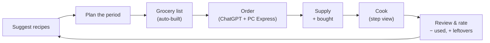

# Solving Food — Product Requirements

> Status: Draft v0.6 · Source: `THOUGHTS.md` + answered open questions + owner reviews · Last updated: 2026-10-12

---

## 1. Vision & Goals

Solving Food is a household meal-planning app for a small circle of **friends and family**. It connects four things that usually live apart: **recipes**, **the meal plan**, **the grocery order**, and **what's actually in the kitchen**. It's built around one workflow: a household plans its meals for a configurable number of days, the app writes the grocery list, an LLM agent (ChatGPT with the PC Express plugin) places the order, and the app keeps track of what's left as the household cooks.

The name **Solving Food** is final.

### Primary goals

1. **Spend as little time on supply data entry as possible.** The app works out what's in the kitchen as *what was bought − what planned meals used*. Users only step in when reality didn't match the plan.
2. **Waste less food.** Point users at recipes that use up ingredients close to expiry.
3. **Plan within a budget.** Show what the plan period costs while users build it.
4. **Make cooking pleasant.** Recipes are easy to read on a phone, with a step-by-step mode.
5. **Learn what the household likes.** Ratings, cook history, and favourites shape future suggestions.

### Non-goals (v1)

- Placing grocery orders directly. The app hands off a list; an external LLM agent places the order.
- Reconciling the order confirmation or a receipt against the list automatically.
- Full nutrition tracking or calorie counting. **Protein is the only nutrient the app tracks** (§6.4).
- Non-food household items (cleaning supplies, toilet paper) on the grocery list.
- Weighing ingredients with scales or sensors. Supply is inferred, not measured.
- Importing recipes from URLs or photos inside the app. An external LLM does this and drops the result into the app (§4.3).
- Deleting a user account from inside the app. Users can leave households (R2.13). Removing an account is done by the project owner in the Firebase console.

### Success metrics

| Metric | Target |
|---|---|
| Time to plan a period + produce the grocery list | < 10 minutes |
| Food discarded as expired (tracked internally) | trending down month over month |
| Planned meals actually cooked | > 95% |

---

## 2. Users, Households & Accounts

- **R2.1** Users sign in with **passwordless email** (magic link or one-time code).
- **R2.2** A **household** has one or more users. A user can belong to more than one household (e.g. a cottage, or a parent's home) and can switch the active household.
- **R2.3** Each user can **create up to 3 households**.
- **R2.4** Members invite others in one of two ways. **By email:** the member types an email address. That address is added to the app's **sign-up allowlist** (R2.12) and a household invite is created for it, so a newcomer sees the invite as soon as they first sign in. **By name:** for people who already have an account, the member **searches the directory of users by name** and sends an invite. In both cases the invitee accepts the invite to join.
- **R2.5** There are **no roles**. Every member of a household can do everything in it, including deleting things and inviting or removing members.
- **R2.6** These belong to a **household** and are shared by all its members: supply, plans, grocery lists, cook history, favourites, brand mappings, stores, kitchen tools, preferences, suggestion weights, and settings.
- **R2.7** **Ratings are per user.** The household sees the average of its members' ratings.
- **R2.8** Households are **completely invisible to each other**. No household can see another's supply, plans, history, or ratings.
- **R2.9** The **recipe and meal library is global**. Every user can search, add, and edit it (§4).
- **R2.10** The only **per-user setting** is the theme (§11). Everything else is configured per household.
- **R2.11** Every household member gets the same experience on their own device. For example, a spouse can check the plan or cook from a recipe on their phone.
- **R2.12** **Sign-up by invitation only.** An email address must be on the **allowlist** before it can sign in. Any member of any household can add an address (R2.4). Someone whose address isn't allowlisted is told so after they follow the sign-in link, and nothing is created for them. Once signed up, a user appears in the user directory so others can invite them to further households. This keeps the shared recipe library (R2.9, R4.19, R4.26) in the hands of people someone in the circle has vouched for.
- **R2.13** **Leaving a household.** Any member can leave. If they are the **last member**, the app warns that leaving **deletes the household and all of its data** (supply, plans, history, ratings, settings) and asks them to confirm. The household is then deleted, and it no longer counts toward its creator's 3-household limit (R2.3). Recipes and meals in the global library are not affected.

---

## 3. Core Loop

1. **Suggest.** The app ranks recipes so the ones that use up supply close to expiry come first, while staying varied and within budget. A **Suggested** sort option is always available, and it also ranks the results of any filter.
2. **Plan.** The user presses **Create meal**, picks one or more recipes (or a saved meal), sets the meal type and servings (default from R11.12), and adds it to the plan (R5.7). The budget meter goes down as they add.
3. **Grocery list.** The app works out *needed − projected supply − items already ordered*, applies preferred brands, and groups items by store.
4. **Order.** The user copies the list into ChatGPT, which orders it through the PC Express plugin. Copying marks the list as **ordered**. When the groceries arrive, the user confirms them and corrects any quantities that changed. The app adds them to supply.
5. **Cook.** The user opens a planned meal and cooks from the step view. Pressing **Done cooking** immediately deducts the recipe's ingredients from supply and records the estimated leftovers, so supply is right even if nobody reviews the meal.
6. **Review.** Straight away or later, the user rates the meal from 1 to 10, adjusts the ingredients they actually used, and confirms leftovers. Supply is corrected by the difference.
7. **Carry over.** Meals not cooked by the end of the period carry over to the next one.

### The plan period

- The household configures the **plan period length in days** (default 7).
- A plan is a list of meals for that period, each assigned to a meal type (breakfast, lunch, dinner, snack), not to specific days. A meal is one or more recipes (§5).
- There is **no limit** on how many meals a plan can hold, and users can add to the plan and generate a new grocery list at any point during the period.
- **R3.1** **Restart period.** In Settings → Household, **Restart period** with a choice of **Today** or **Tomorrow** ends the current period now and starts a new one of the configured length at midnight (household timezone) on the chosen day. Meals not yet cooked move into it exactly as at the end of a period (R6.6); cooked meals stay in the old period and in History. A confirmation says how many planned meals will move. Choosing the day the current period already starts on changes nothing and says so. It needs a connection, like the rollover.

---

## 4. Recipes

### 4.1 Library & Browsing

- **R4.1** Users can search recipes by name and full text (title, ingredients, tags, notes).
- **R4.2** Users can filter and sort by **meal type** (the first filter in the filter sheet, M9), cuisine, main protein, protein per serving, total and active time, rating, whether the household has cooked it before, cost per serving, tags, favourites, and **"can make with current supply"**.
- **R4.3** Recipes the household can make with current supply, after subtracting what planned meals will use, are visibly marked.
- **R4.4** A special filter, **"Use what's left"**, shows only recipes that the remaining supply covers fully, or nearly fully.
- **R4.5** Recipe cards show stats such as *"You've made this 14 times"*, the last time it was cooked, and the household's average rating. A recipe the household has never cooked shows no stats line on its card or on its recipe page (no "never cooked" or "0×").
- **R4.6** Users can **favourite** recipes and meals. Favourites belong to the household. They're also how a household keeps track of its own recipes (e.g. family recipes), since there are no private recipes.
- **R4.7** The same filter and sort component is used everywhere a list of recipes or meals appears: Recipes, Plan, Meals, and History.

### 4.2 Recipe Detail & Cooking View

- **R4.8** The detail view shows the image, servings, times, ingredients, steps, tools, source link, and the household's notes.
- **R4.9** **Next to every ingredient**, the view shows how much of it is in supply (e.g. `Salmon 400 g · have 250 g ⚠`). Free-use ingredients (R8.14) show *staple* instead of an amount. Expired lots don't count (R8.15).
- **R4.10** **Step mode** shows one step at a time in large text, full screen, with that step's ingredients and any timers. The screen stays awake while it's open. A step too long for the screen scrolls inside its own area; the Back / Next buttons and the timers always stay visible and are never covered (M9).
- **R4.11** Step instructions always show ingredient **amounts inline** where each ingredient is mentioned (e.g. "Add the butter (30 g)").
- **R4.12** A **mise en place** screen lists all prep tasks up front (chop, measure, preheat) before step mode starts. The browser or phone **back button** in step mode returns to mise en place (and, in a meal of several recipes, from mise en place to the list of recipes) instead of leaving the cooking view (M9).
- **R4.13** Users can scale servings, and quantities update to match. On the recipe page the servings control sits directly above the ingredients it scales.
- **R4.14** If the household is missing a tool the recipe needs (from the kitchen tools setting), the view says so.

### 4.3 Adding & Editing Recipes

- **R4.15** **Manual entry.** Users can add a recipe with a title, images, ingredients, steps, tags, cuisine, main protein, servings, times, and tools.
- **R4.16** **Drop folder.** A `.cook` (Cooklang) file placed in the app's cloud drop folder is imported automatically, and the file is deleted once it's processed. This is how recipes arrive from an external LLM: the user gives the LLM a recipe link or photo, the LLM writes a Cooklang file following a **Claude skill**, and drops it in the folder. Images referenced by the file are **saved into the app** (never hot-linked), and the result of each import (success or error) is shown as a notification (R12.1). Ingredient names in the file are matched to the shared ingredient list ignoring case, plurals, preparation words ("chopped", "boneless", "softened", "to taste"), qualifiers after a comma or in brackets, and spelling variants (chilli/chile, courgette/zucchini, mince/ground); a name nothing matches becomes a new ingredient to review (R4.27), and the import's notification links to the review.
- **R4.17** The Claude skill defines the Cooklang schema the app expects, including **cuisine** and **main protein**, so the LLM infers them.
- **R4.18** **Full recipes are stored**, including all steps. The app is private to friends and family.
- **R4.19** **Anyone can edit any recipe**, and the change applies for all users. There are no private copies or forks. Edits are versioned so mistakes can be undone.
- **R4.20** **Deduplication.** When a recipe is added, the app checks for an existing one with the same source URL, a near-identical title, or a very similar ingredient set. If it finds one, the user chooses to keep the existing recipe, keep the new one, or keep both. Drop-folder imports that look like duplicates wait in a review list until someone decides.

### 4.4 Sharing

- **R4.21** A **Copy link** button shares a recipe or meal. The link opens the normal recipe or meal page, which is readable without an account.
- R4.22 *Withdrawn after M6 (owner's review): the recipe page has no `.cook` download. Recipes still leave the app as `.cook` files inside the household data download (R11.10).*

### 4.5 Cooking Timers & Layouts

- **R4.23** **Timers alert even when the phone is locked** or the app is in the background. A notification announces which timer finished and opens the recipe at that step. On iPhone, this requires the app to be installed to the home screen, and the app prompts the user to install it the first time they start a timer.
- **R4.24** The cooking view has layouts for **phone portrait, phone landscape, and tablet**. On larger or landscape screens, the current step, its ingredients, and running timers are shown side by side, so a propped-up tablet can be followed from across the kitchen.

### 4.6 Managing the Library

- **R4.25** **Cuisine** and **main protein** are chosen from **fixed lists**, the same in the recipe form and the Claude skill, so recipes are classified consistently.
- **R4.26** **Any user can delete a recipe, and deletion goes through a Trash.** A confirmation dialog warns that it will be removed **for all users in every household**. A deleted recipe moves to **Trash** for **30 days**. While in Trash it's hidden from the Recipes list, search, and suggestions, and it can't be added to plans or meals. Meals and planned items that already reference it keep working and show a *recipe in Trash* badge. Any user can open the Trash and **restore** a recipe, which undoes all of this. After 30 days the recipe is deleted permanently: it's removed from meals, plans, and favourites everywhere, and past cook history keeps the recipe's name, marked as deleted.
- **R4.27** **Ingredient review and merge.** Ingredients that need review (new names from imports, or missing conversions) are listed on an **Ingredients** page reached from Settings (with a live count), the phone's More sheet, a banner on the Recipes page (hidden for the session when dismissed, back while anything needs review), the Drop page, and the import's notification. The page opens on the review list; each entry shows the recipes that use it and what it looks like ("Looks like: tater tots"). **Merge into…** picks the ingredient it means (the suggestions, or any ingredient), shows what will move ("1 recipe, 1 Supply row"), and after confirming moves every recipe line, saved meal, planned side and grocery line to that ingredient for everyone; the duplicate's name becomes one of the target's names, so the next import with that wording matches it. **Keep as new** opens the ingredient to complete its fields. A shipped catalogue ingredient can't be merged into a new one.
- **R4.28** **Side recipes.** Besides breakfast, lunch, dinner, and snack, a recipe's meal type can be **side**: a dish eaten next to a main (rice pilaf, coleslaw). Side is an option of the meal type filter. A recipe that is only a side is never suggested as a meal of its own (Suggested, the optimiser, expiry and use-it-up proposals) and sorts last when sorting by Suggested; it can still be added to a meal next to a main in Create meal (R5.7).

---

## 5. Meals (Recipe Collections)

- **R5.1** A **meal** is one or more recipes eaten together, e.g. *"Taco night" = tortillas + carnitas + pico de gallo*. **Every item in the plan is a meal.** A recipe planned on its own is simply a one-recipe meal.
- **R5.2** **Saved meals** are meals the household has named and kept for reuse. They live in the **Meals** list, separate from recipes, and can be favourited, rated, shared, and picked directly when creating a meal (R5.7). Meals that aren't saved exist only in the plan and in history.
- **R5.3** **Both saved meals and individual recipes can be rated.**
- **R5.4** Meals are **not tied to a specific day**. A plan is a list of meals for the period, cooked in any order.
- **R5.5** Each planned meal has a type: breakfast, lunch, dinner, or snack. A meal-prep batch can cover several meal slots.
- **R5.6** When cooking a meal with several recipes, the user **chooses the order**. Each recipe's name shows its total time underneath, for quick reference.
- **R5.7** **Creating a meal happens on the Plan page.** The user presses **Create meal**, then picks **one or more recipes** using the shared search, filter, and sort component (R4.7) with multi-select, with Suggested recipes shown first. Alternatively they pick a **saved meal**. They set the meal type (R5.5) and servings (default R11.12), then press **Add to plan**. The **Add to plan** button on a recipe page or card is a shortcut that creates a one-recipe meal after the same two choices.
- **R5.8** **Saving a meal.** While creating a meal, or later from the plan or the review flow (*"Save this meal?"*), the user can give it a **name** and save it to the Meals list (R5.2). Saving doesn't change the planned item; it adds a reusable copy. A planned meal created from a saved meal remembers which one, so the saved meal collects ratings and cook stats.
- **R5.9** **Sides.** A meal can have **sides**: things eaten as they are, without a recipe (frozen fries, frozen vegetables, corn chips, potato chips, rice, bread rolls). While creating a meal the user picks sides from a **search dropdown**; they can be changed later from the plan item. Only purchasable sides exist (no "homemade bread" side; that's a recipe). Saved meals keep their sides. Sides show on the plan row ("Salmon + fries, peas") and in History, count in the budget meter and the budget impact, and are ignored by suggestions and the optimiser. A meal still needs at least one recipe.
- **R5.10** **Side portions.** Each side has a **portion per person**, stored on the meal when it is created, so a meal for N servings needs N portions. Sides are ingredients and are **tracked in Supply** like any other: **Done cooking** subtracts the portions, the review can correct them, and the grocery list subtracts what's already in supply. Free-use ingredients (R8.14) can't be tracked sides.

---

## 6. Planning

### 6.1 Plan Page

- **R6.1** The Plan page shows the **meals selected for the current period** as a list that can be sorted and filtered; each row shows the meal's name or recipes and its sides (R5.9). Its primary action is **Create meal** (R5.7). The page has no button to the grocery list; the Grocery tab in the navigation is the way there.
- **R6.2** **Period coverage view.** Above the list, the Plan page shows the plan period as a **calendar-like strip**: one cell per day, labelled with its weekday and date for orientation, and one row per meal type the household plans (R11.13; breakfast, lunch, and dinner by default).
  - Cells **fill from left to right** as meals are added. Five dinners planned in a 7-day period fill the first five dinner cells, and the row reads **5/7**. It's a visual version of "5 of 7 dinners planned", **not a schedule**. Meals are never assigned to specific days, and the cells can't be tapped to pick a day. (The strip doesn't spell this out in a hint.)
  - A meal-prep recipe or leftover portions fill one cell per portion they cover (e.g. 4 lunches from one batch fill 4 lunch cells).
  - Cooked meals show as solid cells and planned-but-not-cooked meals as outlined cells, so the strip also shows progress through the period.
  - If more meals are planned than there are days, the row shows the overflow (e.g. **8/7, +1**).
  - Snacks aren't shown in the strip.
- **R6.3** A **budget meter** is always visible. It starts at the household's budget for the period and goes down as meals are added. The cost of a meal counts only ingredients that **still have to be bought**; ingredients already in supply, or already on a grocery list that has been ordered but not yet delivered, cost nothing extra. The meter therefore answers *"what will the next grocery order cost?"* Once an order is confirmed as received, the planned meals are covered and the meter goes back up. **This is intended.** What the household actually spent in a period is shown on the History page (R10.3).
- **R6.4** The budget covers **all food for planned meals** in the period. Food bought outside of recipes (manual list additions, staples) doesn't count against it.
- **R6.5** Going over budget is allowed. The meter goes negative and turns red, but the app **never stops** the user from adding meals.
- **R6.6** Meals not cooked by the end of the period **roll over** into the next period's plan automatically.
- **R6.23** **Eating out.** In Create meal, an **Eating out** choice adds a plan entry for a meal type the household will eat out, with an optional note ("Pizza at Mom's"). It has no recipes, so it adds nothing to the grocery list or the budget, takes nothing from Supply, and can't be cooked. It shows distinctly on the Plan page (an *Eating out* card) and in the coverage strip (a hatched cell), and it counts as covered for the period. It can be removed like any planned meal and doesn't carry over into the next period.
- **R6.7** Planned meals show an **expiry badge** when one of their ingredients is expiring soon, e.g. *"Salmon expires in 2 days"*.

### 6.2 Meal Prep & Leftovers

- **R6.8** One recipe can produce **several portions** that cover future lunches or breakfasts, and these can last into the next period.
- **R6.9** After a meal is cooked, the app asks: *"Estimated leftovers: 3 lunches — correct?"* The user adjusts the number with ▲/▼ buttons.
- **R6.10** Leftover portions are tracked as their own supply items, with an expiry date (4 days in the fridge or 90 days frozen by default). They fill lunch/breakfast slots in the plan.

### 6.3 Suggestions

- **R6.11** The Plan page has a **Suggested** section ranked by a configurable score, with a **See more** link under it that opens the Recipes page sorted by Suggested:

  | Positive factors | Negative factors |
  |---|---|
  | Expiry urgency (uses soon-to-expire supply) | Missing ingredients |
  | Supply utilisation (uses what's on hand) | Cost |
  | Household rating | Same main protein as other chosen meals |
  | Historical preference (frequency, recency) | Same cuisine as other chosen meals |
  | Variety | Recently cooked (avoid repetition) |
  | Matches household food preferences | Missing kitchen tools |
  | Meets the protein goal | |

- **R6.12** Users can **tune the weight** of each factor in Settings. Presets such as *"Use it up"*, *"Cheap week"*, and *"Adventurous"* are available.
- **R6.13** **Expiry alerts.** If supply will expire during the period (e.g. salmon), the app shows it prominently and suggests recipes that use more of it.

### 6.4 Protein Goal

- **R6.14** The household sets a **protein goal per serving** for each meal type (e.g. dinner ≥ 35 g). Each goal can be turned off.
- **R6.15** Recipe cards and the recipe page show **protein per serving**.
- **R6.16** Suggestions favour recipes that meet the goal (weighted like the other factors), and the optimiser can be told to only propose recipes that meet it.
- **R6.17** The Plan page shows the **average protein per serving** for each meal type in the current plan, next to the goal, at the bottom of the page directly above the budget optimiser.

### 6.5 Budget Optimiser

- **R6.18** The user can ask for *"n dinners under $x"* (any meal type). The optimiser proposes a **complete set** of recipes that share ingredients, to cut waste and cost, but differ in cuisine and protein.
- **R6.19** If the user doesn't like the set, **Next** shows another set that also works well together, and **Back** returns to earlier sets. There's no fixed number of sets: Next keeps going through every combination that is genuinely good, then says *"No more good combinations"*.
- **R6.20** The user accepts a set as a whole, which adds every recipe in it to the plan. They can remove individual recipes from the Plan page afterwards.

### 6.6 Prices

- **R6.21** Ingredient prices come from **live PC Express data** where available. A preconfigured **estimated price list** is the fallback when live prices can't be fetched.
- **R6.22** Each household picks the **PC Express store** its prices come from, using an in-app store search. The default is **Loblaws Greenbank Road** (Ottawa).

---

## 7. Grocery List & Ordering

- **R7.1** The **grocery list** is generated automatically as *ingredients needed by the plan − projected supply − items on lists already ordered but not yet received*, rounded up to purchasable pack sizes. The pack size comes from the ingredient's brand mapping (R7.3), or from a typical pack size in the ingredient data when there's no mapping, or the raw amount is listed when neither is known.
- **R7.2** The list is **food only**.
- **R7.3** **Brand mapping.** A dedicated page maps a generic ingredient to a preferred product, e.g. `canned tomatoes → Mutti Polpa 400 g`. The grocery list uses the mapped product name, so the LLM orders the right thing.
- **R7.4** **Stores.** Each ingredient (or category) has a preferred store, e.g. *meat → Costco*. The list is grouped by store. Only the PC Express section is meant to be copied into ChatGPT. Other stores (e.g. Costco) become in-store checklists.
- **R7.5** **Copy button.** One button copies the PC Express section in a clean, LLM-friendly format with quantities and brands. Copying marks the list as **ordered**, so its items aren't added to the list again until the order is confirmed (R7.8). The user can undo this if the order wasn't placed.
- **R7.6** **Manual additions.** Users can add any food item to the list at any time.
- **R7.7** **Staples cadence.** The app learns how fast the household uses staple foods (milk, eggs, coffee, and the free-use ingredients in R8.14). When an item is probably running low, it asks *"Are you out of milk?"* and offers to add it to the list. Until the household has bought an item at least twice, the app uses a typical interval from the ingredient data.
- **R7.8** **Purchase confirmation.** After an order is delivered or a store trip is done, the user is shown the list of items to confirm. They can adjust for substitutions and out-of-stock items. If they change nothing, the app assumes everything was bought and arrived. The result is added to supply.
- **R7.9** **Freeze prompt for bulk buys.** Confirming a bulk purchase of a freezable item (e.g. 3 kg of chicken from Costco) asks *"Freeze some of this?"* and lets the user choose how much to freeze.
- **R7.10** **Product search for brand mapping.** The brand mapping page has an in-app **PC Express product search** showing name, pack size, image, and current price at the household's store. Picking a result links the ingredient to that exact product.
- **R7.11** **Sides on the list.** The sides of planned meals (R5.9, R5.10) are added to the grocery list like recipe ingredients: portion × servings, minus supply and incoming, rounded up to packs, priced, and grouped by store.

---

## 8. Supply

> Terminology: the app always says **Supply**, never "inventory".

- **R8.1** Supply is **inferred**: *purchases − consumption from cooked meals ± manual corrections*. Users don't need to weigh anything.
- **R8.2** Supply **starts empty**. Users can add what they already have by typing an ingredient name (e.g. "chicken"), choosing from the matching options, and entering an amount.
- **R8.3** Each ingredient has a configured set of **allowed measurements** (weight, volume, count) with the conversions between them. Amounts can be entered in any allowed measurement.
- **R8.4** The Supply page shows each ingredient as **current amount (amount left after all planned meals are cooked)**, e.g. `Rice 2.0 kg (1.2 kg)`.
- **R8.5** Expiry is tracked **per purchase**: two cartons of milk bought on different days have different expiry dates. Each purchase gets an **expected expiry date** (or none, for items that don't expire), estimated from the ingredient type and where it's stored. Items are visibly flagged as fresh, use soon, or expired.
- **R8.6** **Freezing.** Users can mark some or all of an item as frozen. The app stores both the original and the frozen expiry estimate and shows whichever applies. Thawing is supported too.
- **R8.7** **Transaction history.** Tapping an item shows the changes behind its number: purchases, meals cooked, corrections, freezes, and discards, each with a date and who did it. Long histories load more as the user scrolls.
- **R8.8** **Manual corrections** are always available ("I actually have ~500 g left", "threw this out"). The user can type an amount or use quick-adjust buttons (e.g. ±5 g / ±25 g, or the equivalent step for the measurement), then press **Apply**.
- **R8.9** **Discarded food is recorded** for internal waste tracking, but waste stats are not shown to users.
- **R8.10** Supply shows exact amounts. It doesn't show any "confidence" or uncertainty indicator.
- **R8.11** Supply tracks **leftovers** (prepared portions) as well as raw ingredients.
- **R8.12** Filters: by location (pantry, cupboards, fridge, freezer), category, expiring soon, low stock.
- **R8.13** **One unit system per amount; Supply is metric; Fahrenheit only.** (Rule v3, from the owner's review after M6.) **Recipe pages** (ingredient list, cooking view and mise en place, inline step amounts, prep tasks, the shared recipe page) never show two unit systems for one amount: an ingredient listed by **imperial weight** is converted and shown in **metric only** (`2 lb chicken` → `900 g chicken`, `8 oz feta` → `225 g`), as are imperial volumes that aren't kitchen measures (fl oz, pints, quarts, gallons → ml / L: `2 pints` → `950 ml`); **cups, tablespoons and teaspoons** read as written with **no metric equivalent** (`1 cup flour`, `2 tbsp butter`, `½ tsp salt`); counts (`2 potatoes`, `3 cloves garlic`), already-metric amounts (`400 g`, `250 ml`) and vague amounts (`a pinch`, `to taste`) read as written. Scaling servings scales the shown amount (`2 cups` → `4 cups`, `900 g` → `1.8 kg`). **Temperatures are shown in Fahrenheit only, never Celsius**: a °C temperature in recipe text (steps, prep tasks, notes) is replaced by its °F value rounded to 5 (`220°C` → `430°F`), and a bracketed Celsius after a Fahrenheit one is dropped (`350°F (175°C)` → `350°F`). **Everywhere else** (supply, grocery list and its copied text, receive/confirm and the freeze prompt, history, notifications, prices, cook review, the results of the supply pickers) is **metric only**: `640 g`, `3 (640 g)`, `1.2 kg`. Supply is always metric, so cups and spoons in recipes are still converted to grams when they're deducted from Supply or bought. Imperial units stay accepted as **input** (recipe files, packaging, the supply add/adjust pickers) and are stored canonically in grams. There's no setting to switch.
- **R8.14** **Free-use ingredients.** Ingredients used freely and often outside recipes, such as cooking oils, salt, pepper, and butter, aren't tracked by amount. Cooking doesn't subtract them and planned meals don't add them to the grocery list. The staples cadence (R7.7) handles them instead. They appear in a **Staples** group on the Supply page with when each was last bought. **Spices are not free-use** and are tracked like other ingredients. Which ingredients are free-use can be changed per ingredient.
- **R8.15** **Expired lots.** When a lot passes its expiry date, it stops counting toward supply: it's excluded from the amounts shown in brackets, from "can make with current supply", from recipe ingredient badges, and from the grocery list calculation, so the app assumes it will have to be replaced. It is **never discarded automatically**. The Supply page and the Plan page show a prompt for each expired lot with two actions: **Still good** (extends the expiry by a few days, or lets the user pick a date) and **Threw it out** (records a discard). Until one is chosen, the lot shows as expired.
- **R8.16** **A merge moves Supply.** Merging an ingredient into another (R4.27) moves its Supply in every household onto the target's row, lot by lot with their expiry dates, together with its history; nothing is dropped, and the merged name no longer appears on the Supply page.
- **R8.17** **Search.** The Supply page has a search box (the same look as the Recipes search) that filters the rows and leftovers by ingredient name or any of its other names, together with the location and other filters. Nothing matching says so, with a way to clear the search.

---

## 9. Finishing a Meal

- **R9.1** While cooking, the user checks off each recipe in the meal as it's done. The **review flow opens automatically** once every recipe is checked off. It also opens if the user taps **Done cooking** before all recipes are checked off.
- **R9.2** The **review flow**:
  1. **Rate it 1–10.** Each user rates for themselves. Each recipe can be rated, and so can the meal if it's a saved one (R5.3). For an unsaved meal with more than one recipe, the flow offers *"Save this meal?"* (R5.8).
  2. **Adjust ingredients used.** The recipe quantities are pre-filled. The user can change any amount, remove an ingredient, or add one.
  3. **Confirm leftovers** with ▲/▼ (R6.9).
- **R9.3** Supply is updated in two steps so that it's never left stale. **Done cooking** immediately subtracts the recipe's ingredients (at the planned servings) and adds the recipe's estimated leftover portions. The review then **corrects** supply by the difference between those defaults and what the user confirms. If the review is never completed, the defaults stand.
- **R9.4** A review doesn't have to be done straight away. Cooked meals without a review appear in a **"pending reviews"** prompt so any household member can finish it later (e.g. that evening). Each other member is prompted to add their own rating.
- **R9.5** Planned items are marked **eaten**. Completing a cooked meal's **review marks it eaten** automatically; there is no separate step (M9, owner's review). Leftovers and snacks, which have no review, are marked eaten by the user ("Ate one", "Ate it"). Until its review is done, a cooked meal on the Plan page shows a **Review** button.

---

## 10. History

- **R10.1** The History page lists everything cooked: date, meal (with its sides, R5.9), ratings, who cooked it, notes, and deviations from the recipe.
- **R10.2** It uses the same filter and sort component as the other lists.
- **R10.3** It shows stats: most-cooked recipes, average rating by cuisine, and spend per period. Spend is the estimated cost of every grocery list confirmed as received in the period, using the prices known at the time.

---

## 11. Settings & Preferences

Everything here belongs to the household except the theme, which is per user.

- **R11.1** **Kitchen tools.** The household lists the equipment it owns (instant pot, food processor, sous vide…). Recipes that need missing tools are flagged or filtered out. Tool names are shown lower-case everywhere, and tools are matched by meaning rather than spelling: owning a skillet covers a recipe's "frying pan" or "large skillet", and the suggestions offer one chip per tool with its other spellings as a hint.
- **R11.2** **Food preferences.** Favourite foods and cuisines, dislikes, and dietary restrictions, set once for the whole household and used in scoring.
- **R11.3** **Suggestion weights** (R6.12).
- **R11.4** **Protein goals** per meal type (R6.14).
- **R11.5** **Plan period** length in days, and **Restart period** (R3.1).
- **R11.6** **Budget** for planned meals per period.
- **R11.7** **Brand mappings** and **stores** (dedicated page, §7).
- **R11.8** **Household members**: invite by email or by name (R2.4), remove members, leave the household (with the last-member warning, R2.13).
- **R11.9** **Theme (per user).** The accent colour. The app uses Catppuccin **Latte** only (changed in M9, owner's review: the flavour picker is gone and the flavour isn't shown; a flavour chosen before is read as Latte).
- **R11.10** **Download & import household data.** A **Download household data** button saves a file with all of the household's data (supply and its history, plans, grocery lists, cook history, ratings, favourites, notes, and settings) plus the recipes and meals it uses. An **Import household data** button loads such a file into the current household, after a warning that it **replaces** the household's existing data. Members aren't changed by an import.
- **R11.11** **Timezone.** Set when the household is created (default *America/Toronto*). Period boundaries and expiry days are worked out in it.
- **R11.12** **Default servings.** The number of servings a recipe is planned for unless the user changes it (asked when the household is created, e.g. 4). Recipes added to the plan are scaled to it.
- **R11.13** **Planned meal types.** Which of breakfast, lunch, and dinner the household plans. All three are on by default. Each one that's on gets a row in the period coverage strip (R6.2), a protein goal (R6.14), and a line in the protein summary (R6.17). Snacks are always available and never shown in the strip.
- **R11.14** **Sides.** A **Sides** page lists the sides the household can pick (R5.9): a shipped list of common ones (frozen fries, frozen vegetables, chips, rice, buns, bread) plus any ingredient the household flags as a side, including one it creates there. Each side shows its portion per person in metric, which the household can change. A changed portion applies to meals created afterwards; meals already planned or saved keep the portion they were made with.

---

## 12. Navigation & UX

### Pages

| Page | Purpose |
|---|---|
| **Plan** | Current period's meals, Create meal, budget meter, suggestions, optimiser, expiry alerts, pending reviews |
| **Recipes** | Global library: search, filter, add, review possible duplicates, Trash |
| **Meals** | Saved meals (named recipe collections) |
| **Supply** | Current and projected amounts, expiry dates, transactions |
| **Grocery** | Generated list grouped by store, copy button, purchase confirmation |
| **History** | Cooked meals, ratings, stats |
| **Settings** | Household (period, budget, timezone, servings, meal types), members and allowlist, brands, stores, sides, ingredients (catalogue and review, R4.27), tools, preferences, weights, theme, data |

- **Landing page:** **Plan** if the current period has a plan, otherwise **Recipes**.
- **Ingredients** is not one of the main pages: it's reached from Settings, the phone's More sheet, and the Recipes page's review banner (R4.27).

### Visual design

- **Brutalist** style: thick borders, hard shadows, monospace or grotesk type, visible structure, no gradients.
- **Catppuccin Latte** palette, with a user-selectable accent.
- **Mobile-first.** Designed for phones first and fully usable one-handed in the kitchen.
- **Scales up properly to large screens**, including 1920×1080 desktops and 4K displays. Big screens use the extra space for more useful content, not stretched or tiny UI:
  - **Phone:** one column, bottom navigation.
  - **Tablet:** two panes where it helps (e.g. recipe list + selected recipe).
  - **Desktop (1080p):** side navigation and multi-pane views. For example, the Plan page shows the plan, suggestions, and budget/protein summary side by side, and recipe grids show more cards per row.
  - **4K:** text and controls scale up so they're comfortable to read at normal viewing distance (respecting the OS display scaling). Grids gain columns, but text stays at a readable line length and nothing stretches edge to edge.
  - **Step mode** gets larger text on bigger screens, so it can be read from across the kitchen on a mounted tablet or TV.
- Installable **PWA**: home-screen icon, works offline. Edits made offline sync when the device reconnects.
- UI inspiration: screenshots of the user's Obsidian recipe database and existing recipe apps (to collect).

### Notifications

- **R12.1** An app-wide **notification system** shows banners at the **bottom of every page** (above the bottom navigation on phones). It's used for things that finish in the background or fail, such as recipe imports, household data imports, and price refresh problems. Success and info banners disappear on their own after a few seconds. Errors stay until dismissed. A banner can link to the related page, e.g. the newly imported recipe.

---

## 13. Non-Functional Requirements

- **NFR1 Cloud-hosted on Firebase.** Hosting, user accounts, and the database all run on Firebase. Every household member can reach the app from anywhere, with nothing to run at home.
- **NFR2 Free tier.** The app stays within Firebase's free usage. Paid features are used only where they're unavoidable, and even then usage must stay inside the no-cost quotas.
- **NFR3 Scale.** Designed for about **3 households and 10 users** in the first year.
- **NFR4 Privacy.** Household data (supply, plans, history, ratings) is visible only to members of that household, enforced by database security rules. Only allowlisted email addresses can sign in (R2.12), also enforced by security rules.
- **NFR5 Live sync.** Changes made by one household member (plan, supply, grocery list) appear on other members' devices without a refresh.
- **NFR6 Responsive.** Every page works and looks intentional from a 360 px-wide phone up to a 3840×2160 (4K) display, with no horizontal scrolling and no pixelated images.
