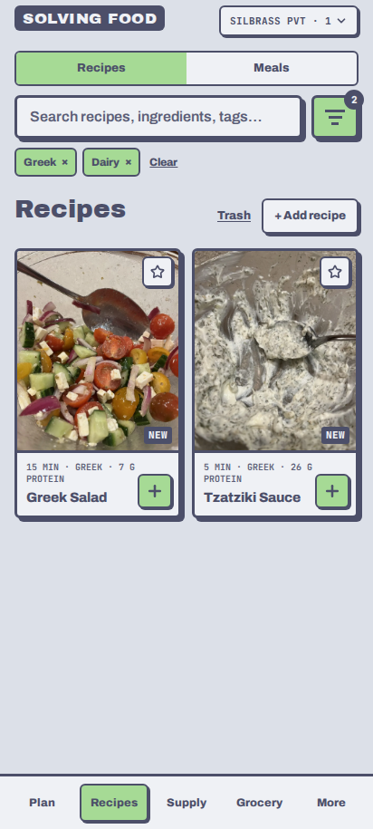
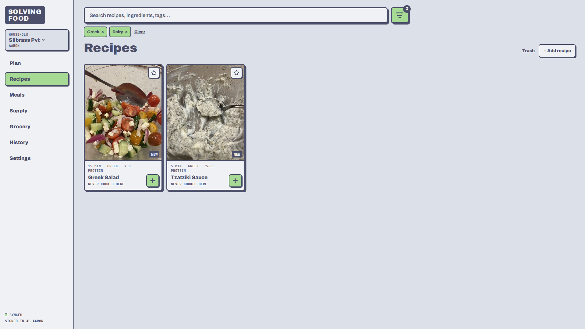

# 🥘 Solving Food

> Your documentation is a direct reflection of your software, so hold it to the same standards.

A meal-planning app for one household (or a few) that keeps **recipes**, **the week's plan**, **the grocery order**, and
**what's actually in the kitchen** in one place, so the shopping list writes itself and food stops expiring at the back
of the fridge.

## ✨ Highlights

- 🛒 **The grocery list writes itself.** Plan the meals, and the list is what those meals need minus what you already
  have, rounded up to the pack sizes you buy, grouped by store. One tap copies it for an ordering assistant.
- 🧮 **Supply without data entry.** What's in the kitchen is worked out as *what was bought − what cooked meals used*.
  You only step in when reality didn't match the plan.
- 🥦 **Waste less.** Expiring ingredients bubble up with recipes that use them, and expired lots ask "still good?"
  instead of silently disappearing.
- 💸 **Plan to a budget.** A budget meter shows what the next order will cost while you build the plan, and an
  optimiser finds "five dinners under $80".
- 👩‍🍳 **Pleasant cooking.** Mise en place, a big-type step mode for a propped-up tablet, timers that ring the locked
  phone, and a two-tap review that corrects the numbers and rates the meal.
- 🤖 **Add recipes by pasting a link.** An AI skill ships with the app: give any Claude a recipe URL or a photo and it
  writes the file the app imports. No typing out ingredients.
- 📱 **Installable, offline-tolerant, shared.** A PWA that works on a phone in the kitchen, with everyone in the
  household seeing the same plan, list, and ticks live.

## 📖 Overview

Solving Food is built for a small circle of friends and family rather than the public. Sign-up is by invitation:
a household member adds your email address, you sign in with a link (no passwords), and you land in the household's
plan. A person can belong to several households (home, the cottage, a parent's place), each with its own plan, supply,
and history, while the recipe library is shared by everyone.

The core loop is short. You **plan** a period (a week by default) from recipes and saved meals, the app builds the
**grocery list**, you order it and **confirm what arrived**, you **cook** from the step view, and you **review** the
meal: what was really used, what's left over, how good it was. Each step feeds the next: the review corrects supply,
supply shapes the next list, ratings and history shape suggestions. Amounts are shown in metric (recipes keep their own wording with the metric amount after it), and
protein per serving is the one nutrient it tracks.

Under the hood it is a React PWA on Firebase (Hosting, Auth, Firestore, Storage, Cloud Functions, push notifications),
written to stay inside the free tier for a household's worth of use. Every change to supply is an event applied by a
server function, so the numbers reconcile and the history is complete. The product requirements and technical design
live in this repository as the source of truth: [`PRODUCT_REQUIREMENTS.md`](PRODUCT_REQUIREMENTS.md) and
[`TECHNICAL_SPECS.md`](TECHNICAL_SPECS.md).

### Authors

Designed and owned by [Aaron Buitenwerf](https://github.com/BoxThatBeat) for his household. The implementation was
built milestone by milestone with Claude (Anthropic), working from the requirement and design documents in this repo.

## 🚀 Usage

Open **https://solvingfood.web.app** on your phone, enter the email address you were invited with, and tap the link
in the email. On an iPhone, add it to the Home Screen first (Share → Add to Home Screen) so timers can alert the locked
phone.

A week in the app looks like this:

1. **Plan.** On the Plan page press *Create meal*, pick one or more recipes (or a saved meal), set servings, done.
   The coverage strip shows which dinners are covered and the budget meter shows what the order will cost.
2. **Order.** The Grocery page already holds what the plan needs minus what's in Supply, grouped by store. *Copy for
   ChatGPT* copies the PC Express section and marks it ordered.
3. **Receive.** When the groceries arrive, confirm them. Supply fills in, expiry dates are estimated, and the Costco
   chicken gets its freeze prompt.
4. **Cook.** Open the meal, run through the mise en place and the steps, start a timer, press *Done cooking*.
5. **Review.** Rate it, correct anything that was different, note the leftovers. Supply and History update.

  
  &nbsp;&nbsp;
  

**Adding a recipe from a link.** Open *Add recipe → Let AI add for me*, download the skill, and follow the two-line
install note on that page. From then on, paste a recipe's web link to Claude and say "add this recipe to Solving Food".
It writes a Cooklang file; drop that file on the same page and the recipe appears in the library with its photo.

## 📦 Installation

There is nothing to install. Solving Food is a web app: open the link above in any current browser (Safari on
iOS 16.4 or later, Chrome, Firefox, Edge) and sign in. Adding it to your phone's Home Screen gives it an icon, full-screen
layout, offline recipe pages, and lock-screen timer alerts.

Access is by invitation only. Ask a member of your household to add your email address under *Settings → Members*.

Want your own copy for a different household? The app runs on one Firebase project per deployment, so you'd set up a
project and deploy this repository to it. [`SETUP.md`](SETUP.md) lists every Firebase fact this deployment relies on
and the steps that were needed to get it live.

## 💬 Feedback and Contributing

This is a small family project, but ideas and bug reports are welcome:

- Something broken or confusing? [Open an issue](https://github.com/BoxThatBeat/solving-food/issues).
- Have an idea or want to talk through a feature? Open an issue too, with "idea" in the title.

If you'd like to work on the code, start with [`CLAUDE.md`](CLAUDE.md) (how work is done in this repo, including the
NixOS dev shell and the rule that the documents are the source of truth), then the milestone plans in
[`Planning/`](Planning/). Development is reproducible: `nix develop` gives you Node, pnpm, the Firebase CLI, the
emulators' JRE, and Playwright's browsers; `pnpm dev` runs the app against the Firebase Emulator Suite; `pnpm test`,
`pnpm test:rules`, `pnpm test:functions`, and `pnpm e2e` run the four test layers, all against emulators, never the
live project.
