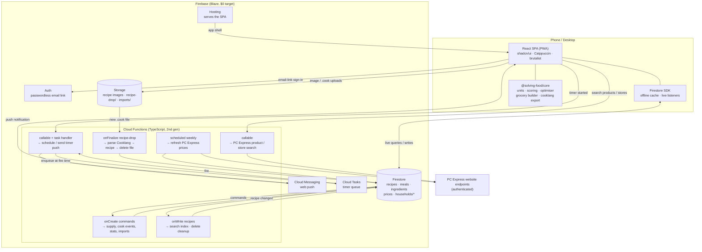
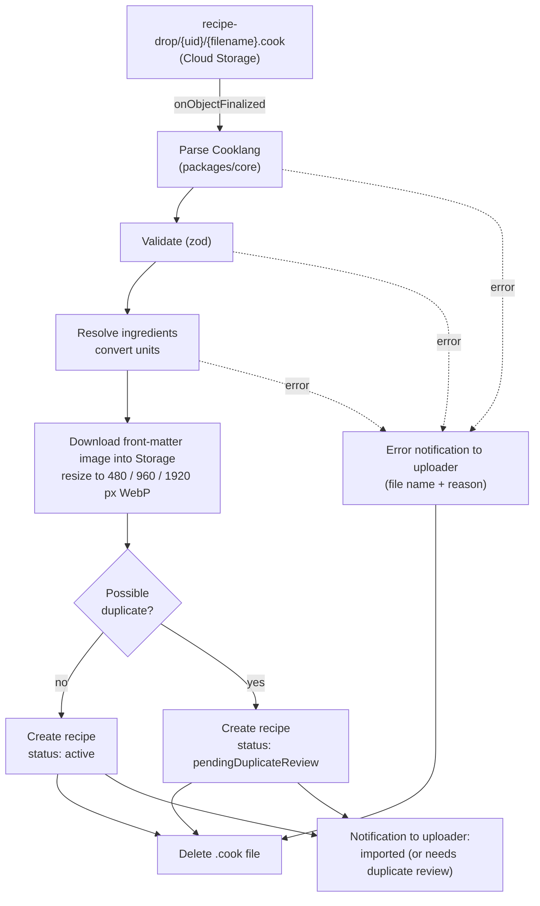

# Solving Food — Technical Specification

> Status: Draft v0.4 · Companion to `PRODUCT_REQUIREMENTS.md` (v0.3) · Last updated: 2026-10-09

---

## 1. Architecture Overview

Everything runs on Firebase. The React PWA reads and writes Firestore directly and gets live updates between household members for free. **Cloud Functions do only what the client can't do safely or at all:** apply supply changes consistently, process the recipe drop folder, maintain the search index, clean up deleted recipes, talk to PC Express (prices, product and store search), deliver timer push notifications, and import household data.

There are **no LLM calls inside the app**. Recipe import (from a URL or a photo) happens outside it: an external LLM following the Claude skill writes a Cooklang file and puts it in the drop folder.



**Design principles**

1. **The client is smart.** Suggestions, the optimiser, projected supply, the grocery list, expiry alerts, and period rollover all run in the browser from a shared TypeScript package. A household's data is small, so this is fast and works offline, and it keeps function calls well inside the free quota.
2. **Supply changes go through the server.** Clients never write supply amounts directly. They write a *command* document, and a function applies it inside a Firestore transaction (§6).
3. **One language.** TypeScript is used everywhere, and `packages/core` is shared by the web app and the functions.

---

## 2. Free-Tier Strategy

NFR2 asks for the free tier unless something paid is unavoidable. **Two required features can't run on the Spark (free) plan:**

- **Cloud Storage**, for recipe images and the drop folder. Since late 2024, new Storage buckets require the Blaze plan.
- **Cloud Functions**, for processing the drop folder and keeping the supply ledger consistent.

So the project uses the **Blaze (pay-as-you-go) plan, designed so the bill stays at $0**. Blaze keeps the same no-cost quotas as Spark. There's no automatic billing kill switch, only alerting. Safeguards:

- A **budget alert at $1/month**.
- All resources in **`us-east1`**. Cloud Storage's always-free tier only applies in `us-central1`, `us-east1`, and `us-west1`, and keeping Firestore and Functions in the same region avoids cross-region charges.
- An **Artifact Registry cleanup policy** (`firebase functions:artifacts:setpolicy`), so old function container images don't build up past the free 0.5 GB.
- Image resizing to three WebP sizes (480 / 960 / 1920 px, ~400 KB total per image) so 4K screens get sharp images. Images uploaded in the app are resized in the browser before upload. Images downloaded from dropped recipes are resized by the drop function (`sharp`).

### Estimated usage at 3 households / 10 users

| Resource | No-cost quota | Expected use | Headroom |
|---|---|---|---|
| Firestore reads | 50,000 / day | ~3,000–6,000 / day (cache + listeners only pull changes) | ~10× |
| Firestore writes | 20,000 / day | < 1,000 / day | 20× |
| Firestore storage | 1 GiB | < 50 MB | 20× |
| Functions invocations | 2M / month | < 10,000 / month | 200× |
| Storage | 5 GB-month (US regions) | ~1 GB of images for 2,000 recipes | 5× |
| Storage egress | 100 GB / month (N. America) | < 5 GB (images cached by the service worker) | 20× |
| Hosting transfer | 360 MB / day | < 50 MB / day | 7× |
| Cloud Scheduler | 3 jobs / account | 1 (price refresh) | — |
| Cloud Tasks | 1M operations / month | < 2,000 (cooking timers) | 500× |
| Cloud Messaging (web push) | free | < 2,000 pushes / month | — |
| Secret Manager | 6 active secret versions, 10,000 accesses / month | 2 secrets (PC Express credentials), ~500 accesses | 20× |

---

## 3. Tech Stack & Repo Layout

| Concern | Choice |
|---|---|
| Language | TypeScript (strict) everywhere |
| Monorepo | pnpm workspaces |
| Frontend | React 19 + Vite, shadcn/ui (Radix) + Tailwind CSS |
| Routing | TanStack Router |
| Data | Firestore SDK with a shared `useLiveQuery` / `useLiveDoc` hook layer |
| Forms / validation | react-hook-form + zod (schemas shared with functions) |
| PWA | `vite-plugin-pwa` (Workbox) for the app shell; Firestore persistent cache for data |
| Theme | `@catppuccin/palette` → CSS variables |
| Search | MiniSearch (client-side full-text) over the recipe index (§9) |
| Backend | Cloud Functions for Firebase (2nd gen, Node 22), region `us-east1` |
| Cooklang | A TypeScript Cooklang parser in `packages/core` (evaluate `@cooklang/cooklang-ts`; write a small one if it lags the spec). Used **only** for drop-folder imports and `.cook` export. |
| Testing | Vitest, fast-check, Firebase Emulator Suite, `@firebase/rules-unit-testing`, Playwright |

```
solving-food/
├─ apps/web/                 React PWA
├─ functions/                Cloud Functions
├─ e2e/                     Playwright suite: specs, page objects, fixtures, seed data
├─ packages/core/            units, ledger math, scoring, optimiser, grocery builder, cooklang ⇄ recipe, taxonomy, types
├─ data/                     ingredient seed data, price-estimates.json
├─ firestore.rules · firestore.indexes.json · storage.rules · firebase.json
└─ .claude/skills/cooklang-recipe/SKILL.md
```

---

## 4. Data Model (Firestore)

Household data is nested under `households/{hid}`, so a single membership check secures it. Global data (recipes, meals, ingredients, prices, the user directory) lives at the top level.

### 4.1 Global collections

```
users/{uid}                                       // private to the user
  email, householdIds[], activeHouseholdId, householdsCreated,   // ≤ 3
  theme: { flavour, accent }

directory/{uid}                                   // readable by every signed-in user, for invites
  displayName, displayNameLower

ingredients/{ingredientId}
  name, aliases[], category, defaultLocation,     // pantry|cupboard|fridge|freezer
  allowedMeasures: ("weight"|"volume"|"count")[],
  canonicalUnit: "g"|"count",
  densityGPerMl?, unitWeightG?, proteinPer100g?,
  shelfLifeDays: { pantry?, cupboard?, fridge?, freezer? },   // all null → never expires
  freezable, isStaple, freeUse, needsReview      // freeUse → tracked by staples cadence only (§5)

recipes/{recipeId}                                // source of truth (structured)
  title, slug, servings, prepMin, cookMin, cuisine, mainProtein, tags[], tools[],   // cuisine/mainProtein from fixed lists
  ingredients: [{ id, ingredientId, amount, measure, canonicalAmount,   // canonical = g or count
                  displayText, optional }],
  steps: [{ text, ingredientRefs[], timerSeconds? }],    // refs → inline amounts (R4.11)
  prepTasks: [{ text, ingredientRefs[] }],               // mise en place (R4.12)
  defaultLeftoverPortions, leftoverMealType?,          // e.g. 4 portions → lunch
  proteinPerServingG?,                                 // derived on save (§5)
  sourceUrl?, sourceUrlCanonical?, fingerprint, ingredientIds[],
  imagePaths[], status: "active"|"pendingDuplicateReview", possibleDuplicateOf?,
  createdBy, updatedBy, version, createdAt, updatedAt
recipes/{recipeId}/versions/{version}             // full snapshot + editedBy, editedAt

recipeIndex/{chunkN}                              // ≤ ~500 compact summaries per doc (§9)

meals/{mealId}
  name, recipes: [{ recipeId, servingsMultiplier }], createdBy, updatedAt

prices/{pcxStoreId}_{productCode}                 // PC Express price at one store
  productName, priceCents, packAmount, packMeasure, pcxStoreId, productCode, fetchedAt

users/{uid}/notifications/{id}                    // bottom-banner notifications (§12)
  kind: "info"|"success"|"error", message, link?, createdAt, dismissedAt?
users/{uid}/devices/{fcmToken}                    // web-push targets for timers
  platform, createdAt, lastSeenAt
```

Recipe ratings and stats are **not** stored on global documents, because households are invisible to each other.

### 4.2 Household collections (`households/{hid}/…`)

```
households/{hid}                 name, createdBy, periodDays, budgetCents, currency,
                                 pcxStoreId,                               // PC Express store for prices; default Loblaws Greenbank Road
                                 currentPeriodId, settings: { scoreWeights{}, tools[],
                                 preferences: { likes[], dislikes[], diets[] },
                                 proteinGoals: { breakfast?, lunch?, dinner?, snack? } }   // g per serving; absent = off
  members/{uid}                  displayName, joinedAt                     // no roles
  invites/{inviteeUid}           inviteeUid, householdName, invitedBy, createdAt

  stores/{storeId}               name, kind: "pcExpress"|"inStore", bulk: bool   // Costco: inStore, bulk
  sourcingRules/{id}             match: { category? | ingredientId? }, storeId
  brandMappings/{ingredientId}   productName, productCode?, packAmount, packMeasure, storeId

  favourites/{type_targetId}     type: "recipe"|"meal", targetId
  notes/{recipeId}               text, updatedBy                            // household's recipe notes
  stats/{type_targetId}          timesCooked, lastCookedAt, ratingSum, ratingCount   // function-maintained

  periods/{periodId}             start, end, budgetCents                    // snapshot at creation
  planItems/{itemId}             periodId, mealId? | recipeId? | leftoverSupplyId?, mealType, servings,
                                 coverage: { breakfast?, lunch?, dinner? },   // slots it fills (R6.2)
                                 status: planned|cooked|skipped|eaten, carriedFromId?,
                                 sourcePlanItemId?, addedBy                 // leftovers → the batch they came from

  cookEvents/{eventId}           planItemId?, recipeIds[], titles[], cookedBy, cookedAt,   // titles survive recipe deletion
                                 used: [{ ingredientId, canonicalAmount }], leftoverPortions,
                                 reviewStatus: "pending"|"done", ratedBy[]
  ratings/{ratingId}             uid, cookEventId, targetType: "recipe"|"meal", targetId, score

  groceryLists/{listId}          periodId, status: draft|ordered|received, createdAt,
                                 items: { [itemId]: { ingredientId?, freeText?, amount, measure,
                                          packs, productName, storeId, estPriceCents,
                                          source: plan|manual|cadence, checked, checkedBy? } }

  supply/{supplyId}              // ingredientId, or "leftover_{eventId}"
    ingredientId?, label, canonicalAmount, canonicalUnit,
    lots: [{ lotId, amount, location, acquiredAt, expiresFresh?, expiresFrozen?, frozenAt? }],
    nextExpiry?
  supply/{supplyId}/transactions/{txId}
    delta, kind: purchase|cook|correction|discard|freeze|thaw|leftover|eaten,
    lotId, ref?: { type, id }, uid, note?, createdAt

  commands/{cmdId}               type, payload, uid, createdAt, status: pending|applied|failed, error?
  cadence/{ingredientId}         avgIntervalDays, lastPurchasedAt, snoozedUntil?
  duplicateReviews/{recipeId}    // drop imports awaiting a keep-which decision
```

**Notes**

- **Grocery items are a map keyed by item ID**, not an array, so two people ticking items at the same time update different fields instead of overwriting each other (§11).
- **Lots live inside the supply document**, so one transaction updates the amount and the lots together. An ingredient rarely has more than a handful of active lots.
- **Discards** are ordinary `discard` transactions. Waste is tracked internally and no UI exposes it (R8.9).

### 4.3 Fixed taxonomies

`cuisine` and `mainProtein` come from **fixed lists** defined once in `packages/core/taxonomy.ts`. The manual-entry form's dropdowns, the drop-folder validator, and the Claude skill (which embeds the lists) all use this one source, so the variety penalties compare clean values. Proposed starting lists, which are easy to extend in code:

- **Cuisine:** american, british, canadian, caribbean, chinese, french, greek, indian, italian, japanese, korean, mediterranean, mexican, middle-eastern, nordic, spanish, thai, vietnamese, other.
- **Main protein:** beef, pork, chicken, turkey, lamb, fish, seafood, eggs, tofu, legumes, dairy, none.

### 4.4 Deleting a recipe

Any user can delete a global recipe. A **confirmation dialog** warns: *"This deletes the recipe for everyone, in every household."* An `onDocumentDeleted(recipes/*)` function then cleans up:

- Deletes `versions/*` and the recipe's images in Storage, and removes it from `recipeIndex`.
- Removes it from every meal that includes it. A meal left with no recipes is deleted.
- In every household: deletes `planned` plan items for it, plus its favourites, notes, and stats.
- Keeps `cookEvents`, ratings, and history entries, which show the stored title marked *(deleted)*.

---

## 5. Units & Measurements

Each ingredient declares the **measurements it allows** (R8.3) and one **canonical unit** for storage. Everything that has a weight, or can be converted to one, is stored in **grams**. Count is the canonical unit only when there's no unit weight (e.g. "1 bay leaf").

| Input | Conversion to canonical | Requires |
|---|---|---|
| Weight (`g`, `kg`, `oz`, `lb`) | static table | — |
| Volume (`tsp`, `tbsp`, `cup`, `ml`, `L`, `fl oz`) | → ml × `densityGPerMl` | `volume` allowed + density |
| Count ("2 potatoes") | × `unitWeightG` | `count` allowed + unit weight |
| Vague ("to taste", "a pinch") | none; `optional: true`, no supply effect | — |

```
"2 medium potatoes" → potato (unitWeightG 213)  → 426 g
"1 cup flour"        → 236.6 ml × 0.53 g/ml     → 125 g
"500 ml milk"        → 500 ml × 1.03 g/ml       → 515 g
```

- **Entering amounts:** the Supply add/correct form and the recipe editor show only an ingredient's allowed measurements. The amount is converted on save, and the original value is kept for display.
- **Quick-adjust buttons** (R8.8) step by measurement: ±5 g / ±25 g for weight, ±5 ml / ±25 ml for volume, ±1 for count.
- **Ingredient picker:** a typeahead over `name` + `aliases` ("chicken" → chicken breast, chicken thighs, whole chicken…). Creating a new ingredient asks for a category, its allowed measurements, and the conversions it needs. Anything incomplete is flagged `needsReview`.
- **Seed data:** about 500 common ingredients with densities, unit weights, **protein per 100 g**, and shelf lives, prepared once from USDA FoodData Central (portion weights and nutrients) and the USDA FoodKeeper dataset, and shipped in `data/`.
- **Protein per serving** = Σ (canonical grams × `proteinPer100g` / 100) ÷ servings, recomputed whenever a recipe or one of its ingredients changes. Ingredients stored by count use `unitWeightG`. If any non-optional ingredient has no protein value, the recipe shows the protein as approximate ("~32 g"), and the missing ingredient is flagged `needsReview`.
- **Display: always metric and imperial together.** Amounts are shown in the recipe's original wording followed by both systems, e.g. "1 cup flour (125 g · 4.4 oz)", "2 potatoes (430 g · 15 oz)", "Rice 2.0 kg · 4.4 lb (1.2 kg · 2.6 lb)". A shared `formatAmount()` in `packages/core` does all formatting, with sensible rounding per unit.

### Free-use ingredients

Ingredients used freely and often outside recipes have `freeUse: true` (they're also `isStaple`). Examples: cooking oils, salt, pepper, butter, sugar, and condiments. **Spices are not free-use**: they're tracked by amount like any other ingredient.

- They're shown in recipes as normal but **skipped in supply math**: cooking doesn't subtract them, the grocery builder doesn't add them from planned meals, and "can make with supply" ignores them.
- They're managed **only by the staples cadence** (§8). Purchases record the date (for the cadence) but don't create tracked amounts.
- On the Supply page they appear in a **Staples** group showing when each was last bought and when the cadence expects it to run out, with no amount.
- The flag is part of the ingredient seed data and can be changed in the ingredient editor.

---

## 6. Supply Ledger

Supply is **event-sourced**. Every change is a transaction. `canonicalAmount` is a cached sum that **only functions** write.

### Command pattern (works offline)

Firestore writes queue up offline, but callable functions don't. So every action that changes supply is written as a **command document** in `households/{hid}/commands`. An `onDocumentCreated` trigger validates the payload with zod and applies it in a **Firestore transaction**, then marks the command `applied` or `failed`. While a command is pending, the client applies its effect optimistically for display.

| Command | Effect |
|---|---|
| `addSupply` | Manual add (R8.2): `purchase` (+) lot with estimated expiry |
| `receiveGroceries` | `purchase` (+) per confirmed item → new lots; optional `freeze` split (R7.9); grocery list → received; update cadence |
| `finishCooking` | `cook` (−) per used ingredient (FEFO, skipping free-use ingredients); `leftover` (+) lot; leftover plan items (§7); plan item → cooked; cook event (`reviewStatus: pending` if not rated) |
| `submitReview` | Per-user ratings for the meal and/or its recipes; updates `stats/*`; marks the review done once the cook confirms |
| `correctSupply` | `correction` (± delta to reach the stated amount). Recorded as-is: the app doesn't ask why or try to infer unplanned consumption |
| `discard` | `discard` (−) on a lot |
| `freeze` / `thaw` | 0-delta transaction; moves the lot and switches its active expiry |
| `markEaten` | `eaten` (−) on a leftover portion or snack; leftover plan item → eaten |
| `importHousehold` | Replaces the household's data from an uploaded export file (§13) |

### Rules

- **FEFO:** consumption takes from the lot that expires first, so per-lot expiry (R8.5) stays accurate without the user choosing a lot.
- **Expiry:** `expiresFresh = acquiredAt + shelfLifeDays[location]`. Freezing sets `expiresFrozen = frozenAt + shelfLifeDays.freezer`. Both values are kept. Ingredients with no shelf life never expire.
- **Projected supply** (the bracketed number in R8.4) = `canonicalAmount − Σ requirements of planned, uncooked items in the current period`. It's computed on the client from live data.
- **Transaction history** uses a paginated query (`orderBy(createdAt desc).limit(25)` + `startAfter`) with infinite scroll (R8.7).
- **Negative supply:** allowed in the ledger, shown as 0, and prompts the user to check the amount.
- **Double-finish guard:** `finishCooking` is a no-op if the plan item is already `cooked`, e.g. when two members finish the same meal.

---

## 7. Planning, Suggestions & Optimiser (client-side)

### Periods & rollover

`households/{hid}.currentPeriodId` points to the active period. When any member opens the app after `period.end`, the client runs a **Firestore transaction**. It creates the next period (length `periodDays`, with a budget snapshot), copies uncooked `planned` items into it with `carriedFromId`, and advances `currentPeriodId`. The transaction makes this idempotent, so two members opening the app at once can't create two periods. No scheduler is needed.

### Coverage & leftovers

Each plan item has a `coverage` map: how many slots of each meal type it fills. This drives the period coverage strip (R6.2) without assigning anything to a day.

- An ordinary dinner covers `{ dinner: 1 }`.
- A **meal-prep recipe** with `defaultLeftoverPortions: 4, leftoverMealType: "lunch"` covers `{ dinner: 1, lunch: 4 }` as soon as it's planned, so the strip shows the lunches as planned straight away.
- When the batch is cooked, `finishCooking` uses the **confirmed** leftover count. It creates one plan item per portion (`leftoverSupplyId`, `sourcePlanItemId`, `coverage: { lunch: 1 }`) and moves the batch's own coverage back to `{ dinner: 1 }`. Leftovers therefore **fill slots automatically** and are never tied to a day.
- Marking a leftover eaten sets its plan item to `eaten`, which shows as a solid cell in the strip. Leftovers still uneaten at period end roll over like any other planned item, as long as they haven't expired.

### Budget

`spent = Σ marginal cost of planned items`, where marginal cost prices only the **shortfall packs** the grocery builder would buy (§8). Ingredients already in supply cost nothing. Manual and staple items are excluded (R6.4). The meter shows `budget − spent` and turns red below zero. Adding meals is never blocked.

### Suggestion score

This runs in a Web Worker using `packages/core/scoring`.

```
score(r) = Σ wᵢ · fᵢ(r, plan, supply)     each fᵢ ∈ [0, 1]
```

| Factor | Computation (sketch) | Sign |
|---|---|---|
| expiryUrgency | Σ grams used from lots expiring within the period, weighted by 1/daysLeft | + |
| supplyUtilisation | fraction of the recipe's canonical amount already in projected supply | + |
| rating | household average / 10 (Bayesian prior for unrated) | + |
| historicalPref | frequency × recency decay; favourite bonus | + |
| variety | novelty vs. the last N periods | + |
| preferences | likes matched; dislikes/diets act as a strong penalty or filter | ± |
| proteinGoal | 1 if `proteinPerServingG` ≥ the goal for the meal type, scaled down linearly below it; skipped when the goal is off | + |
| missingIngredients | share not covered by supply | − |
| cost | marginal cost / remaining budget | − |
| sameProtein / sameCuisine | already present in the plan | − |
| recentlyCooked | cooked within the last N days | − |
| missingTools | hard filter | − |

The **Suggested sort** (§3 of the PRD) applies the same scoring to any filtered list. Weights and presets are stored in `households/{hid}.settings.scoreWeights`.

### Expiry badges & alerts

For each planned item, the client finds the earliest-expiring lot among its ingredients that the item would use, and shows a badge when it expires within the period (R6.7). Supply expiring with no planned use raises an alert with suggestions sorted by `expiryUrgency` (R6.13).

### Optimiser ("n dinners under $x")

1. **Set score:** Σ suggestion scores + an *ingredient-overlap bonus* (a shared spinach bag makes the second spinach recipe nearly free) − penalties for repeated cuisine or protein. Hard constraints: total marginal cost ≤ x, exactly n recipes, and caps per cuisine and protein.
2. **Quality threshold:** a set is **good** if it meets the hard constraints and its set score is ≥ 80% of the best set found (the ratio is configurable in `packages/core`). There's **no fixed number of sets**. The optimiser offers every good set it can find.
3. **Search:** in a Web Worker, run greedy construction plus local-search swaps from many randomised starting points. Keep each new good set that differs enough from the ones already found (recipe Jaccard similarity < 0.5). Results stream in sorted best-first. Search stops when a run of attempts (e.g. 200) in a row finds no new good set, or after a time budget of a few seconds, with the remaining space continued lazily as the user presses Next.
4. **Next / Back:** Next shows the next good set. Back returns to earlier ones instantly from memory. When the good sets run out, the sheet says *"No more good combinations"* and offers to relax the budget or caps.
5. **Accept:** writes all of the set's plan items in one batch.

An optional **"meets protein goal"** toggle turns the protein goal into a hard filter for the optimiser.

### Protein summary

The Plan page shows, for each meal type, the average `proteinPerServingG` of the planned items next to the household goal (R6.17). This is computed on the client.

---

## 8. Grocery List & Prices

### Builder (client-side)

```
needs     = Σ requirements of planned, uncooked items (scaled by servings), excluding free-use ingredients
shortfall = max(0, needs − (current supply − other planned use))
packs     = ceil(shortfall / brandMapping.packAmount)
+ manual items + accepted "are you out of X?" prompts
→ group by store: ingredient rule → category rule → brandMapping.storeId → default store
```

Regenerating keeps manual items and checked-off state. The list is a Firestore document, so every member sees ticks live, which matters at Costco.

**Copy button:** copies only the `pcExpress` store items:

```
Please add these to my PC Express cart:
- Mutti Polpa chopped tomatoes, 400 g can × 2
- Organic baby spinach, 312 g clamshell × 1
- Lactantia 2% milk, 4 L × 1
Substitutions: closest equivalent size; skip if unavailable.
```

**Confirming a purchase** (R7.8): the confirmation screen lists the items as bought. Edits are optional. When a confirmed item comes from a `bulk` store and its ingredient is `freezable`, the screen asks how much to freeze (R7.9). Everything is submitted as one `receiveGroceries` command.

**Staples cadence:** the `receiveGroceries` handler updates `cadence/{ingredientId}.avgIntervalDays` (an exponential moving average of the gaps between purchases). The client raises an "Are you out of X?" prompt when `daysSinceLastPurchase ≥ 0.85 × avgIntervalDays`. *Yes* adds the item to the draft list; *Not yet* snoozes it.

### Prices

PC Express has **no official public API**. Third-party scrapers exist, but they're paid, which rules them out under NFR2. The app uses the **same undocumented JSON endpoints the PC Express website calls**. The owner accepts the risk that they may change or break, and that this may not be permitted by PC Express's terms.

**Authentication:** requests are made as the owner's **PC Express account**. Its credentials (or refresh token) are stored in **Secret Manager** (`defineSecret`) and used only inside functions, never sent to clients. A module `functions/src/pcx/` wraps sign-in, token refresh, product search, store search, and price lookup. If the endpoints change, this is the only module to fix.

**Store selection:** each household picks its **PC Express store** in Settings → Stores, using an in-app store search (callable `pcxSearchStores`). The default is **Loblaws Greenbank Road** (Ottawa), which is set when the household is created (R6.22). Its PC Express store ID is looked up once with the store search and kept in `packages/core` config.

**Linking products:** the brand mapping page has an **in-app product search** (callable `pcxSearchProducts(query, pcxStoreId)`). Results show the name, pack size, image, and current price at the household's store. Picking one saves `productCode`, `productName`, `packAmount`, and `packMeasure` on the mapping, and writes the price to `prices/*`.

**Price refresh & resolution:**

1. A **weekly scheduled function** (the one Cloud Scheduler job) collects every distinct `(pcxStoreId, productCode)` pair across households and refreshes `prices/{pcxStoreId}_{productCode}`.
2. Prices are resolved in this order: **live price** for the household's store (fetched ≤ 14 days ago) → **`data/price-estimates.json`** (per-ingredient $/kg or $/unit) → unknown. Unknown prices count as $0, and the item is marked "price unknown" on the meter.
3. If a fetch or sign-in fails, the function logs it, leaves old prices in place, and posts an error notification to the owner. The app falls back to estimates automatically as prices age.

---

## 9. Recipes: Storage, Search, Drop Folder & Dedupe

### Source of truth

The **structured Firestore document** is the source of truth (§4.1). The manual editor reads and writes it directly. Cooklang is used only to **get recipes in** (drop folder) and **get recipes out** (`.cook` export, generated client-side by `packages/core`).

### Versioning

Every save writes the recipe and a `versions/{n}` snapshot in **one batch**. Rules require `version == previous + 1`. Restoring an old version is just saving its snapshot as a new version.

### Search

Firestore has no full-text search. An `onDocumentWritten(recipes/*)` function maintains `recipeIndex/{chunk}` documents, each holding ≤ ~500 compact summaries: `{id, title, tags, cuisine, mainProtein, proteinPerServingG, ingredientIds, totalMin, thumb}`. The client loads a few chunk documents (cached offline), builds a **MiniSearch** index, and applies every filter in memory: supply, tools, favourites, cooked before, and cost. Meals use the same approach with a smaller index.

### Drop folder



- **Getting files in:**
  1. An in-app **"Drop recipes"** area (drag and drop or file picker, several files at once) uploads to `recipe-drop/{uid}/`. This works for anyone signed in.
  2. The project owner can run `gcloud storage cp *.cook gs://<bucket>/recipe-drop/<uid>/` from a terminal, which lets Claude Code drop files directly.
- **Unknown ingredients** found in a dropped file are created with `needsReview: true` and defaults inferred from the category.
- **Images** referenced in front matter are always **downloaded into Storage** (never hot-linked) and resized to the three standard sizes. If the download fails, the recipe is still imported without an image, and the notification says so.
- **Results** are reported through the notification system (§12): a success or error banner appears at the bottom of **whatever page the uploader is on**, linking to the new recipe or describing the error.

Firebase supports a drop folder (Storage + a trigger), so **no REST API is built** (as the PRD specifies).

### Claude skill (`.claude/skills/cooklang-recipe/SKILL.md`)

- Cooklang syntax: ingredients (incl. multi-word), cookware, timers, front matter, comments, sections.
- **Required front matter:** `title`, `servings`, `cuisine`, `main_protein`, `prep_time`, `cook_time`, `tags`. `cuisine` and `main_protein` must come from the fixed lists (§4.3), which the skill embeds (generated from `packages/core/taxonomy.ts`). Optional: `source`, `image`, `leftover_portions`, `prep` (mise en place tasks).
- House conventions: metric weights, canonical ingredient names, and how to describe count-based ingredients.
- How to deliver files: write the `.cook` files and upload them with `gcloud storage cp`, or save them locally for the user to drag into the app.
- Worked examples, including converting a recipe web page and a photographed recipe.

```cooklang
---
title: Sheet-Pan Salmon with Potatoes
servings: 4
cuisine: nordic
main_protein: fish
leftover_portions: 2
prep_time: 15 minutes
cook_time: 30 minutes
source: https://example.com/salmon
image: https://example.com/salmon.jpg
tags: [weeknight, one-pan]
---

Preheat the #oven to 220°C.

Toss @baby potatoes{600%g} with @olive oil{2%tbsp} and @salt{} on a #sheet pan{}. Roast ~{15%minutes}.

Add @salmon fillet{600%g} and @lemon{1}, sliced. Roast ~{12%minutes} more.
```

### Deduplication

A recipe is flagged as a possible duplicate if any of these hold:

- Same `sourceUrlCanonical` (tracking parameters stripped).
- Title trigram similarity > 0.8 **and** ingredient-set Jaccard similarity > 0.7.
- Same `fingerprint`: a hash of sorted ingredient IDs plus rounded amounts per serving.

**Resolution** (R4.20):

- **Keep existing:** delete the new recipe.
- **Keep new:** copy the new content **onto the existing recipe's ID** as a new version, then delete the new document. History, favourites, and plans in every household keep working.
- **Keep both:** clear the flag.

The manual editor runs this check before saving. Drop imports are flagged `pendingDuplicateReview` and listed on the Recipes page.

---

## 10. Authentication, Households & Security

### Sign-in

- Firebase Auth **email link** (passwordless). Firebase sends the email for free.
- **iOS PWA caveat:** a link tapped in Mail opens Safari, not the installed PWA, which has separate storage. The free fix: the sign-in screen also has a **"Paste sign-in link"** field. `signInWithEmailLink(auth, email, pastedLink)` accepts a pasted link, so no extra function or email service is needed.
- **Open sign-up:** anyone with the app's URL can create an account. This is needed because invites work by finding people in the user directory, so they must sign up first.
- On first sign-in, the user sets a display name, which creates `directory/{uid}`.

### Households & invites (no functions needed)

- **Create:** a batch writes `households/{hid}`, `members/{uid}`, and increments `users/{uid}.householdsCreated`. Rules use `getAfter()` to require that the counter goes up by exactly 1 and stays ≤ 3 (R2.3).
- **Invite:** a member searches `directory` by name (with 10 users, the client just loads it all) and writes `households/{hid}/invites/{inviteeUid}`.
- **See invites:** a collection-group query on `invites` where `inviteeUid == me`.
- **Accept:** the invitee creates their own `members/{uid}` document in a batch that deletes the invite. Rules allow this only when the invite exists.
- **Remove or leave:** any member can delete any `members/*` document (no roles, R2.5).

### Security rules (sketch)

```
function signedIn() { return request.auth != null; }
function isMember(hid) { return exists(/databases/$(db)/documents/households/$(hid)/members/$(request.auth.uid)); }

match /households/{hid} {
  allow read, update: if isMember(hid);
  match /supply/{doc=**}     { allow read: if isMember(hid); allow write: if false; }   // functions only
  match /stats/{id}          { allow read: if isMember(hid); allow write: if false; }
  match /commands/{id}       { allow read: if isMember(hid);
                               allow create: if isMember(hid) && validCommand(request.resource.data); }
  match /members/{uid}       { allow read, delete: if isMember(hid);
                               allow create: if uid == request.auth.uid
                                 && exists(/databases/$(db)/documents/households/$(hid)/invites/$(uid)); }
  match /invites/{uid}       { allow read: if isMember(hid) || uid == request.auth.uid;
                               allow create: if isMember(hid);
                               allow delete: if isMember(hid) || uid == request.auth.uid; }
  match /{coll}/{id}         { allow read, write: if isMember(hid) && coll in WRITABLE; }
}
match /recipes/{id}      { allow get: if true;                // share links work without an account
                           allow list, create: if signedIn();
                           allow update: if signedIn() && validVersionBump(); }
match /meals/{id}        { allow get: if true; allow list, create, update: if signedIn(); }
match /directory/{uid}   { allow read: if signedIn(); allow write: if uid == request.auth.uid; }
match /users/{uid}       { allow read, write: if uid == request.auth.uid;
                           match /notifications/{id} { allow read, update, delete: if uid == request.auth.uid; }   // functions create
                           match /devices/{token}    { allow read, write: if uid == request.auth.uid; } }
match /recipeIndex/{id}  { allow read: if signedIn(); allow write: if false; }
match /prices/{id}       { allow read: if signedIn(); allow write: if false; }
```

Share links work for both recipes and meals: `allow get: if true` on both, and a meal page reads its recipes the same way.

Storage rules: `recipe-drop/{uid}/**` can only be written by that user, with a size limit of 1 MB and `.cook` files only. Image uploads are capped at 2 MB. `imports/{hid}/**` can be written by household members, JSON only, ≤ 20 MB.

---

## 11. Live Sync & Concurrency

Live sync (NFR5) comes from Firestore listeners and adds little complexity. A few patterns keep it correct:

| Concern | Approach |
|---|---|
| Subscription cleanup | All reads go through `useLiveQuery` / `useLiveDoc`, which unsubscribe on unmount |
| Concurrent edits to lists | Grocery items are a **map keyed by ID**, updated field-by-field (`items.<id>.checked`) instead of rewriting an array |
| Supply consistency | Only functions write supply, one transaction per command |
| Duplicate actions | Commands are idempotent per target (e.g. finishing an already-cooked plan item does nothing) |
| Editors | The recipe editor and the review sheet work on a copy taken when they open. If the version changes underneath, the user sees "edited elsewhere — reload or overwrite?" |
| Period rollover | Done in a transaction, so concurrent openings are safe (§7) |
| Recalculation | Updates are debounced ~300 ms before suggestions or projected supply recompute in the worker |
| Pending writes | `hasPendingWrites` drives a small "syncing" indicator, which is useful for offline commands |

---

## 12. Frontend

### Routes

```
/                → redirect: /plan if the current period has items, else /recipes
/plan  /recipes  /recipes/new  /recipes/:id  /recipes/:id/edit  /recipes/:id/cook
/meals  /meals/:id  /meals/:id/cook  /supply  /supply/:id  /grocery  /history
/settings/{household,members,brands,stores,tools,preferences,weights,theme,data}
/drop            (upload .cook files, see import results)
```

`/recipes/:id` and `/meals/:id` also render for signed-out visitors (share links). These pages show only the global recipe content, without supply badges, notes, or stats.

### Key components

- **`<CollectionView>`**: shared search, filter, and sort for Recipes, Meals, Plan, and History, with a **Suggested** sort. Filter state lives in the URL.
- **`<BudgetMeter>`**: sticky on the Plan page; turns red below zero.
- **`<SupplyBadge>`**: the "have / need" chip next to recipe ingredients.
- **`<CoverageStrip>`**: the period coverage view (R6.2). One row per meal type, one cell per day, filled left to right from plan items' `coverage`. Cooked or eaten cells are solid, planned cells are outlined, and overflow shows as "+n". Cells aren't interactive.
- **`<ExpiryBadge>`**: on planned meals (R6.7).
- **`<ProteinSummary>`**: average protein per serving vs. goal for each meal type, on the Plan page.
- **`<OptimiserSheet>`**: n / $x inputs, Next / Back / Accept.
- **`<MealCookView>`**: the meal's recipes with their durations; the user picks the order and checks recipes off. When all are checked, it opens the review.
- **`<StepMode>`**: full-screen, swipe between steps, inline amounts, Screen Wake Lock API, inline timers (§12 Cooking timers). Adapts to orientation and size (§12 Cooking layouts).
- **`<MiseEnPlace>`**: the prep checklist shown before step mode.
- **`<ReviewSheet>`**: per-user 1–10 rating for the meal and recipes → used amounts → leftovers ▲/▼. It can be completed later from **Pending reviews** on the Plan page.
- **`<SupplyAdjust>`**: typed amount, ±5 / ±25 buttons, Apply.
- **`<LedgerList>`**: paginated transaction history.
- **`<IngredientPicker>`**: typeahead with allowed-measurement selector.
- **`<NotificationBanners>`**: the app-wide notification system. Banners stack at the bottom of every page, above the bottom tab bar on phones. Fed by a live listener on `users/{uid}/notifications` (undismissed) plus local, client-only messages. Success and info banners auto-dismiss after ~6 s; errors stay until dismissed. Each can link to the related page.
- **`<PcxProductSearch>`** / **`<PcxStorePicker>`**: PC Express search on the brand mapping and stores pages.
- **`<DataTransfer>`**: Settings → Data, with the Download and Import household data buttons (§13).

### Responsive layout

Mobile-first CSS (Tailwind) with min-width breakpoints. Layouts add panes and columns as space grows instead of stretching:

| Breakpoint | Width | Layout |
|---|---|---|
| base | < 640 px | One column, bottom tab bar, sheets for detail views |
| `md` | ≥ 768 px | Two panes on list pages (list + detail); tab bar becomes a collapsible side rail |
| `lg` | ≥ 1024 px | Persistent side navigation; Plan page in 2 columns |
| `xl` | ≥ 1440 px | 1080p desktops: Plan page in 3 columns (plan · suggestions · budget/protein/expiry); recipe detail shows ingredients and steps side by side |
| `3xl` (custom) | ≥ 2200 px CSS width | 4K at low OS scaling: root font size steps up, grids gain columns, max content width keeps line lengths readable |

Techniques:

- **Fluid type and spacing:** the root font size uses `clamp()` (e.g. `clamp(16px, 0.45vw + 12px, 22px)`) so rem-based text, spacing, and border widths scale smoothly between breakpoints. Brutalist borders and shadows are in rem, so they stay proportional on 4K.
- **Readable measure:** text blocks are capped at ~70ch. Extra space goes to more columns or panes, never to longer lines.
- **Auto-filling grids:** recipe and meal cards use `grid-template-columns: repeat(auto-fill, minmax(18rem, 1fr))`, so 4K gets more cards per row without hand-tuned breakpoints.
- **Container queries** (`@container`) for components like `<RecipeCard>` and `<BudgetMeter>`, so they adapt to the pane they're in rather than the whole window.
- **Sharp images:** recipe images are stored in several sizes (e.g. 480 / 960 / 1920 px WebP) and served with `srcset`/`sizes`, so 4K and high-DPI screens get crisp images and phones don't download large ones. Icons are SVG (lucide).
- **Step mode** sizes its text with viewport units (`clamp(1.5rem, 3vw, 4rem)`) so it reads well on a phone, a mounted tablet, or a TV.
- **Testing:** covered by `responsive.spec.ts` and `visual.spec.ts` (§14.1) at phone, 1080p, and 4K (1× and 2× device scale factor).

### Cooking layouts

| Context | Layout |
|---|---|
| Phone, portrait | One step at a time, its ingredients and timers below it |
| Phone, landscape | Step on the left; that step's ingredients and timers on the right |
| Tablet, portrait | Current step large, with a preview of the next step and the full ingredient list below |
| Tablet / desktop, landscape | Three panes: ingredient checklist · current step (large) · timers and next step |

Swiping, tapping the screen edges, and arrow keys all change step. Layouts are chosen by orientation and container size, so a tablet propped up in the kitchen gets the multi-pane view.

### Cooking timers

Timers must keep running and **alert even when the phone is locked** or the app is in the background.

- **In the foreground:** timers count down in the page, using wall-clock end times so they stay right after the tab is suspended. An alarm sound and vibration play when one ends.
- **Locked or backgrounded:** starting a timer calls `scheduleTimer({ endsAt, label })`. That callable creates a **Cloud Tasks** task scheduled for `endsAt`. When it fires, a task handler sends a **web push via Firebase Cloud Messaging** to all of the user's registered devices (`users/{uid}/devices`). The service worker shows a notification ("Salmon: roast done") with an action that opens the recipe at that step.
- Pausing or cancelling a timer deletes the task. Adjusting it reschedules the task.
- **Permissions:** notification permission is requested the first time a timer is started. On iOS, web push only works for the app **installed to the home screen** (iOS 16.4+), so the first timer on iOS Safari prompts the user to install the app.
- **Offline:** if the device is offline when a timer starts, the push can't be scheduled. The timer still runs in the page, and a banner warns that it won't alert while the phone is locked.

### Theming

Catppuccin flavour colours become CSS variables (`--ctp-base`, `--ctp-text`, `--accent`) mapped onto shadcn tokens. The theme is stored on `users/{uid}.theme`, with a localStorage cache to avoid a flash on load. Brutalist styling: 2–3 px borders in `--ctp-text`, hard offset shadows (`4px 4px 0`), minimal radius, and a grotesk or monospace font (e.g. Space Grotesk / JetBrains Mono).

### Offline

Firestore `persistentLocalCache` (multi-tab) caches data and queues writes. Together with the command pattern, this means finishing a meal, adjusting supply, or ticking groceries works with no signal. Workbox caches the app shell and images for planned recipes.

---

## 13. Deployment & Operations

- **Environments:** `solving-food-dev` and `solving-food-prod` Firebase projects (both Blaze with budget alerts, both expected to cost $0). Local development runs entirely on the **Emulator Suite**.
- **CI/CD:** GitHub Actions runs lint, unit, rules, and functions tests plus the Playwright PR suite (§14.1) on every PR. Merging to `main` deploys to prod. PRs get Hosting preview channels.
- **Monitoring:** Cloud Functions logs and error reporting, the $1 budget alert, and an alert if the weekly price refresh fails twice in a row.
- **Secrets:** PC Express credentials are set with `firebase functions:secrets:set` in each project. The dev project and the emulators use the PC Express stub (§14.1), not real credentials.

### Household data download & import

There are no automatic backups. Instead, **Settings → Data** has two buttons:

- **Download household data:** the client reads the household's collections (settings, stores, brand mappings, supply with lots and transactions, periods, plan items, grocery lists, cook events, ratings, favourites, notes, cadence). It packages them as `solving-food-<household>-<date>.zip` containing `household.json` (with a schema version) and the recipes and meals the household references, as `.cook` files plus JSON. This runs entirely in the browser and costs only Firestore reads.
- **Import household data:** the user picks an export zip. The client validates it with the shared zod schema and shows a summary (counts, export date). After a confirmation dialog warning that **this replaces the current household's data**, the client uploads the file to `imports/{hid}/` and writes an `importHousehold` command. The function:
  1. Deletes the household's current data (except members).
  2. Writes the imported documents. Supply amounts and transactions are written by the function, so the ledger rules still hold.
  3. Matches each referenced recipe by ID, then by fingerprint. Missing recipes are created from the included `.cook` files.
  4. Deletes the upload, and posts a success or error notification.
- Members aren't part of an import. The importing household keeps its current members.

---

## 14. Testing Strategy

- **Unit (Vitest, `packages/core`):** unit conversion and metric + imperial formatting, Cooklang → recipe and recipe → Cooklang round-trip, FEFO ledger math, free-use exclusion, scoring, optimiser (threshold, diversity, exhaustion), coverage counting, grocery rounding, budget math, period rollover, export schema.
- **Property tests (fast-check):** Σ transactions == `canonicalAmount`; FEFO never takes a lot below zero; export → import round-trip keeps the recipe the same.
- **Security rules:** household isolation; the 3-household limit; invite/accept flow; clients can't write supply, stats, the index, or prices; version bump enforced.
- **Functions (emulator):** every command handler including `importHousehold`, the drop-folder pipeline (good file, bad file, duplicate, image download and resize), index maintenance, recipe-delete cleanup across households, PC Express module against the stub, timer scheduling and cancellation.
- **E2E (Playwright):** a full suite covering every user-facing requirement in the PRD (§14.1).

### 14.1 End-to-End Suite (Playwright)

**Coverage rule:** every user-facing PRD requirement (R2.x–R12.x, NFR5, NFR6) has at least one Playwright test. Each test is tagged with the requirement IDs it covers (e.g. `test('budget goes negative and turns red', { tag: ['@R6.5'] }, …)`), and a CI script fails the build if a user-facing requirement has no tagged test.

#### Environment

- Runs against the **Firebase Emulator Suite** (Auth, Firestore, Storage, Functions) and a production build of the web app (`vite preview`). It never touches real Firebase projects.
- **Sign-in** reads the email-link codes from the Auth emulator's `oobCodes` endpoint, so the real passwordless flow is exercised. A `signedInAs(user)` fixture reuses stored auth state for the tests that aren't about sign-in.
- **Seed data:** a fixtures module loads a known dataset before each test file: ingredients, ~30 recipes, meals, households, supply lots, and prices. It resets emulator data between files (`DELETE /emulator/v1/projects/{id}/databases/(default)/documents`).
- **Time control:** `page.clock` fixes "now" for tests involving expiry, rollover, cadence, and "made 14 times" stats.
- **Function results:** tests wait for the UI to show the result of a command or drop import (`expect.poll` / auto-retrying assertions), never fixed sleeps.
- **PC Express** is never called. The PC Express module is pointed at a local stub server returning canned sign-in, search, store, and price responses, including failure cases.
- **Cloud Tasks and push:** the timer functions use a stub queue in tests. Specs check that tasks are scheduled and cancelled, and trigger the handler directly to check the notification payload.

#### Projects (Playwright `projects` matrix)

| Project | Browser | Viewport / device | Runs |
|---|---|---|---|
| `phone-ios` | WebKit | iPhone 15 (390×844, 3× DPR) | Full suite |
| `phone-android` | Chromium | Pixel 7 (412×915, 2.6× DPR) | Full suite |
| `tablet` | WebKit | iPad (820×1180) | Layout + cooking specs |
| `desktop-1080p` | Chromium | 1920×1080 | Full suite |
| `desktop-firefox` | Firefox | 1920×1080 | Smoke subset (`@smoke`) |
| `desktop-4k` | Chromium | 3840×2160 at 1× and 1920×1080 at 2× DPR | Layout + visual specs |

#### Spec files

| Spec | Covers |
|---|---|
| `auth.spec.ts` | Open sign-up; email-link sign-in; "paste sign-in link" fallback; display-name setup and directory entry; sign-out (R2.1, R2.12) |
| `households.spec.ts` | Create household; 3-household limit; search directory and invite; accept/decline; switch active household; remove member; leave (R2.2–R2.5, R11.8) |
| `isolation.spec.ts` | User in household A can't see B's supply, plan, history, or ratings, through the UI or direct Firestore reads from the page (R2.8, NFR4) |
| `recipes-browse.spec.ts` | Full-text search; every filter and sort, including Suggested; "can make" marking; "Use what's left"; stats on cards; favourites (R4.1–R4.7) |
| `recipe-detail.spec.ts` | Supply badges next to ingredients; servings scaling; missing-tool warning; protein per serving (R4.8–R4.9, R4.13–R4.14, R6.15) |
| `cooking.spec.ts` | Mise en place; step mode navigation (swipe, tap, keys); inline amounts; portrait/landscape and tablet layouts; wake lock requested (R4.10–R4.12, R4.24) |
| `timers.spec.ts` | Start, pause, cancel, and adjust timers; foreground alarm; push scheduled and cancelled (task stub); install prompt on iOS; offline warning banner (R4.23) |
| `recipe-edit.spec.ts` | Manual create and edit with fixed cuisine/protein lists; version history and restore; concurrent-edit warning; delete with all-users warning and cleanup of plans, meals, and favourites (R4.15, R4.19, R4.25–R4.26) |
| `drop-folder.spec.ts` | Upload `.cook` files → recipes appear with downloaded images; invalid file shows an error banner on whatever page is open; file deleted after processing; duplicate goes to the review list; keep existing / keep new / keep both (R4.16–R4.17, R4.20) |
| `notifications.spec.ts` | Banners appear at the bottom of any page, stack, auto-dismiss (success) or persist (error), link to their target, and stay dismissed across devices (R12.1) |
| `sharing.spec.ts` | Copy link; signed-out visitor sees the recipe/meal page without household data; `.cook` export downloads and re-imports (R4.21–R4.22) |
| `meals.spec.ts` | Create, edit, favourite, share meals; choose recipe order with durations shown; meal and recipe ratings (R5.1–R5.6) |
| `plan.spec.ts` | Add/remove items; meal types; coverage strip fills left to right, shows n/N and overflow, cells not clickable; budget meter goes down, goes negative and turns red, never blocks; expiry badges; protein summary; landing page redirect (R6.1–R6.7, R6.17) |
| `rollover.spec.ts` | Uncooked items carry over at period end; two members opening at once creates one period (R6.6) |
| `leftovers.spec.ts` | Meal-prep batch fills lunch cells when planned; confirmed ▲/▼ count replaces the estimate; leftover supply item with expiry; leftover plan items roll over; mark eaten (R6.8–R6.10, R9.5) |
| `suggestions.spec.ts` | Ranking reflects expiry, supply, ratings, variety, and protein goal; weight sliders and presets change the order; expiry alerts (R6.11–R6.14, R6.16) |
| `optimiser.spec.ts` | "n dinners under $x" respects the budget; Next gives a different good set; Back restores the previous one; "No more good combinations" when exhausted; Accept adds all; protein-goal toggle (R6.18–R6.20) |
| `prices.spec.ts` | Store picker (defaults to Loblaws Greenbank Road); in-app product search links a brand mapping; live price used when fresh; falls back to estimates when stale or failed; "price unknown" marker (R6.21–R6.22, R7.10) |
| `grocery.spec.ts` | List built from plan − supply with pack rounding; free-use ingredients excluded (R8.14); brand names applied; grouped by store; copy button copies only the PC Express section; manual additions; cadence prompts (R7.1–R7.7) |
| `receive.spec.ts` | Confirm unchanged = everything bought; edit quantities and substitutions; freeze prompt for bulk freezable items; supply updated (R7.8–R7.9) |
| `supply.spec.ts` | Starts empty; add via ingredient picker in each allowed measurement; current (projected) display in metric + imperial (R8.13); Staples group for free-use items (R8.14); per-lot expiry flags; freeze/thaw; ±5/±25 + Apply corrections; discard; filters; transaction history with infinite scroll (R8.1–R8.12) |
| `review.spec.ts` | Review opens when all recipes are checked off and on early "Done cooking"; per-user ratings; adjust used ingredients; pending reviews completed later by another member (R9.1–R9.4) |
| `history.spec.ts` | Cooked list, filters, stats (R10.1–R10.3) |
| `settings.spec.ts` | Tools, preferences, weights, protein goals, plan period, budget, brand mappings, stores and sourcing rules; theme flavour and accent persist per user only (R11.1–R11.9) |
| `data-transfer.spec.ts` | Download produces a valid zip; import into another household after the replace warning reproduces supply, plan, history, and favourites; members unchanged; invalid file rejected with an error banner (R11.10) |
| `live-sync.spec.ts` | Two browser contexts as two members: plan, supply, and grocery ticks appear on the other device without reload; simultaneous grocery ticks both survive (NFR5) |
| `offline.spec.ts` | `context.setOffline(true)`: finish a meal, adjust supply, tick groceries; go back online and the changes apply and sync (§12 Offline) |
| `pwa.spec.ts` | Manifest valid; service worker registers; app shell loads offline after first visit |
| `responsive.spec.ts` | Expected layout per breakpoint (bottom bar vs. side nav, pane counts, Plan page columns); no horizontal scroll; text line length capped; correct image size chosen from `srcset` (NFR6) |
| `visual.spec.ts` | `toHaveScreenshot()` baselines for every page in Latte and Mocha at phone, 1080p, and 4K |
| `a11y.spec.ts` | `@axe-core/playwright` scan of every page with no serious or critical violations; keyboard-only navigation of the core loop |
| `core-loop.spec.ts` | Full journey: plan → optimiser accept → grocery list → confirm with freeze prompt → cook → review later → supply, stats, and history updated (`@smoke`) |

#### Structure & practices

- **Page objects** in `e2e/pages/` (e.g. `PlanPage`, `SupplyPage`) and **fixtures** in `e2e/fixtures/` (`signedInAs`, `household`, `seed`, `secondMember`), so specs read as user stories.
- **Locators** use roles and accessible names (`getByRole`, `getByLabel`). `data-testid` is used only where no accessible name exists.
- Tests are independent and can run in parallel. Each file gets its own emulator data, and each test creates the households it needs.
- **Artifacts:** trace, video, and screenshots are kept on first retry. The HTML report is uploaded from CI.
- **Flake policy:** CI allows 1 retry, and any test that passes only on retry is reported. A test that is flaky twice in a week is fixed or quarantined (`test.fixme`) with an issue.

#### CI

- **Every PR:** `@smoke` on all projects, plus the full suite on `phone-ios` and `desktop-1080p`, sharded across 4 runners.
- **Merge to `main`:** the full matrix, including 4K and visual baselines, must pass before deploying.
- Visual baseline updates (`--update-snapshots`) happen only in a dedicated PR, so changes are reviewed as images.

---

## 15. Milestones

| # | Milestone | Scope |
|---|---|---|
| M0 | Skeleton | Monorepo, Firebase projects (Blaze + alerts, `us-east1`), emulators, PWA shell, theme, email-link auth, CI deploy, Playwright harness (fixtures, seed data, project matrix, requirement-tag check) |
| M1 | Recipes | Ingredient seed data (incl. free-use flags), taxonomies, structured editor, versioning, delete + cleanup, search index, notification banners, drop folder + Claude skill, dedupe, share links |
| M2 | Plan + Grocery | Periods & rollover, meals, Plan page with coverage strip, budget meter (estimates), brand mappings, stores, grocery builder, copy button |
| M3 | Supply & Cooking | Commands, ledger, manual add, confirmation with freeze prompt, cooking views and layouts, timers with push, review flow, leftovers, projected supply, expiry |
| M4 | Households | Directory, invites, multiple households (≤ 3), member management, data download & import |
| M5 | Smarts | Suggestions & weights, expiry badges and alerts, optimiser, staples cadence, PC Express module (auth, store and product search, price refresh) |

Each milestone is done only when the Playwright specs for its requirements (§14.1) pass across the project matrix.

