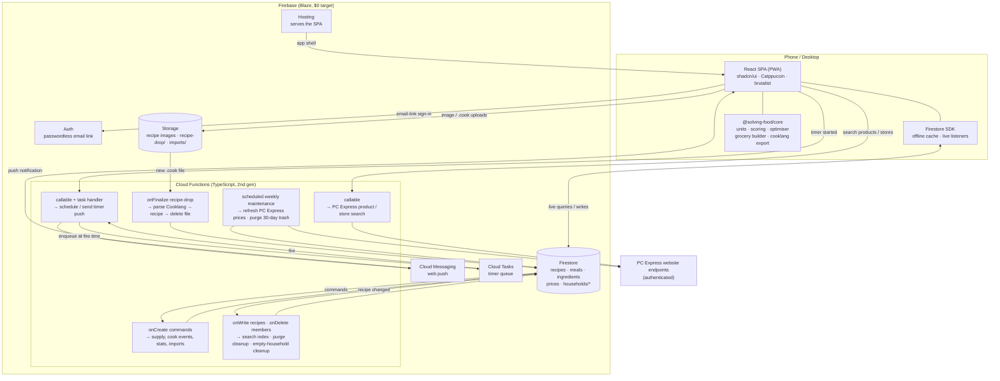
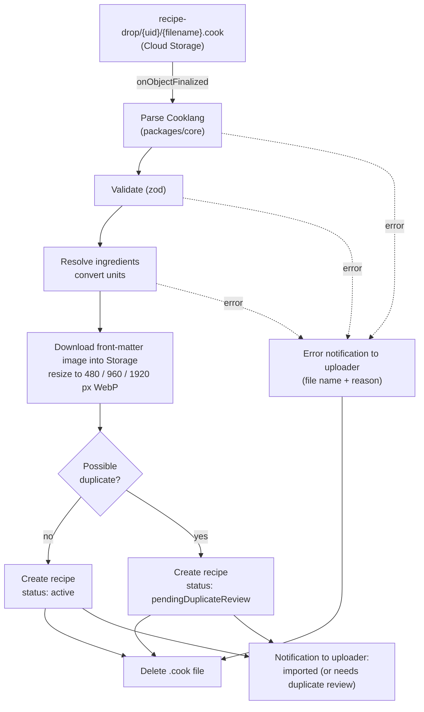

# Solving Food — Technical Specification

> Status: Draft v0.5 · Companion to `PRODUCT_REQUIREMENTS.md` (v0.5) · Last updated: 2026-10-10 (M2)

---

## 1. Architecture Overview

Everything runs on Firebase. The React PWA reads and writes Firestore directly and gets live updates between household members for free. **Cloud Functions do only what the client can't do safely or at all:** apply supply changes consistently, process the recipe drop folder, maintain the search index, purge trashed recipes and clean up after them, delete a household when its last member leaves, talk to PC Express (prices, product and store search), deliver timer push notifications, and import household data.

There are **no LLM calls inside the app**. Recipe import (from a URL or a photo) happens outside it: an external LLM following the Claude skill writes a Cooklang file and puts it in the drop folder.



**Design principles**

1. **The client is smart.** Suggestions, the optimiser, projected supply, the grocery list, expiry alerts, and period rollover all run in the browser from a shared TypeScript package. A household's data is small, so this is fast and works offline, and it keeps function calls well inside the free quota.
2. **Supply changes go through the server.** Clients never write supply amounts directly. They write a *command* document, and a function applies it inside a Firestore transaction (§6).
3. **One language.** TypeScript is used everywhere, and `packages/core` is shared by the web app and the functions.

---

## 2. Free-Tier Strategy

NFR2 asks for the free tier unless something paid is unavoidable. **Two required features can't run on the Spark (free) plan:**

- **Cloud Storage**, for recipe images and the drop folder. Since late 2024, new Storage buckets require the Blaze plan.
- **Cloud Functions**, for processing the drop folder and keeping the supply ledger consistent.

So the project uses the **Blaze (pay-as-you-go) plan, designed so the bill stays at $0**. Blaze keeps the same no-cost quotas as Spark. There's no automatic billing kill switch, only alerting. (Google documents a Pub/Sub-triggered function that detaches billing at a threshold; it was considered and **rejected** because it would take the app down. Alerts only.) Safeguards:

- A **budget alert at $1/month**.
- All resources in **`us-east1`**. Cloud Storage's always-free tier only applies in `us-central1`, `us-east1`, and `us-west1`, and keeping Firestore and Functions in the same region avoids cross-region charges.
- An **Artifact Registry cleanup policy** (`firebase functions:artifacts:setpolicy`), so old function container images don't build up past the free 0.5 GB.
- Image resizing to three WebP sizes (480 / 960 / 1920 px, ~400 KB total per image) so 4K screens get sharp images. Images uploaded in the app are resized in the browser before upload. Images downloaded from dropped recipes are resized by the drop function (`sharp`).

### Estimated usage at 3 households / 10 users

| Resource | No-cost quota | Expected use | Headroom |
|---|---|---|---|
| Firestore reads | 50,000 / day | ~3,000–6,000 / day (cache + listeners only pull changes) | ~10× |
| Firestore writes | 20,000 / day | < 1,000 / day | 20× |
| Firestore storage | 1 GiB | < 50 MB | 20× |
| Functions invocations | 2M / month | < 10,000 / month | 200× |
| Storage-trigger invocations (`dropFolder`) | counted in the 2M above | every finalized object fires it: each `.cook` and photo dropped, plus 3 per recipe image stored (480/960/1920) and 3 per photo added in the editor. ~10 per imported recipe; < 1,000 / month. Non-drop paths return in milliseconds | — |
| Firestore-trigger invocations (`recipeIndex`, `recipeCleanup`, `ingredientRecipes`) | counted in the 2M above | one per recipe or ingredient write; the one-off 475-ingredient seed upload was 475 | — |
| Weekly maintenance reads (M2: index summary refresh) | in the 50,000 reads / day | every active recipe + the index chunks once a week: ~30 now, ≤ 2,000 at the design scale | 25× on that day |
| Plan, rollover, grocery (M2) | no functions | client-only: listeners on the period's plan items, stores, rules, mappings, lists; rollover is a client transaction (§7); price estimates are bundled in the web app (no reads) | — |
| `sharp` image resizing in `dropFolder` | Cloud Run 180k vCPU-s, 360k GiB-s / month | 512 MiB, ~2–8 s per imported photo: < 500 GiB-s / month | 700× |
| Storage | 5 GB-month (US regions) | ~1 GB of images for 2,000 recipes | 5× |
| Storage egress | 100 GB / month (N. America) | < 5 GB (images cached by the service worker) | 20× |
| Hosting transfer | 360 MB / day | < 50 MB / day | 7× |
| Cloud Scheduler | 3 jobs / **billing account** | 1 (weekly maintenance: price refresh + trash purge) | 2 spare |
| Command trigger (`commands`, M3) | counted in the 2M above | one per supply change, cook, review, eaten: ~20–60 / day per household; each runs one transaction (~5–30 reads, ~5–40 writes) | — |
| Timer callables (`scheduleTimer`, `cancelTimer`, M3) | counted in the 2M above | one per timer start, pause, adjust, cancel: < 3,000 / month | — |
| Cloud Tasks (queue `timers`, created by the `timers` task function's deploy, M3) | 1M operations / month | < 2,000 (cooking timers: enqueue + delete) | 500× |
| Cloud Messaging (web push) | free | < 2,000 pushes / month | — |
| Secret Manager | 6 active secret versions, 10,000 accesses / month | 2 secrets (PC Express credentials), ~500 accesses | 20× |
| Cloud Build (function deploys) | 2,500 build-minutes / month | ~10 deploys × ~2 min | 100× |
| Artifact Registry | 0.5 GB storage | one image per function; cleanup policy deletes images older than 1 day | — |
| Cloud Run (2nd gen functions run on it) | 2M requests, 180k vCPU-s / month | same as Functions invocations; 256 MiB, max 2 instances | 200× |

---

## 3. Tech Stack & Repo Layout

| Concern | Choice |
|---|---|
| Language | TypeScript (strict) everywhere |
| Monorepo | pnpm workspaces |
| Frontend | React 19 + Vite, shadcn/ui (Radix) + Tailwind CSS |
| Routing | TanStack Router |
| Data | Firestore SDK with a shared `useLiveQuery` / `useLiveDoc` hook layer |
| Forms / validation | react-hook-form + zod (schemas shared with functions) |
| PWA | `vite-plugin-pwa` (Workbox) for the app shell; Firestore persistent cache for data |
| Theme | The design prototype's Catppuccin `FLAV` / `ACCENTS` tables (Latte default) → CSS variables → Tailwind theme |
| Search | MiniSearch (client-side full-text) over the recipe index (§9) |
| Backend | Cloud Functions for Firebase (2nd gen, Node 22), region `us-east1` |
| Cooklang | A TypeScript Cooklang parser in `packages/core` (evaluate `@cooklang/cooklang-ts`; write a small one if it lags the spec). Used **only** for drop-folder imports and `.cook` export. |
| Testing | Vitest, fast-check, Firebase Emulator Suite, `@firebase/rules-unit-testing`, Playwright |

```
solving-food/
├─ apps/web/                 React PWA
├─ functions/                Cloud Functions
├─ e2e/                     Playwright suite: specs, page objects, fixtures, seed data
├─ packages/core/            units, ledger math, scoring, optimiser, grocery builder, cooklang ⇄ recipe, taxonomy, types
├─ data/                     ingredient seed data, price-estimates.json
├─ firestore.rules · firestore.indexes.json · storage.rules · firebase.json
└─ .claude/skills/cooklang-recipe/SKILL.md
```

---

## 4. Data Model (Firestore)

Household data is nested under `households/{hid}`, so a single membership check secures it. Global data (recipes, meals, ingredients, prices, the user directory) lives at the top level.

### 4.1 Global collections

```
users/{uid}                                       // private to the user
  email, activeHouseholdId, householdsCreated,    // ≤ 3; decremented by the function that deletes an emptied household
  theme: { flavour, accent }
  // No list of household IDs here: membership is read with a collection-group query on members (§10),
  // so a member removed by someone else never sees a stale list.

allowlist/{emailLower}                            // sign-up allowlist (R2.12); readable by its own address, writable by any signed-in user
  addedBy, addedAt, inviteHouseholdId?            // optional: household invite created alongside (R2.4)

directory/{uid}                                   // readable by every signed-in user, for invites
  displayName, displayNameLower

ingredients/{ingredientId}
  name, aliases[], category, defaultLocation,     // pantry|cupboard|fridge|freezer
  allowedMeasures: ("weight"|"volume"|"count")[],
  canonicalUnit: "g"|"count",
  densityGPerMl?, unitWeightG?, proteinPer100g?,
  shelfLifeDays: { pantry?, cupboard?, fridge?, freezer? },   // all null → never expires
  defaultPackAmount?, defaultPackMeasure?,        // pack rounding when there's no brand mapping (§8)
  defaultCadenceDays?,                            // staples cadence before the household has bought it twice (§8)
  freezable, isStaple, freeUse, needsReview      // freeUse → tracked by staples cadence only (§5)

recipes/{recipeId}                                // source of truth (structured)
  title, slug, servings, prepMin, cookMin, cuisine, mainProtein, tags[], tools[],   // cuisine/mainProtein from fixed lists
  ingredients: [{ id, ingredientId, amount, measure, canonicalAmount,   // canonical = g or count
                  displayText, optional }],
  steps: [{ text, ingredientRefs[], timerSeconds? }],    // refs → inline amounts (R4.11)
  prepTasks: [{ text, ingredientRefs[] }],               // mise en place (R4.12)
  defaultLeftoverPortions, leftoverMealType?,          // e.g. 4 portions → lunch
  proteinPerServingG?,                                 // derived on save (§5)
  sourceUrl?, sourceUrlCanonical?, fingerprint, ingredientIds[],
  imagePaths[], indexChunk,                            // which recipeIndex chunk holds its summary (§9)
  status: "active"|"pendingDuplicateReview"|"trashed", possibleDuplicateOf?,
  trashedAt?, trashedBy?,                              // Trash (§4.4); purged 30 days after trashedAt
  createdBy, updatedBy, version, createdAt, updatedAt
recipes/{recipeId}/versions/{version}             // full snapshot + editedBy, editedAt

recipeIndex/{chunkN}                              // ≤ ~500 compact summaries per doc (§9); from M2 each also has
                                                  // tools[] and lines {ingredientId: canonical per serving} (a map:
                                                  // Firestore can't store nested arrays) for the tools and cost filters

meals/{mealId}                                    // SAVED meals only (R5.2); unsaved meals live inside plan items
  name, recipes: [{ recipeId, servingsMultiplier }],   // 1..12 recipes, multiplier 0.5–10
  createdBy, updatedBy, createdAt, updatedAt

prices/{pcxStoreId}_{productCode}                 // PC Express price at one store
  productName, priceCents, packAmount, packMeasure, pcxStoreId, productCode, fetchedAt

users/{uid}/notifications/{id}                    // bottom-banner notifications (§12)
  kind: "info"|"success"|"error", message, link?, createdAt, dismissedAt?
users/{uid}/devices/{fcmToken}                    // web-push targets for timers
  platform, createdAt, lastSeenAt
```

Recipe ratings and stats are **not** stored on global documents, because households are invisible to each other.

### 4.2 Household collections (`households/{hid}/…`)

```
households/{hid}                 name, createdBy, periodDays, budgetCents, currency,
                                 timezone,                                 // IANA, default America/Toronto (R11.11)
                                 defaultServings,                          // plan items are scaled to this (R11.12)
                                 plannedMealTypes: ("breakfast"|"lunch"|"dinner")[],   // default all three (R11.13)
                                 pcxStoreId,                               // PC Express store for prices; default Loblaws Greenbank Road
                                 defaultStoreId,                           // store for items no mapping or rule sends elsewhere (§8);
                                                                           // set with the default stores (M2)
                                 currentPeriodId, settings: { scoreWeights{}, tools[],
                                 preferences: { likes[], dislikes[], diets[] },
                                 proteinGoals: { breakfast?, lunch?, dinner?, snack? } }   // g per serving; absent = off
  members/{uid}                  uid, displayName, joinedAt                // no roles; uid duplicated for the collection-group query
  invites/{inviteeKey}           inviteeUid? | inviteeEmailLower?, householdName, invitedBy, createdAt
                                 // key = uid for directory invites, or the lower-cased email for email invites (R2.4)

  stores/{storeId}               name, kind: "pcExpress"|"inStore", bulk: bool   // Costco: inStore, bulk
                                 // seeded as stores/pc-express and stores/costco with the household (or by the client
                                 // bootstrap for households created before M2)
  sourcingRules/{id}             // id = cat_<category> or ing_<ingredientId>: one rule per target
  sourcingRules/{id}             match: { category? | ingredientId? }, storeId
  brandMappings/{ingredientId}   productName, productCode?, packAmount, packMeasure, storeId

  favourites/{type_targetId}     type: "recipe"|"meal", targetId
  notes/{recipeId}               text, updatedBy                            // household's recipe notes
  stats/{type_targetId}          timesCooked, lastCookedAt, ratingSum, ratingCount   // function-maintained

  periods/{periodId}             start, end, budgetCents                    // snapshot at creation; follows a budget change
                                                                           // made in Settings during the period. ID = local
                                                                           // start date ("2026-10-05"), so rollovers are idempotent
  planItems/{itemId}             periodId, kind: "meal"|"leftover", mealType, servings,
                                 recipes: [{ recipeId, servingsMultiplier }],   // kind=meal: the meal itself (R5.1), 1..n recipes
                                 savedMealId?, name?,                        // set when created from / saved as a Meals-list meal (R5.8)
                                 leftoverSupplyId?, sourcePlanItemId?,       // kind=leftover → the batch they came from
                                 coverage: { breakfast?, lunch?, dinner? },   // slots it fills (R6.2)
                                 status: planned|cooked|skipped|eaten, carriedFromId?, addedBy, addedAt
                                 // carried copies have ID <newPeriodId>_<fromItemId>; the original stays in its period

  cookEvents/{eventId}           planItemId?, recipeIds[], titles[], cookedBy, cookedAt,   // titles survive recipe deletion
                                 used: [{ ingredientId, canonicalAmount }], leftoverPortions,
                                 reviewStatus: "pending"|"done", ratedBy[]
  ratings/{ratingId}             uid, cookEventId, targetType: "recipe"|"meal", targetId, score

  groceryLists/{listId}          periodId, status: draft|ordered|received, createdAt, orderedAt?, orderedBy?, receivedAt?,
                                 items: { [itemId]: { ingredientId?, freeText?, amount, measure,   // amount: canonical bought
                                          need?, packAmount?, packLabel?,                        // shortfall, pack (canonical), "400 g"
                                          packs, productName, storeId, estPriceCents, priceSource?,
                                          source: plan|manual|cadence, checked, checkedBy? } }
                                 // the current draft is groceryLists/draft; Copy moves its items into a new list
                                 // with status ordered (Undo moves them back and deletes it)
                                 // status → ordered when the Copy button is used (R7.5); items on ordered lists count as "incoming" (§8)

  supply/{supplyId}              // ingredientId, or "leftover_{eventId}"
    ingredientId?, label, canonicalAmount, canonicalUnit,
    lots: [{ lotId, amount, location, acquiredAt, expiresFresh?, expiresFrozen?, frozenAt?,
             expiryExtendedTo? }],                                        // set by "Still good" (R8.15)
    nextExpiry?
  supply/{supplyId}/transactions/{txId}
    delta, kind: purchase|cook|correction|discard|freeze|thaw|leftover|eaten|extendExpiry,
    lotId, ref?: { type, id }, uid, note?, createdAt

  commands/{cmdId}               type, payload, uid, createdAt, status: pending|applied|failed, error?
  cadence/{ingredientId}         avgIntervalDays, lastPurchasedAt, snoozedUntil?
```

**Notes**

- **Function-only collections.** Clients can read but never write `supply/**`, `stats`, `cookEvents`, `ratings`, and `cadence`. They change only through commands (§6), so a cook event can't exist without its supply deductions and a rating can't be forged for another user. Everything else under the household is read/write for members.
- **Drop imports awaiting a duplicate decision** are simply recipes with `status: pendingDuplicateReview`; the Recipes page lists them with a query on that field. There is no per-household review collection, because recipes are global.
- **Grocery items are a map keyed by item ID**, not an array, so two people ticking items at the same time update different fields instead of overwriting each other (§11).
- **Lots live inside the supply document**, so one transaction updates the amount and the lots together. An ingredient rarely has more than a handful of active lots.
- **Discards** are ordinary `discard` transactions. Waste is tracked internally and no UI exposes it (R8.9).

### 4.3 Fixed taxonomies

`cuisine` and `mainProtein` come from **fixed lists** defined once in `packages/core/taxonomy.ts`. The manual-entry form's dropdowns, the drop-folder validator, and the Claude skill (which embeds the lists) all use this one source, so the variety penalties compare clean values. Proposed starting lists, which are easy to extend in code:

- **Cuisine:** american, british, canadian, caribbean, chinese, french, greek, indian, italian, japanese, korean, mediterranean, mexican, middle-eastern, nordic, spanish, thai, vietnamese, other.
- **Main protein:** beef, pork, chicken, turkey, lamb, fish, seafood, eggs, tofu, legumes, dairy, none.

### 4.4 Deleting a recipe (Trash)

Any user can delete a global recipe, but deletion is **soft** (R4.26). A **confirmation dialog** warns: *"This removes the recipe for everyone, in every household. It stays in Trash for 30 days."* The client then sets `status: "trashed"`, `trashedAt`, `trashedBy` as a normal versioned save. Rules forbid clients from deleting recipe documents outright.

**While trashed:**

- The index function drops it from `recipeIndex`, so it disappears from search, lists, and suggestions.
- The client refuses to add a trashed recipe to a plan or meal. Existing plan items and meals that reference it still render (they read the document directly) with a *recipe in Trash* badge, and can still be cooked.
- `/recipes/trash` lists trashed recipes with a **Restore** button. Restoring sets `status: "active"` as a new version, and the index function puts it back.

**Purge:** the weekly maintenance function (§8, §13) finds recipes with `trashedAt` older than 30 days and deletes each document. An `onDocumentDeleted(recipes/*)` function then cleans up:

- Deletes `versions/*` and the recipe's images in Storage.
- Removes it from every saved meal that includes it. A saved meal left with no recipes is deleted.
- In every household: removes it from the `recipes` list of `planned` plan items (an item left with no recipes is deleted), plus its favourites, notes, and stats.
- Keeps `cookEvents`, ratings, and history entries, which show the stored title marked *(deleted)*.

The same cleanup runs for the only other hard delete: a new drop import discarded with **Keep existing** during duplicate review (§9), which was never visible to anyone.

---

## 5. Units & Measurements

Each ingredient declares the **measurements it allows** (R8.3) and one **canonical unit** for storage. Everything that has a weight, or can be converted to one, is stored in **grams**. Count is the canonical unit only when there's no unit weight (e.g. "1 bay leaf").

| Input | Conversion to canonical | Requires |
|---|---|---|
| Weight (`g`, `kg`, `oz`, `lb`) | static table | — |
| Volume (`tsp`, `tbsp`, `cup`, `ml`, `L`, `fl oz`) | → ml × `densityGPerMl` | `volume` allowed + density |
| Count ("2 potatoes") | × `unitWeightG` | `count` allowed + unit weight |
| Vague ("to taste", "a pinch") | none; `optional: true`, no supply effect | — |

```
"2 medium potatoes" → potato (unitWeightG 213)  → 426 g
"1 cup flour"        → 236.6 ml × 0.53 g/ml     → 125 g
"500 ml milk"        → 500 ml × 1.03 g/ml       → 515 g
```

- **Entering amounts:** the Supply add/correct form and the recipe editor show only an ingredient's allowed measurements. The amount is converted on save, and the original value is kept for display.
- **Quick-adjust buttons** (R8.8) step by measurement: ±5 g / ±25 g for weight, ±5 ml / ±25 ml for volume, ±1 for count.
- **Ingredient picker:** a typeahead over `name` + `aliases` ("chicken" → chicken breast, chicken thighs, whole chicken…). Creating a new ingredient asks for a category, its allowed measurements, and the conversions it needs. Anything incomplete is flagged `needsReview`.
- **Seed data:** about 500 common ingredients with densities, unit weights, **protein per 100 g**, and shelf lives, prepared once from USDA FoodData Central (portion weights and nutrients) and the USDA FoodKeeper dataset, and shipped in `data/`.
- **Protein per serving** = Σ (canonical grams × `proteinPer100g` / 100) ÷ servings, recomputed whenever a recipe or one of its ingredients changes. Ingredients stored by count use `unitWeightG`. If any non-optional ingredient has no protein value, the recipe shows the protein as approximate ("~32 g"), and the missing ingredient is flagged `needsReview`.
- **Display: always metric and imperial together.** Amounts are shown in the recipe's original wording followed by both systems, e.g. "1 cup flour (125 g · 4.4 oz)", "2 potatoes (430 g · 15 oz)", "Rice 2.0 kg · 4.4 lb (1.2 kg · 2.6 lb)". A shared `formatAmount()` in `packages/core` does all formatting, with sensible rounding per unit.

### Free-use ingredients

Ingredients used freely and often outside recipes have `freeUse: true` (they're also `isStaple`). Examples: cooking oils, salt, pepper, butter, sugar, and condiments. **Spices are not free-use**: they're tracked by amount like any other ingredient.

- They're shown in recipes as normal but **skipped in supply math**: cooking doesn't subtract them, the grocery builder doesn't add them from planned meals, and "can make with supply" ignores them.
- They're managed **only by the staples cadence** (§8). Purchases record the date (for the cadence) but don't create tracked amounts.
- On the Supply page they appear in a **Staples** group showing when each was last bought and when the cadence expects it to run out, with no amount.
- The flag is part of the ingredient seed data and can be changed in the ingredient editor.

---

## 6. Supply Ledger

Supply is **event-sourced**. Every change is a transaction. `canonicalAmount` is a cached sum that **only functions** write.

### Command pattern (works offline)

Firestore writes queue up offline, but callable functions don't. So every action that changes supply is written as a **command document** in `households/{hid}/commands`. An `onDocumentCreated` trigger validates the payload with zod and applies it in a **Firestore transaction**, then marks the command `applied` or `failed`. While a command is pending, the client applies its effect optimistically for display.

| Command | Effect |
|---|---|
| `addSupply` | Manual add (R8.2): `purchase` (+) lot with estimated expiry |
| `receiveGroceries` | `purchase` (+) per confirmed item → new lots; optional `freeze` split (R7.9); grocery list → received; update cadence |
| `finishCooking` | Issued by **Done cooking**, before any review (R9.3). `cook` (−) per recipe ingredient at the planned servings (FEFO, skipping free-use ingredients); `leftover` (+) lot of `defaultLeftoverPortions`; leftover plan items (§7); plan item → cooked; cook event with `reviewStatus: pending` |
| `submitReview` | Per-user rating for the meal and/or its recipes; updates `stats/*`. When the reviewer also confirms **used amounts and leftovers**, the function writes `correction` (±) transactions for the difference between the recipe defaults already deducted and the confirmed amounts, adjusts the leftover lot and its plan items to the confirmed count, and marks the review `done`. Later ratings from other members only add ratings |
| `correctSupply` | `correction` (± delta to reach the stated amount). Recorded as-is: the app doesn't ask why or try to infer unplanned consumption |
| `discard` | `discard` (−) on a lot. Also what **Threw it out** sends for an expired lot (R8.15) |
| `extendExpiry` | **Still good** on an expired lot (R8.15): 0-delta transaction that sets `expiryExtendedTo` (default +3 days, or a chosen date) so the lot counts again |
| `freeze` / `thaw` | 0-delta transaction; moves the lot and switches its active expiry |
| `markEaten` | `eaten` (−) on a leftover portion or snack; leftover plan item → eaten |
| `importHousehold` | Replaces the household's data from an uploaded export file (§13) |

### Rules

- **FEFO:** consumption takes from the lot that expires first, so per-lot expiry (R8.5) stays accurate without the user choosing a lot. Expired lots are skipped unless nothing else is left.
- **Expiry:** `expiresFresh = acquiredAt + shelfLifeDays[location]`. Freezing sets `expiresFrozen = frozenAt + shelfLifeDays.freezer`. Both values are kept. The active expiry is `expiryExtendedTo` if set, else frozen or fresh depending on `frozenAt`. Ingredients with no shelf life never expire. Dates are compared in the household's `timezone`.
- **Leftover lots** use fixed shelf lives from `packages/core` config: 4 days in the fridge, 90 days frozen (R6.10).
- **Expired lots** (R8.15) are excluded from every client-side calculation: available supply, projected supply, "can make", ingredient badges, the grocery builder, and `supplyUtilisation` / `missingIngredients` in scoring. They stay in the document until the user answers the **Still good / Threw it out** prompt (`<ExpiredLotPrompt>`, §12). Nothing discards them automatically.
- **Projected supply** (the bracketed number in R8.4) = `Σ unexpired lots − Σ requirements of planned, uncooked items in the current period`. It's computed on the client from live data.
- **Transaction history** uses a paginated query (`orderBy(createdAt desc).limit(25)` + `startAfter`) with infinite scroll (R8.7).
- **Negative supply (as built, M3):** a lot never goes below zero. Consumption beyond what the lots hold takes what there is, notes "short by n" on the transaction, and sets the supply doc's `shortAt`, which shows a "check the amount" flag until a correction or purchase clears it. A stored deficit was dropped because the next purchase would either pay it off (wrong: the new bag is full) or keep it forever.
- **Double-finish guard:** `finishCooking` is a no-op if the plan item is already `cooked`, e.g. when two members finish the same meal.

**As built (M3):** `functions/src/commands/` (dispatcher `commands`, `onDocumentCreated`, `retry: false`). The handler re-reads the command inside the transaction and skips anything not `pending`, so a command applies at most once; no-op outcomes ("already cooked", "already received") are stored in the command's `result`. Failures set `status: failed` and `error` and post an error banner to the issuer. Command payloads use canonical amounts and epoch-ms instants (`packages/core/commands.ts`); `finishCooking` carries a client-chosen `cookEventId` so the cook view can open the review at once. The ledger math is `packages/core/ledger.ts` (FEFO, corrections, discards, freeze/thaw splits `<lotId>-f<n>` / `-t<n>`, Still good, refunds). Details:

- `finishCooking` stores on the cook event `defaults` (the recipe amounts at the planned servings, which the review pre-fills), `deducted` (what the ledger actually took) and per-lot `takes`; `submitReview` corrects against `deducted` (used more → FEFO take; used less → put back into the lots it came from). It also bumps `stats/*.timesCooked` and `lastCookedAt` at cooking time, so "made n times" doesn't wait for a review; ratings update `ratingSum`/`ratingCount` (re-rating replaces).
- Leftover plan items have `recipes: []` (their food is already cooked, so they add nothing to the grocery list or budget), `name` = the meal's title, `leftoverSupplyId`, ID `<cookEventId>_lo<n>`, and go into the household's current period.
- `markEaten`: leftover → one portion out of its lot; cooked meal → status only; a planned snack → its recipe amounts come out of supply (kind `eaten`); a planned non-snack meal is refused ("cook it first").
- `receiveGroceries`: lines not mentioned arrived as listed (R7.8); missing lines have amount 0. Each bought tracked ingredient gets a lot `<commandId>-<itemId>` in its default location (frozen from the start when that is the freezer), plus the freeze split. The list gets `receivedAt`, `receivedBy`, `receivedCents` (estimated cost of what arrived, pro rata) and per-line `receivedAmount`. Cadence keeps `purchaseCount` alongside the EMA; `avgIntervalDays` is null until the second purchase.
- Thawing gives the lot a fresh expiry of 2 days from thawing (the original fresh date has usually passed); the frozen expiry stays on the lot.

---

## 7. Planning, Suggestions & Optimiser (client-side)

### Periods & rollover

`households/{hid}.currentPeriodId` points to the active period. When any member opens the app after `period.end` (midnight in the household's `timezone`), the client runs a **Firestore transaction**. It creates the next period (length `periodDays`, with a budget snapshot), copies uncooked `planned` items into it with `carriedFromId`, and advances `currentPeriodId`. The transaction makes this idempotent, so two members opening the app at once can't create two periods. No scheduler is needed. Transactions need a connection, so a device that is offline keeps showing the ended period with a "period ended, will roll over when online" note, and all its other actions still work.

Implementation (M2, `apps/web/src/data/plan.ts` `bootstrapHousehold`, periods in `packages/core/period.ts`): the check runs on app open, on focus, when the connection returns, and at the moment the period ends. A period runs from local midnight on its start date for `periodDays` days (DST-safe: a 7-day period can be 167 or 169 hours) and its document ID is the start date, so concurrent rollovers write the same document. When nobody opened the app for a while, the next period is the one containing now, aligned to the old boundaries. Carried items get the ID `<newPeriodId>_<fromItemId>` and the originals stay in their period as history. The household's first period is written in its creation batch; households created before M2 get it (and the default stores) from the same bootstrap. A new period length applies from the next period; a budget change in Settings also updates the current period's snapshot.

**Creating meals (R5.7, R5.8):** every `kind: "meal"` plan item is created by `<CreateMealSheet>`: multi-select recipes (via `<CollectionView>` with Suggested first) or pick a saved meal, choose `mealType` and `servings` (default `household.defaultServings`, R11.12), optionally name it and tick "Save as meal", which also writes a `meals/{id}` document and sets `savedMealId`. "Add to plan" on a recipe opens the same sheet with that recipe preselected. Each recipe is scaled by `servings × servingsMultiplier`. The user can change servings and meal type on the plan item afterwards (which recomputes its coverage). The sheet has two steps: pick (recipes with multipliers, or a saved meal) and details (meal type, servings, name + Save as meal, budget impact). Ratings and `stats` for meals key on `savedMealId`, so unsaved meals only rate their recipes.

### Coverage & leftovers

Each plan item has a `coverage` map: how many slots of each meal type it fills. This drives the period coverage strip (R6.2) without assigning anything to a day. The strip shows one row per entry in `household.plannedMealTypes` (R11.13); a plan item for a meal type that's turned off still exists and still counts in the list, it just has no row.

- An ordinary dinner covers `{ dinner: 1 }`. A snack covers nothing (snacks have no row).
- Leftover portions are summed across the meal's recipes and not scaled by servings (the recipe's own estimate; M3 confirms the real count).
- A **meal-prep recipe** with `defaultLeftoverPortions: 4, leftoverMealType: "lunch"` covers `{ dinner: 1, lunch: 4 }` as soon as it's planned, so the strip shows the lunches as planned straight away.
- When the batch is cooked, `finishCooking` uses the **confirmed** leftover count. It creates one plan item per portion (`leftoverSupplyId`, `sourcePlanItemId`, `coverage: { lunch: 1 }`) and moves the batch's own coverage back to `{ dinner: 1 }`. Leftovers therefore **fill slots automatically** and are never tied to a day.
- Marking a leftover eaten sets its plan item to `eaten`, which shows as a solid cell in the strip. Leftovers still uneaten at period end roll over like any other planned item, as long as they haven't expired.

### Budget

`spent = Σ marginal cost of planned items`, where marginal cost prices only the **shortfall packs** the grocery builder would buy (§8). Ingredients already in supply, or **incoming** on an ordered-but-not-received list, cost nothing. Manual and staple items are excluded (R6.4). The meter shows `budget − spent` and turns red below zero. Adding meals is never blocked.

By design the meter is a *"what will the next order cost"* gauge (R6.3): after a grocery list is confirmed as received, the planned meals are covered and `spent` drops back toward zero. Pack rounding makes the cost order-dependent (the first recipe that needs flour pays for the whole bag), which is accepted. Each plan item shows its own share in `addedAt` order ("+$3.91 to buy"); the shares sum to `spent`. Actual spend for a period is `Σ estPriceCents` of the period's received lists and is shown on History (R10.3).

### Suggestion score

This runs in a Web Worker using `packages/core/scoring`.

```
score(r) = Σ wᵢ · fᵢ(r, plan, supply)     each fᵢ ∈ [0, 1]
```

| Factor | Computation (sketch) | Sign |
|---|---|---|
| expiryUrgency | Σ grams used from lots expiring within the period, weighted by 1/daysLeft | + |
| supplyUtilisation | fraction of the recipe's canonical amount already in projected supply | + |
| rating | household average / 10 (Bayesian prior for unrated) | + |
| historicalPref | frequency × recency decay; favourite bonus | + |
| variety | novelty vs. the last N periods | + |
| preferences | likes matched; dislikes/diets act as a strong penalty or filter | ± |
| proteinGoal | 1 if `proteinPerServingG` ≥ the goal for the meal type, scaled down linearly below it; skipped when the goal is off | + |
| missingIngredients | share not covered by supply | − |
| cost | marginal cost / remaining budget | − |
| sameProtein / sameCuisine | already present in the plan | − |
| recentlyCooked | cooked within the last N days | − |
| missingTools | hard filter | − |

The **Suggested sort** (§3 of the PRD) applies the same scoring to any filtered list. Weights and presets are stored in `households/{hid}.settings.scoreWeights`.

### Expiry badges & alerts

For each planned item, the client finds the earliest-expiring lot among its ingredients that the item would use, and shows a badge when it expires within the period (R6.7). Supply expiring with no planned use raises an alert with suggestions sorted by `expiryUrgency` (R6.13).

### Optimiser ("n dinners under $x")

1. **Set score:** Σ suggestion scores + an *ingredient-overlap bonus* (a shared spinach bag makes the second spinach recipe nearly free) − penalties for repeated cuisine or protein. Hard constraints: total marginal cost ≤ x, exactly n recipes, and caps per cuisine and protein.
2. **Quality threshold:** a set is **good** if it meets the hard constraints and its set score is ≥ 80% of the best set found (the ratio is configurable in `packages/core`). There's **no fixed number of sets**. The optimiser offers every good set it can find.
3. **Search:** in a Web Worker, run greedy construction plus local-search swaps from many randomised starting points. Keep each new good set that differs enough from the ones already found (recipe Jaccard similarity < 0.5). Results stream in sorted best-first. Search stops when a run of attempts (e.g. 200) in a row finds no new good set, or after a time budget of a few seconds, with the remaining space continued lazily as the user presses Next.
4. **Next / Back:** Next shows the next good set. Back returns to earlier ones instantly from memory. When the good sets run out, the sheet says *"No more good combinations"* and offers to relax the budget or caps.
5. **Accept:** writes all of the set's plan items in one batch.

An optional **"meets protein goal"** toggle turns the protein goal into a hard filter for the optimiser.

### Protein summary

The Plan page shows, for each meal type, the average `proteinPerServingG` of the planned items next to the household goal (R6.17). This is computed on the client.

---

## 8. Grocery List & Prices

### Builder (client-side)

```
needs     = Σ requirements of planned, uncooked items (scaled by servings), excluding free-use ingredients
incoming  = Σ amounts on this household's grocery lists with status "ordered" (copied, not yet received)
shortfall = max(0, needs − unexpired supply − incoming)
packSize  = brandMapping.packAmount ?? ingredient.defaultPackAmount ?? shortfall   // no rounding if unknown
packs     = ceil(shortfall / packSize)
+ manual items + accepted "are you out of X?" prompts
→ store: brandMapping.storeId → ingredient sourcing rule → category sourcing rule → household default store
```

Regenerating keeps manual items and checked-off state. The list is a Firestore document, so every member sees ticks live, which matters at Costco.

Implementation (M2, `packages/core/grocery.ts`, Grocery page): the current draft is `groceryLists/draft`. While the Grocery page is open it writes the field-level difference between the stored draft and the generated plan lines (`mergeDraft`); plan lines are keyed by ingredient ID, manual ones `manual_<id>`. Manual lines are free text or an ingredient bought in whole packs; they don't count against the budget (R6.4). Store resolution falls through a rule or mapping that points at a deleted store. Expired lots don't count as supply (R8.15), so the builder buys replacements for them.

Store resolution starts with the brand mapping because a mapping pinned to a specific PC Express product must never be sent to Costco by a broader category rule.

**Copy button:** copies only the `pcExpress` store items and sets the list's `status` to `ordered` (R7.5), with an **Undo** in the confirmation toast that sets it back to `draft`. In M2 the draft's items move into a new list document with `status: ordered`, `orderedAt`, `orderedBy` (all stores: an in-store checklist such as Costco's travels with the order and stays tickable there), and Undo moves them back. If the browser refuses the clipboard, a sheet shows the text to copy by hand. Lines read `- <product>, <pack> × <packs>`, or `- <product>, <grams>` without a pack:

```
Please add these to my PC Express cart:
- Mutti Polpa chopped tomatoes, 400 g can × 2
- Organic baby spinach, 312 g clamshell × 1
- Lactantia 2% milk, 4 L × 1
Substitutions: closest equivalent size; skip if unavailable.
```

**Confirming a purchase** (R7.8): the confirmation screen lists the items as bought. Edits are optional. When a confirmed item comes from a `bulk` store and its ingredient is `freezable`, the screen asks how much to freeze (R7.9). Everything is submitted as one `receiveGroceries` command.

**Staples cadence:** the `receiveGroceries` handler updates `cadence/{ingredientId}.avgIntervalDays` (an exponential moving average of the gaps between purchases). Until an item has been bought twice there's no gap to average, so the client uses `ingredient.defaultCadenceDays` from the seed data (e.g. milk 7, eggs 14, olive oil 60). The client raises an "Are you out of X?" prompt when `daysSinceLastPurchase ≥ 0.85 × interval`. *Yes* adds the item to the draft list; *Not yet* snoozes it.

### Prices

PC Express has **no official public API**. Third-party scrapers exist, but they're paid, which rules them out under NFR2. The app uses the **same undocumented JSON endpoints the PC Express website calls**. The owner accepts the risk that they may change or break, and that this may not be permitted by PC Express's terms.

**Authentication:** requests are made as the owner's **PC Express account**. Its credentials (or refresh token) are stored in **Secret Manager** (`defineSecret`) and used only inside functions, never sent to clients. A module `functions/src/pcx/` wraps sign-in, token refresh, product search, store search, and price lookup. If the endpoints change, this is the only module to fix.

**Store selection:** each household picks its **PC Express store** in Settings → Stores, using an in-app store search (callable `pcxSearchStores`). The default is **Loblaws Greenbank Road** (Ottawa), which is set when the household is created (R6.22). Its PC Express store ID is looked up once with the store search and kept in `packages/core` config.

**Linking products:** the brand mapping page has an **in-app product search** (callable `pcxSearchProducts(query, pcxStoreId)`). Results show the name, pack size, image, and current price at the household's store. Picking one saves `productCode`, `productName`, `packAmount`, and `packMeasure` on the mapping, and writes the price to `prices/*`.

**Price refresh & resolution:**

1. A **weekly scheduled maintenance function** (the project's one Cloud Scheduler job, shared with the trash purge in §4.4) collects every distinct `(pcxStoreId, productCode)` pair across households and refreshes `prices/{pcxStoreId}_{productCode}`.
2. Prices are resolved in this order: **live price** for the household's store (fetched ≤ 14 days ago) → **`data/price-estimates.json`** (per-ingredient price of a pack: `priceCents`, `packAmount`, `packMeasure`, plus a derived `centsPerUnit`) → unknown. Unknown prices count as $0, and the item is marked "price unknown" on the meter. The estimates are bundled into the web app (no Firestore reads, works offline); `pnpm prices:check` keeps them complete for the seed.
3. If a fetch or sign-in fails, the function logs it, leaves old prices in place, and posts an error notification to the **project owner**, whose uid is set in the function's config (`OWNER_UID` parameter). The app falls back to estimates automatically as prices age.

---

## 9. Recipes: Storage, Search, Drop Folder & Dedupe

### Source of truth

The **structured Firestore document** is the source of truth (§4.1). The manual editor reads and writes it directly. Cooklang is used only to **get recipes in** (drop folder) and **get recipes out** (`.cook` export, generated client-side by `packages/core`).

### Versioning

Every save writes the recipe and a `versions/{n}` snapshot in **one batch**. Rules require `version == previous + 1`. Restoring an old version is just saving its snapshot as a new version.

### Search

Firestore has no full-text search. An `onDocumentWritten(recipes/*)` function maintains `recipeIndex/{chunk}` documents, each holding ≤ ~500 compact summaries: `{id, title, tags, cuisine, mainProtein, proteinPerServingG, ingredientIds, totalMin, thumb}`. A recipe is assigned a chunk on creation (`indexChunk`, the lowest chunk with room) and stays there. Recipes with `status: trashed` or `pendingDuplicateReview` are left out of the index. The client loads a few chunk documents (cached offline), builds a **MiniSearch** index (ingredient names resolved from the `ingredients` collection, household notes merged in), and applies every filter in memory: supply, tools, favourites, cooked before, and cost. Meals use the same approach with a smaller index.

### Drop folder



- **Trigger scope:** 2nd-gen Storage triggers fire for **every** object in the bucket, including image uploads and import files. The function returns immediately unless the path starts with `recipe-drop/`. These no-op invocations are counted in the §2 estimate.
- **Getting files in:**
  1. An in-app **"Drop recipes"** area (drag and drop or file picker, several files at once) uploads to `recipe-drop/{uid}/`. This works for anyone signed in.
  2. The project owner can run `gcloud storage cp *.cook gs://<bucket>/recipe-drop/<uid>/` from a terminal, which lets Claude Code drop files directly.
- **Unknown ingredients** found in a dropped file are created with `needsReview: true` and defaults inferred from the category.
- **Images** referenced in front matter are always **downloaded into Storage** (never hot-linked) and resized to the three standard sizes. If the download fails, the recipe is still imported without an image, and the notification says so.
- **Results** are reported through the notification system (§12): a success or error banner appears at the bottom of **whatever page the uploader is on**, linking to the new recipe or describing the error.

- **Bulk loads** (`pnpm drop:recipes`, `scripts/lib/drop.ts`) send a few recipes at a time, each photo just before its
  `.cook`, and re-upload a `.cook` that hasn't been picked up after a minute or two (a new object generation fires a
  new event; the function de-duplicates by generation). Image variant uploads retry transient failures.

Firebase supports a drop folder (Storage + a trigger), so **no REST API is built** (as the PRD specifies).

### Claude skill (`.claude/skills/cooklang-recipe/SKILL.md`)

- Cooklang syntax: ingredients (incl. multi-word), cookware, timers, front matter, comments, sections.
- **Required front matter:** `title`, `servings`, `cuisine`, `main_protein`, `prep_time`, `cook_time`, `tags`. `cuisine` and `main_protein` must come from the fixed lists (§4.3), which the skill embeds (generated from `packages/core/taxonomy.ts`). Optional: `source`, `image`, `leftover_portions`, `prep` (mise en place tasks).
- House conventions (the same as `data/recipes/README.md`): keep the recipe's own units (the app converts and shows
  metric and imperial), ingredient names the app knows (a generated list of the seed's names and aliases ships with the
  skill), salt and pepper as separate tokens, preparation words outside the token, and how to describe count-based
  ingredients.
- How to deliver files: write the `.cook` files and upload them with `gcloud storage cp`, or save them locally for the user to drag into the app.
- The lists and ingredient names are generated by `pnpm gen:skill`; a unit test fails when they're stale and imports every example in the skill.
- Worked examples, including converting a recipe web page and a photographed recipe.

```cooklang
---
title: Sheet-Pan Salmon with Potatoes
servings: 4
cuisine: nordic
main_protein: fish
leftover_portions: 2
prep_time: 15 minutes
cook_time: 30 minutes
source: https://example.com/salmon
image: https://example.com/salmon.jpg
tags: [weeknight, one-pan]
---

Preheat the #oven to 220°C.

Toss @baby potatoes{600%g} with @olive oil{2%tbsp} and @salt{} on a #sheet pan{}. Roast ~{15%minutes}.

Add @salmon fillet{600%g} and @lemon{1}, sliced. Roast ~{12%minutes} more.
```

### Deduplication

A recipe is flagged as a possible duplicate if any of these hold:

- Same `sourceUrlCanonical` (tracking parameters stripped).
- Title trigram similarity > 0.8 **and** ingredient-set Jaccard similarity > 0.7.
- Same `fingerprint`: a hash of sorted ingredient IDs plus rounded amounts per serving.

**Resolution** (R4.20):

- **Keep existing:** delete the new recipe (a hard delete, allowed by rules only while `status == pendingDuplicateReview`).
- **Keep new:** copy the new content **onto the existing recipe's ID** as a new version, then delete the new document the same way. History, favourites, and plans in every household keep working.
- **Keep both:** set the new recipe to `active`.

The manual editor runs this check before saving. Drop imports are flagged `pendingDuplicateReview` and listed on the Recipes page.

---

## 10. Authentication, Households & Security

### Sign-in

- Firebase Auth **email link** (passwordless). Firebase sends the email for free.
- **iOS PWA caveat:** a link tapped in Mail opens Safari, not the installed PWA, which has separate storage. The free fix: the sign-in screen also has a **"Paste sign-in link"** field. `signInWithEmailLink(auth, email, pastedLink)` accepts a pasted link, so no extra function or email service is needed.
- **Allowlisted sign-up (R2.12):** Firebase Auth itself can't restrict who completes an email link without the paid Identity Platform blocking functions, so the gate is in **Firestore rules** instead. Every rule that grants a signed-in user anything requires `allowed()`: an `allowlist/{email}` document exists for `request.auth.token.email` (lower-cased). Someone not on the list can complete the Firebase sign-in, but the app can't create their `users/{uid}` or `directory/{uid}` documents and can't read anything, so it shows *"This address hasn't been invited"* and signs them out. An orphaned Auth account with no data is harmless; the owner can prune them in the console.
- Any signed-in user can add an address to the allowlist (that's how invites by email work, R2.4). Rules let a user read only their own allowlist entry.
- On first sign-in, the user sets a display name, which creates `users/{uid}` and `directory/{uid}`.

### Households & invites (one function)

- **Create:** a batch writes `households/{hid}`, `members/{uid}`, and increments `users/{uid}.householdsCreated`. Rules use `getAfter()` to require that the counter goes up by exactly 1 and stays ≤ 3 (R2.3), and allow the creator's own `members/{uid}` document when `households/{hid}.createdBy == uid` in the same batch.
- **Which households am I in:** a **collection-group query** on `members` where `uid == me`. There is no list on the user document, so a member removed by someone else drops out of the list immediately (§11).
- **Invite by name:** a member searches `directory` by name (with 10 users, the client just loads it all) and writes `households/{hid}/invites/{inviteeUid}`.
- **Invite by email:** a member writes `allowlist/{emailLower}` (if missing) and `households/{hid}/invites/{emailLower}` with `inviteeEmailLower` in one batch.
- **See invites:** two collection-group queries on `invites`: `inviteeUid == me` and `inviteeEmailLower == my email`.
- **Accept:** the invitee creates their own `members/{uid}` document in a batch that deletes the invite. Rules allow this only when an invite keyed by their uid **or** their email exists.
- **Remove or leave:** any member can delete any `members/*` document (no roles, R2.5). Before a user deletes their **own** document, the client checks whether they're the last member and shows the warning from R2.13.
- **Empty household cleanup:** an `onDocumentDeleted(households/*/members/*)` function checks whether any members remain. If none do, it deletes the household document and all of its subcollections (`recursiveDelete`) and decrements `users/{createdBy}.householdsCreated`. It's the only household-level function besides commands, and it's idempotent, so two simultaneous leaves are safe.

### Security rules (sketch)

```
function email()    { return lower(request.auth.token.email); }
function allowed()  { return request.auth != null
                        && request.auth.token.email_verified == true                 // see note below
                        && exists(/databases/$(db)/documents/allowlist/$(email())); }   // R2.12
function isMember(hid) { return allowed()
                        && exists(/databases/$(db)/documents/households/$(hid)/members/$(request.auth.uid)); }
function me()       { return request.auth.uid; }

// Function-only household collections: readable by members, never written by clients.
FUNCTION_ONLY = ['supply', 'stats', 'cookEvents', 'ratings', 'cadence']

match /allowlist/{emailLower} { allow get: if request.auth != null && emailLower == email();
                                allow create: if allowed(); }                          // invite by email

match /households/{hid} {
  allow read, update: if isMember(hid);
  allow create: if allowed() && request.resource.data.createdBy == me()
                && householdsCreatedBumpedByOne() && getAfter(/users/$(me())).data.householdsCreated <= 3;   // R2.3

  match /members/{uid}       { allow read: if isMember(hid);
                               allow delete: if isMember(hid);                           // remove or leave (R2.5, R2.13)
                               allow create: if uid == me() && request.resource.data.uid == me() && (
                                    getAfter(/households/$(hid)).data.createdBy == me()   // creator, same batch
                                 || exists(/households/$(hid)/invites/$(uid))             // invite by name
                                 || exists(/households/$(hid)/invites/$(email()))); }      // invite by email
  match /invites/{key}       { allow read: if isMember(hid) || key == me() || key == email();
                               allow create: if isMember(hid);
                               allow delete: if isMember(hid) || key == me() || key == email(); }
  match /commands/{id}       { allow read: if isMember(hid);
                               allow create: if isMember(hid) && request.resource.data.uid == me()
                                                && validCommand(request.resource.data); }
  match /supply/{doc=**}     { allow read: if isMember(hid); }                           // write: functions only
  match /{coll}/{id}         { allow read: if isMember(hid);
                               allow write: if isMember(hid) && !(coll in FUNCTION_ONLY); }
  // As built (M2): each household collection has its own match with shape checks. Periods, plan items, and stores
  // use isMemberAfter(hid) (existsAfter on the member doc) for writes, so the creation batch can write the first
  // period and the default stores. Clients create plan items as planned and can't change their status (M3's commands
  // do). Grocery lists are draft or ordered (with orderedAt and orderedBy); received is set by the command function.
}
match /{path=**}/members/{uid} { allow read: if allowed() && resource.data.uid == me(); } // "my households" query (filters on the uid field)
match /{path=**}/invites/{key} { allow read: if allowed() && (key == me() || key == email()); }

match /recipes/{id}      { allow get: if true;                // share links work without an account
                           allow list, create: if allowed();
                           allow update: if allowed() && validVersionBump();           // includes trashing & restoring
                           allow delete: if allowed() && resource.data.status == 'pendingDuplicateReview';   // dedupe only; purge is a function
                           match /versions/{v} { allow read: if allowed();
                                                 allow create: if allowed() && v == getAfter(/recipes/$(id)).data.version; } }
match /meals/{id}        { allow get: if true; allow list, create, update, delete: if allowed(); }
match /ingredients/{id}  { allow get: if true;                // share-link recipe pages resolve ingredient names
                           allow list, create, update: if allowed(); }
match /directory/{uid}   { allow read: if allowed(); allow write: if uid == me() && allowed(); }
match /users/{uid}       { allow read, write: if uid == me() && allowed();
                           match /notifications/{id} { allow read, update, delete: if uid == me(); }   // functions create
                           match /devices/{token}    { allow read, write: if uid == me(); } }
match /recipeIndex/{id}  { allow read: if allowed(); }       // write: functions only
match /prices/{id}       { allow read: if allowed(); }       // write: functions only
```

**Verified email (M0 decision):** `allowed()` also requires `email_verified`. The Email/Password provider must be enabled for email-link sign-in, which would otherwise let anyone register an allowlisted address they don't own with a password. Email-link sign-in always verifies the address, so real users are unaffected. The collection-group `members` rule checks the duplicated `uid` *field* rather than the document ID, because Firestore can only prove a query safe from the fields it filters on. A collection-group single-field index on `members.uid` is declared in `firestore.indexes.json`.

Share links work for both recipes and meals: `allow get: if true` on both, and a meal page reads its recipes the same way. Public `get` on single documents can't be enumerated, so the exposure is limited to someone who already has a link.

Storage rules: `recipe-drop/{uid}/**` can only be written by that user, with a size limit of 1 MB and `.cook` files only. Image uploads under `recipes/{recipeId}/**` are capped at 2 MB per file and allowed for allowlisted users; **reads of recipe images are public**, so share-link pages render them. `imports/{hid}/**` can be written by household members, JSON or zip only, ≤ 20 MB, and read by nobody but functions.

---

## 11. Live Sync & Concurrency

Live sync (NFR5) comes from Firestore listeners and adds little complexity. A few patterns keep it correct:

| Concern | Approach |
|---|---|
| Subscription cleanup | All reads go through `useLiveQuery` / `useLiveDoc`, which unsubscribe on unmount |
| Concurrent edits to lists | Grocery items are a **map keyed by ID**, updated field-by-field (`items.<id>.checked`) instead of rewriting an array |
| Supply consistency | Only functions write supply, one transaction per command |
| Duplicate actions | Commands are idempotent per target (e.g. finishing an already-cooked plan item does nothing) |
| Editors | The recipe editor and the review sheet work on a copy taken when they open. If the version changes underneath, the user sees "edited elsewhere — reload or overwrite?" |
| Offline recipe edits | A recipe save queued offline is rejected by the version-bump rule on reconnect if someone else saved first, and the SDK drops it silently. So the editor **requires a connection to save**: offline, it keeps the draft in IndexedDB and shows "will save when online", then re-checks the version before writing. Household data (commands, plan, grocery ticks) has no such rule and syncs normally |
| Membership | "My households" is a live collection-group query on `members`, so being removed takes effect on the next snapshot and the app switches to another household or the "no household" screen |
| Period rollover | Done in a transaction, so concurrent openings are safe (§7). Not possible offline; the client waits for a connection |
| Recalculation | Updates are debounced ~300 ms before suggestions or projected supply recompute in the worker |
| Pending writes | `hasPendingWrites` drives a small "syncing" indicator, which is useful for offline commands |

---

## 12. Frontend

### Routes

```
/                → redirect: /plan if the current period has items, else /recipes
/plan  /recipes  /recipes/new  /recipes/trash  /recipes/:id  /recipes/:id/edit  /recipes/:id/cook
/meals  /meals/:id  /meals/:id/cook  /supply  /supply/:id  /grocery  /history       (/meals/:id renders signed out too)
/settings/{household,members,brands,stores,tools,preferences,weights,theme,data}
/drop            (upload .cook files, see import results)
/not-invited     (signed in with an address that isn't on the allowlist)
```

`/settings/household` holds period length, budget, timezone, default servings, and planned meal types. `/settings/members` holds the member list, invite by name or email (which writes the allowlist), remove, and leave.

`/recipes/:id` and `/meals/:id` also render for signed-out visitors (share links). These pages show only the global recipe content, without supply badges, notes, or stats.

### Key components

- **`<CollectionView>`**: shared search, filter, and sort for Recipes, Meals, Plan, and History, with a **Suggested** sort. Filter state lives in the URL.
- **`<CreateMealSheet>`**: the Plan page's primary action (R5.7). Tabs *Recipes* (multi-select `<CollectionView>`, Suggested sort first, selected recipes pinned at the top with per-recipe multiplier) and *Saved meals*; then meal type, servings, optional name + "Save as meal" (R5.8); Add to plan.
- **`<BudgetMeter>`**: sticky on the Plan page (a compact bar on phones, a card in the desktop's right column); turns red below zero; shows "n prices unknown".
- **`<SupplyBadge>`**: the "have / need" chip next to recipe ingredients.
- **`<CoverageStrip>`**: the period coverage view (R6.2). One row per meal type, one cell per day, filled left to right from plan items' `coverage`. Cooked or eaten cells are solid, planned cells are outlined, and overflow shows as "+n". Cells aren't interactive.
- **`<ExpiryBadge>`**: on planned meals (R6.7).
- **`<ProteinSummary>`**: average protein per serving vs. goal for each meal type, on the Plan page.
- **`<OptimiserSheet>`**: n / $x inputs, Next / Back / Accept.
- **`<MealCookView>`**: the plan item's recipes with their durations; the user picks the order and checks recipes off. When all are checked, it opens the review. One-recipe meals skip the ordering step.
- **`<StepMode>`**: full-screen, swipe between steps, inline amounts, Screen Wake Lock API, inline timers (§12 Cooking timers). Adapts to orientation and size (§12 Cooking layouts).
- **`<MiseEnPlace>`**: the prep checklist shown before step mode.
- **`<ReviewSheet>`**: per-user 1–10 rating for each recipe, and for the meal when it has a `savedMealId` (otherwise a "Save this meal?" prompt for multi-recipe meals, R5.8) → used amounts (pre-filled with what `finishCooking` already deducted) → leftovers ▲/▼. Submits a `submitReview` command whose corrections are the differences. It can be completed later from **Pending reviews** on the Plan page.
- **`<SupplyAdjust>`**: typed amount, ±5 / ±25 buttons, Apply.
- **`<ExpiredLotPrompt>`**: shown on Supply and Plan for each expired lot, with **Still good** (`extendExpiry`) and **Threw it out** (`discard`) (R8.15).
- **`<TrashList>`**: `/recipes/trash`, trashed recipes with days remaining and a Restore button (R4.26).
- **`<LeaveHouseholdDialog>`**: the leave confirmation, with the extra "this deletes the household and all its data" warning when the user is the last member (R2.13).
- **`<LedgerList>`**: paginated transaction history.
- **`<IngredientPicker>`**: typeahead with allowed-measurement selector.
- **`<NotificationBanners>`**: the app-wide notification system. Banners stack at the bottom of every page, above the bottom tab bar on phones. Fed by a live listener on `users/{uid}/notifications` (undismissed) plus local, client-only messages. Success and info banners auto-dismiss after ~6 s; errors stay until dismissed. Each can link to the related page. At most three show at once, with a "+N more · Dismiss all" row for the rest (a bulk drop reports one per file). The stack is always mounted as an `aria-live` region above sheets, so banners stay visible and announced while a sheet is open.
- **`<PcxProductSearch>`** / **`<PcxStorePicker>`**: PC Express search on the brand mapping and stores pages.
- **`<DataTransfer>`**: Settings → Data, with the Download and Import household data buttons (§13).

### Responsive layout

Mobile-first CSS (Tailwind) with min-width breakpoints. Layouts add panes and columns as space grows instead of stretching:

| Breakpoint | Width | Layout |
|---|---|---|
| base | < 640 px | One column, bottom tab bar, sheets for detail views |
| `md` | ≥ 768 px | Two panes on list pages (list + detail); tab bar becomes a collapsible side rail |
| `lg` | ≥ 1024 px | Persistent side navigation; Plan page in 2 columns |
| `xl` | ≥ 1440 px | 1080p desktops: Plan page in 3 columns (plan · suggestions · budget/protein/expiry); recipe detail shows ingredients and steps side by side |
| `3xl` (custom) | ≥ 2200 px CSS width | 4K at low OS scaling: root font size steps up, grids gain columns, max content width keeps line lengths readable |

Techniques:

- **Fluid type and spacing:** the root font size uses `clamp()` (e.g. `clamp(16px, 0.45vw + 12px, 22px)`) so rem-based text, spacing, and border widths scale smoothly between breakpoints. Brutalist borders and shadows are in rem, so they stay proportional on 4K.
- **Readable measure:** text blocks are capped at ~70ch. Extra space goes to more columns or panes, never to longer lines.
- **Auto-filling grids:** recipe and meal cards use `grid-template-columns: repeat(auto-fill, minmax(18rem, 1fr))`, so 4K gets more cards per row without hand-tuned breakpoints.
- **Container queries** (`@container`) for components like `<RecipeCard>` and `<BudgetMeter>`, so they adapt to the pane they're in rather than the whole window.
- **Sharp images:** recipe images are stored in several sizes (e.g. 480 / 960 / 1920 px WebP) and served with `srcset`/`sizes`, so 4K and high-DPI screens get crisp images and phones don't download large ones. Icons are SVG (lucide).
- **Step mode** sizes its text with viewport units (`clamp(1.5rem, 3vw, 4rem)`) so it reads well on a phone, a mounted tablet, or a TV.
- **Testing:** covered by `responsive.spec.ts` and `visual.spec.ts` (§14.1) at phone, 1080p, and 4K (1× and 2× device scale factor).

### Cooking layouts

| Context | Layout |
|---|---|
| Phone, portrait | One step at a time, its ingredients and timers below it |
| Phone, landscape | Step on the left; that step's ingredients and timers on the right |
| Tablet, portrait | Current step large, with a preview of the next step and the full ingredient list below |
| Tablet / desktop, landscape | Three panes: ingredient checklist · current step (large) · timers and next step |

Swiping, tapping the screen edges, and arrow keys all change step. Layouts are chosen by orientation and container size, so a tablet propped up in the kitchen gets the multi-pane view.

### Cooking timers

Timers must keep running and **alert even when the phone is locked** or the app is in the background.

- **In the foreground:** timers count down in the page, using wall-clock end times so they stay right after the tab is suspended. An alarm sound and vibration play when one ends.
- **Locked or backgrounded:** starting a timer calls `scheduleTimer({ endsAt, label })`. That callable creates a **Cloud Tasks** task scheduled for `endsAt`. When it fires, a task handler sends a **web push via Firebase Cloud Messaging** to all of the user's registered devices (`users/{uid}/devices`). The service worker shows a notification ("Salmon: roast done") with an action that opens the recipe at that step.
- Pausing or cancelling a timer deletes the task. Adjusting it reschedules the task.
- **Permissions:** notification permission is requested the first time a timer is started. On iOS, web push only works for the app **installed to the home screen** (iOS 16.4+), so the first timer on iOS Safari prompts the user to install the app.
- **Offline:** if the device is offline when a timer starts, the push can't be scheduled. The timer still runs in the page, and a banner warns that it won't alert while the phone is locked.

### Theming

Colours come from the design prototype's `FLAV` and `ACCENTS` tables (not `@catppuccin/palette`), as CSS variables named as in the prototype (`--base --mantle --pg --desk --ink --sub --acc --onc --line --s0 --scrim`, plus the look tokens `--bw --sh --r --tt --tilt`), mapped onto Tailwind colours (`bg-base`, `text-ink`, `border-line`) and the shadcn token names. Latte with the green accent is the default. The theme (`{ flavour, accent }`, accent by name) is stored on `users/{uid}.theme`, with a localStorage cache of the computed variables applied by an inline script before first paint. Brutalist styling uses the prototype's Classic look: 3 px borders in `--line`, hard 4 px offset shadows, 6 px radius, all expressed in rem so they scale with the fluid root size. Type: Archivo (500–900), Archivo Black for display, JetBrains Mono for numbers, self-hosted.

### Offline

Firestore `persistentLocalCache` (multi-tab) caches data and queues writes. Together with the command pattern, this means finishing a meal, adjusting supply, or ticking groceries works with no signal. Workbox caches the app shell and images for planned recipes.

---

## 13. Deployment & Operations

- **Environments:** a **single Firebase project, `solvingfood`** (Blaze, budget alert, expected to cost $0), used as production. There is no dev project: the app is used by one family, and local development and every automated test run entirely on the **Emulator Suite**. Project facts and the web config are in `SETUP.md`.
- **CI/CD:** GitHub Actions runs lint, type-check, unit, property, rules, and functions (emulator) tests, the requirement-tag coverage check, and the Playwright suite (§14.1) on every PR. The repo is public, so Actions minutes are unlimited. Merging to `master` deploys to the project. PRs get Hosting preview channels.
- **Monitoring:** Cloud Functions logs and error reporting, the $1 budget alert, and an alert if the weekly maintenance job fails twice in a row.
- **Secrets:** PC Express credentials are set by the owner with `firebase functions:secrets:set PCX_EMAIL` / `PCX_PASSWORD`. The emulators use the PC Express stub (§14.1), never real credentials.

### Household data download & import

There are no automatic backups. Instead, **Settings → Data** has two buttons:

- **Download household data:** the client reads the household's collections (settings, stores, brand mappings, supply with lots and transactions, periods, plan items, grocery lists, cook events, ratings, favourites, notes, cadence). It packages them as `solving-food-<household>-<date>.zip` containing `household.json` (with a schema version) and the recipes and meals the household references, as `.cook` files plus JSON. This runs entirely in the browser and costs only Firestore reads.
- **Import household data:** the user picks an export zip. The client validates it with the shared zod schema and shows a summary (counts, export date). After a confirmation dialog warning that **this replaces the current household's data**, the client uploads the file to `imports/{hid}/` and writes an `importHousehold` command. The function:
  1. Deletes the household's current data (except members).
  2. Writes the imported documents. Supply amounts and transactions are written by the function, so the ledger rules still hold.
  3. Matches each referenced recipe by ID, then by fingerprint. Missing recipes are created from the included `.cook` files.
  4. Deletes the upload, and posts a success or error notification.
- Members aren't part of an import. The importing household keeps its current members.

---

## 14. Testing Strategy

- **Unit (Vitest, `packages/core`):** unit conversion and metric + imperial formatting, Cooklang → recipe and recipe → Cooklang round-trip, FEFO ledger math, free-use exclusion, scoring, optimiser (threshold, diversity, exhaustion), coverage counting, grocery rounding, budget math, period rollover, export schema.
- **Property tests (fast-check):** Σ transactions == `canonicalAmount`; FEFO never takes a lot below zero; export → import round-trip keeps the recipe the same.
- **Security rules:** allowlist gate (a non-allowlisted signed-in user can read and create nothing); household isolation; the 3-household limit; creator's member doc in the creation batch; invite/accept by uid and by email; collection-group reads of `members` and `invites` limited to one's own; clients can't write the function-only collections (supply, stats, cookEvents, ratings, cadence), the index, or prices; version bump enforced; recipe hard-delete allowed only for `pendingDuplicateReview`.
- **Functions (emulator):** every command handler including `submitReview` corrections, `extendExpiry`, and `importHousehold`; the drop-folder pipeline (good file, bad file, duplicate, image download and resize, non-drop path ignored); index maintenance including trashed recipes leaving and re-entering; weekly maintenance (price refresh against the stub, 30-day trash purge); recipe-purge cleanup across households; empty-household cleanup and counter decrement; timer scheduling and cancellation.
- **E2E (Playwright):** a full suite covering every user-facing requirement in the PRD (§14.1).

### 14.1 End-to-End Suite (Playwright)

**Coverage rule:** every user-facing PRD requirement (R2.x–R12.x, NFR5, NFR6) has at least one Playwright test. Each test is tagged with the requirement IDs it covers (e.g. `test('budget goes negative and turns red', { tag: ['@R6.5'] }, …)`), and a script (`pnpm e2e:coverage`, run locally and in CI since it only reads the spec files) fails if a user-facing requirement has no tagged test.

**Where it runs:** in **GitHub Actions** on every PR and on merge, against the Emulator Suite. The repo is public, so Actions minutes are free. It also runs locally with `pnpm e2e` for development.

#### Environment

- Runs against the **Firebase Emulator Suite** (Auth, Firestore, Storage, Functions) and a production build of the web app (`vite preview`). It never touches real Firebase projects.
- **Sign-in** reads the email-link codes from the Auth emulator's `oobCodes` endpoint, so the real passwordless flow is exercised. A `signedInAs(user)` fixture reuses stored auth state for the tests that aren't about sign-in.
- **Seed data:** global setup loads the ingredient seed and the owner's 28 household recipes (`data/recipes/cooklang`) once per run, **through the real drop folder** (Storage → `dropFolder`), as the uploader `e2e-seed`. The library is global and files run in parallel, so specs never wipe data: they read the seed recipes and create their own (unique titles) for anything they change. Households, meals, supply lots, and prices are seeded per test by fixtures.
- **Time control:** `page.clock` fixes "now" for tests involving expiry, rollover, cadence, and "made 14 times" stats.
- **Function results:** tests wait for the UI to show the result of a command or drop import (`expect.poll` / auto-retrying assertions), never fixed sleeps.
- **PC Express** is never called. The PC Express module is pointed at a local stub server returning canned sign-in, search, store, and price responses, including failure cases.
- **Cloud Tasks and push:** the timer functions use a stub queue in tests. Specs check that tasks are scheduled and cancelled, and trigger the handler directly to check the notification payload.
- **WebKit limits:** Playwright's WebKit build on Linux has no Push API, Notification API, or Screen Wake Lock. Specs that assert on those run on the Chromium projects only; on `phone-ios` and `tablet` they assert the UI around them (the install prompt, the offline banner, the timer countdown).

#### Projects (Playwright `projects` matrix)

| Project | Browser | Viewport / device | Runs |
|---|---|---|---|
| `phone-ios` | WebKit | iPhone 15 (390×844, 3× DPR) | Full suite |
| `phone-android` | Chromium | Pixel 7 (412×915, 2.6× DPR) | Full suite |
| `tablet` | WebKit | iPad (820×1180) | Layout + cooking specs |
| `desktop-1080p` | Chromium | 1920×1080 | Full suite |
| `desktop-firefox` | Firefox | 1920×1080 | Smoke subset (`@smoke`) |
| `desktop-4k` | Chromium | 3840×2160 at 1× and 1920×1080 at 2× DPR | Layout + visual specs |

#### Spec files

| Spec | Covers |
|---|---|
| `auth.spec.ts` | Allowlisted email signs in; non-allowlisted email reaches "not invited" and nothing is created; "paste sign-in link" fallback; display-name setup and directory entry; sign-out (R2.1, R2.12) |
| `households.spec.ts` | Create household with timezone, default servings, and meal types; 3-household limit; invite by name and by email (allowlist + invite); accept/decline; switch active household; remove member; leave; last member sees the deletion warning and the household is gone afterwards (R2.2–R2.5, R2.13, R11.8) |
| `isolation.spec.ts` | User in household A can't see B's supply, plan, history, or ratings, through the UI or direct Firestore reads from the page (R2.8, NFR4) |
| `recipes-browse.spec.ts` | Full-text search; every filter and sort, including Suggested; "can make" marking; "Use what's left"; stats on cards; favourites (R4.1–R4.7) |
| `recipe-detail.spec.ts` | Supply badges next to ingredients; servings scaling; missing-tool warning; protein per serving (R4.8–R4.9, R4.13–R4.14, R6.15) |
| `cooking.spec.ts` | Mise en place; step mode navigation (swipe, tap, keys); inline amounts; portrait/landscape and tablet layouts; wake lock requested (R4.10–R4.12, R4.24) |
| `timers.spec.ts` | Start, pause, cancel, and adjust timers; foreground alarm; push scheduled and cancelled (task stub); install prompt on iOS; offline warning banner (R4.23) |
| `recipe-edit.spec.ts` | Manual create and edit with fixed cuisine/protein lists; version history and restore; concurrent-edit warning; offline draft saved when online; delete with all-users warning moves to Trash and hides from search and plans; restore from Trash; purge after 30 days (clock) cleans up plans, meals, and favourites (R4.15, R4.19, R4.25–R4.26) |
| `drop-folder.spec.ts` | Upload `.cook` files → recipes appear with downloaded images; invalid file shows an error banner on whatever page is open; file deleted after processing; duplicate goes to the review list; keep existing / keep new / keep both (R4.16–R4.17, R4.20) |
| `notifications.spec.ts` | Banners appear at the bottom of any page, stack, auto-dismiss (success) or persist (error), link to their target, and stay dismissed across devices (R12.1) |
| `sharing.spec.ts` | Copy link; signed-out visitor sees the recipe/meal page without household data; `.cook` export downloads and re-imports (R4.21–R4.22) |
| `meals.spec.ts` | Saved meals list: edit, favourite, share; "Save as meal" from Create meal and from the review flow; saved meal picked in Create meal; choose recipe order with durations shown; meal and recipe ratings (R5.1–R5.4, R5.6, R5.8) |
| `plan.spec.ts` | Create meal with one recipe, with several recipes, and from a saved meal; Add to plan shortcut from a recipe; remove items; default servings; meal types (R5.5, R5.7); coverage strip shows only planned meal types, fills left to right, shows n/N and overflow, cells not clickable; budget meter goes down, ignores incoming and in-supply ingredients, goes back up after receiving, goes negative and turns red, never blocks; expiry badges; protein summary; landing page redirect (R6.1–R6.7, R6.17, R11.12–R11.13) |
| `rollover.spec.ts` | Uncooked items carry over at period end; two members opening at once creates one period (R6.6) |
| `leftovers.spec.ts` | Meal-prep batch fills lunch cells when planned; confirmed ▲/▼ count replaces the estimate; leftover supply item with expiry; leftover plan items roll over; mark eaten (R6.8–R6.10, R9.5) |
| `suggestions.spec.ts` | Ranking reflects expiry, supply, ratings, variety, and protein goal; weight sliders and presets change the order; expiry alerts (R6.11–R6.14, R6.16) |
| `optimiser.spec.ts` | "n dinners under $x" respects the budget; Next gives a different good set; Back restores the previous one; "No more good combinations" when exhausted; Accept adds all; protein-goal toggle (R6.18–R6.20) |
| `prices.spec.ts` | Store picker (defaults to Loblaws Greenbank Road); in-app product search links a brand mapping; live price used when fresh; falls back to estimates when stale or failed; "price unknown" marker (R6.21–R6.22, R7.10) |
| `grocery.spec.ts` | List built from plan − supply − incoming with pack rounding (mapping, default pack, or raw); expired lots treated as missing; free-use ingredients excluded (R8.14); brand names applied; grouped by store with mapping winning over category rule; copy button copies only the PC Express section and marks the list ordered (with undo); regenerating doesn't re-add ordered items; manual additions; cadence prompts including the seeded default interval (R7.1–R7.7) |
| `receive.spec.ts` | Confirm unchanged = everything bought; edit quantities and substitutions; freeze prompt for bulk freezable items; supply updated (R7.8–R7.9) |
| `supply.spec.ts` | Starts empty; add via ingredient picker in each allowed measurement; current (projected) display in metric + imperial (R8.13); Staples group for free-use items (R8.14); per-lot expiry flags; expired lot excluded from amounts and "can make" until Still good / Threw it out (R8.15); freeze/thaw; ±5/±25 + Apply corrections; discard; filters; transaction history with infinite scroll (R8.1–R8.12) |
| `review.spec.ts` | Done cooking deducts recipe defaults and adds estimated leftovers immediately; review opens when all recipes are checked off and on early "Done cooking"; per-user ratings; adjusting used ingredients posts corrections for the difference; pending reviews completed later by another member (R9.1–R9.4) |
| `history.spec.ts` | Cooked list, filters, stats (R10.1–R10.3) |
| `settings.spec.ts` | Tools, preferences, weights, protein goals, plan period, budget, timezone, default servings, planned meal types, brand mappings, stores and sourcing rules; theme flavour and accent persist per user only (R11.1–R11.9, R11.11–R11.13) |
| `data-transfer.spec.ts` | Download produces a valid zip; import into another household after the replace warning reproduces supply, plan, history, and favourites; members unchanged; invalid file rejected with an error banner (R11.10) |
| `live-sync.spec.ts` | Two browser contexts as two members: plan, supply, and grocery ticks appear on the other device without reload; simultaneous grocery ticks both survive (NFR5) |
| `offline.spec.ts` | `context.setOffline(true)`: finish a meal, adjust supply, tick groceries; go back online and the changes apply and sync (§12 Offline) |
| `pwa.spec.ts` | Manifest valid; service worker registers; app shell loads offline after first visit |
| `responsive.spec.ts` | Expected layout per breakpoint (bottom bar vs. side nav, pane counts, Plan page columns); no horizontal scroll; text line length capped; correct image size chosen from `srcset` (NFR6) |
| `visual.spec.ts` | `toHaveScreenshot()` baselines for every page in Latte and Mocha at phone, 1080p, and 4K |
| `a11y.spec.ts` | `@axe-core/playwright` scan of every page with no serious or critical violations; keyboard-only navigation of the core loop |
| `core-loop.spec.ts` | Full journey: plan → optimiser accept → grocery list → confirm with freeze prompt → cook → review later → supply, stats, and history updated (`@smoke`) |

#### Structure & practices

- **Page objects** in `e2e/pages/` (e.g. `PlanPage`, `SupplyPage`) and **fixtures** in `e2e/fixtures/` (`signedInAs`, `household`, `seed`, `secondMember`), so specs read as user stories.
- **Locators** use roles and accessible names (`getByRole`, `getByLabel`). `data-testid` is used only where no accessible name exists.
- Tests are independent and can run in parallel. Each file gets its own emulator data, and each test creates the households it needs.
- **Artifacts:** trace, video, and screenshots are kept on first retry. The HTML report is uploaded from CI.
- **Flake policy:** CI allows 1 retry, and any test that passes only on retry is reported. A test that is flaky twice in a week is fixed or quarantined (`test.fixme`) with an issue.

#### CI

- **Every PR:** lint, type-check, unit and property tests, rules tests, functions tests on the emulator, `pnpm e2e:coverage`, then `@smoke` on all Playwright projects plus the full suite on `phone-ios` and `desktop-1080p`, sharded across 4 runners.
- **Merge to `master`:** the full matrix, including 4K and visual baselines, must pass before deploying.
- Visual baseline updates (`--update-snapshots`) happen only in a dedicated PR, so changes are reviewed as images. Baselines are generated on Linux (the CI runner OS) so they're stable across developer machines; the local dev shell is also Linux.

---

## 15. Milestones

| # | Milestone | Scope |
|---|---|---|
| M0 | Skeleton | Monorepo, the `solvingfood` Firebase project (Blaze + alerts, `us-east1`, see `SETUP.md`), emulators, PWA shell, theme, email-link auth with allowlist, a single household created automatically for the first user (all data is nested under a household from day one), CI (lint, unit, rules, functions), Playwright harness (fixtures, seed data, project matrix, requirement-tag check) |
| M1 | Recipes | Ingredient seed data (incl. free-use flags, default packs, default cadence), taxonomies, structured editor, versioning, Trash + purge + cleanup, search index, notification banners, drop folder + Claude skill, dedupe, share links |
| M2 | Plan + Grocery | Periods & rollover, household settings (timezone, servings, meal types), meals, Plan page with coverage strip, budget meter (estimates), brand mappings, stores, grocery builder with incoming, copy button marks ordered |
| M3 | Supply & Cooking | Commands, ledger, manual add, confirmation with freeze prompt, cooking views and layouts, timers with push, Done cooking → review corrections, leftovers, projected supply, expiry and the expired-lot prompt, History page and stats, supply-based recipe filters |
| M4 | Households | Directory, invites by name and email, multiple households (≤ 3), member management, last-member deletion, data download & import |
| M5 | Smarts | Suggestions & weights, expiry badges and alerts, optimiser, staples cadence, PC Express module (auth, store and product search, weekly maintenance job) |

Each milestone is done only when the Playwright specs for its requirements (§14.1) pass in CI across the project matrix. The detailed, task-level plan for each milestone lives in `Planning/`.

