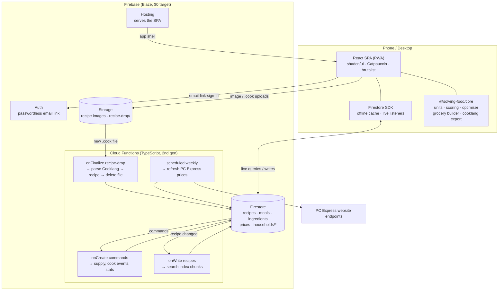
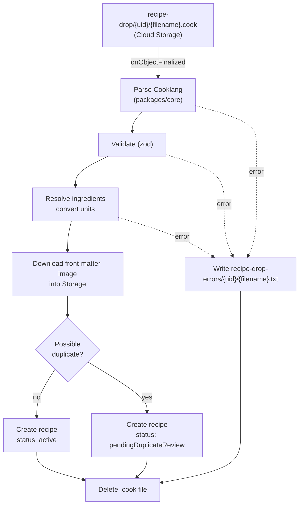

# Solving Food — Technical Specification

> Status: Draft v0.3 · Companion to `PRODUCT_REQUIREMENTS.md` (v0.3) · Last updated: 2026-10-09
>
> Precedence rule: where `THOUGHTS.md` contradicts itself, the later line wins. This is why the stack is **Firebase**, not a Rust server on a Raspberry Pi.

---

## 1. Architecture Overview

Everything runs on Firebase. The React PWA reads and writes Firestore directly and gets live updates between household members for free. **Cloud Functions do only what the client can't do safely or at all:** apply supply changes consistently, process the recipe drop folder, maintain the search index, and fetch prices.

There are **no LLM calls inside the app**. Recipe import (from a URL or a photo) happens outside it: an external LLM following the Claude skill writes a Cooklang file and puts it in the drop folder.



**Design principles**

1. **The client is smart.** Suggestions, the optimiser, projected supply, the grocery list, expiry alerts, and period rollover all run in the browser from a shared TypeScript package. A household's data is small, so this is fast and works offline, and it keeps function calls well inside the free quota.
2. **Supply changes go through the server.** Clients never write supply amounts directly. They write a *command* document, and a function applies it inside a Firestore transaction (§6).
3. **One language.** TypeScript is used everywhere, and `packages/core` is shared by the web app and the functions.

---

## 2. Free-Tier Strategy

NFR2 asks for the free tier unless something paid is unavoidable. **Two required features can't run on the Spark (free) plan:**

- **Cloud Storage**, for recipe images and the drop folder. Since late 2024, new Storage buckets require the Blaze plan.
- **Cloud Functions**, for processing the drop folder and keeping the supply ledger consistent.

So the project uses the **Blaze (pay-as-you-go) plan, designed so the bill stays at $0**. Blaze keeps the same no-cost quotas as Spark. Safeguards:

- A **budget alert at $1/month**.
- All resources in **`us-east1`**. Cloud Storage's always-free tier only applies in `us-central1`, `us-east1`, and `us-west1`, and keeping Firestore and Functions in the same region avoids cross-region charges.
- An **Artifact Registry cleanup policy** (`firebase functions:artifacts:setpolicy`), so old function container images don't build up past the free 0.5 GB.
- Client-side image compression before upload (WebP, ~1600 px max, ~200 KB).

### Estimated usage at 3 households / 10 users

| Resource | No-cost quota | Expected use | Headroom |
|---|---|---|---|
| Firestore reads | 50,000 / day | ~3,000–6,000 / day (cache + listeners only pull changes) | ~10× |
| Firestore writes | 20,000 / day | < 1,000 / day | 20× |
| Firestore storage | 1 GiB | < 50 MB | 20× |
| Functions invocations | 2M / month | < 10,000 / month | 200× |
| Storage | 5 GB-month (US regions) | ~1 GB of images for 2,000 recipes | 5× |
| Storage egress | 100 GB / month (N. America) | < 5 GB (images cached by the service worker) | 20× |
| Hosting transfer | 360 MB / day | < 50 MB / day | 7× |
| Cloud Scheduler | 3 jobs / account | 1 (price refresh) | — |

### Open questions

- Is the Blaze-with-$0-target approach acceptable? The alternative that stays on Spark drops recipe images and the drop folder, and does all supply math in client-side transactions, which can't run offline.
- Should a budget overrun automatically disable billing (a "kill switch" function)? That stops the app, but it caps the cost.

---

## 3. Tech Stack & Repo Layout

| Concern | Choice |
|---|---|
| Language | TypeScript (strict) everywhere |
| Monorepo | pnpm workspaces |
| Frontend | React 19 + Vite, shadcn/ui (Radix) + Tailwind CSS |
| Routing | TanStack Router |
| Data | Firestore SDK with a shared `useLiveQuery` / `useLiveDoc` hook layer |
| Forms / validation | react-hook-form + zod (schemas shared with functions) |
| PWA | `vite-plugin-pwa` (Workbox) for the app shell; Firestore persistent cache for data |
| Theme | `@catppuccin/palette` → CSS variables |
| Search | MiniSearch (client-side full-text) over the recipe index (§9) |
| Backend | Cloud Functions for Firebase (2nd gen, Node 22), region `us-east1` |
| Cooklang | A TypeScript Cooklang parser in `packages/core` (evaluate `@cooklang/cooklang-ts`; write a small one if it lags the spec). Used **only** for drop-folder imports and `.cook` export. |
| Testing | Vitest, fast-check, Firebase Emulator Suite, `@firebase/rules-unit-testing`, Playwright |

```
solving-food/
├─ apps/web/                 React PWA
├─ functions/                Cloud Functions
├─ packages/core/            units, ledger math, scoring, optimiser, grocery builder, cooklang ⇄ recipe, types
├─ data/                     ingredient seed data, price-estimates.json
├─ firestore.rules · firestore.indexes.json · storage.rules · firebase.json
└─ .claude/skills/cooklang-recipe/SKILL.md
```

---

## 4. Data Model (Firestore)

Household data is nested under `households/{hid}`, so a single membership check secures it. Global data (recipes, meals, ingredients, prices, the user directory) lives at the top level.

### 4.1 Global collections

```
users/{uid}                                       // private to the user
  email, householdIds[], activeHouseholdId, householdsCreated,   // ≤ 3
  theme: { flavour, accent }

directory/{uid}                                   // readable by every signed-in user, for invites
  displayName, displayNameLower

ingredients/{ingredientId}
  name, aliases[], category, defaultLocation,     // pantry|cupboard|fridge|freezer
  allowedMeasures: ("weight"|"volume"|"count")[],
  canonicalUnit: "g"|"count",
  densityGPerMl?, unitWeightG?, proteinPer100g?,
  shelfLifeDays: { pantry?, cupboard?, fridge?, freezer? },   // all null → never expires
  freezable, isStaple, needsReview

recipes/{recipeId}                                // source of truth (structured)
  title, slug, servings, prepMin, cookMin, cuisine, mainProtein, tags[], tools[],
  ingredients: [{ id, ingredientId, amount, measure, canonicalAmount,   // canonical = g or count
                  displayText, optional }],
  steps: [{ text, ingredientRefs[], timerSeconds? }],    // refs → inline amounts (R4.11)
  prepTasks: [{ text, ingredientRefs[] }],               // mise en place (R4.12)
  defaultLeftoverPortions, proteinPerServingG?,        // derived on save (§5)
  sourceUrl?, sourceUrlCanonical?, fingerprint, ingredientIds[],
  imagePaths[], status: "active"|"pendingDuplicateReview", possibleDuplicateOf?,
  createdBy, updatedBy, version, createdAt, updatedAt
recipes/{recipeId}/versions/{version}             // full snapshot + editedBy, editedAt

recipeIndex/{chunkN}                              // ≤ ~500 compact summaries per doc (§9)

meals/{mealId}
  name, recipes: [{ recipeId, servingsMultiplier }], createdBy, updatedAt

prices/{productCode}                              // PC Express product
  productName, priceCents, packAmount, packMeasure, storeId, fetchedAt
```

Recipe ratings and stats are **not** stored on global documents, because households are invisible to each other.

### 4.2 Household collections (`households/{hid}/…`)

```
households/{hid}                 name, createdBy, periodDays, budgetCents, currency,
                                 currentPeriodId, settings: { scoreWeights{}, tools[],
                                 preferences: { likes[], dislikes[], diets[] },
                                 proteinGoals: { breakfast?, lunch?, dinner?, snack? } }   // g per serving; absent = off
  members/{uid}                  displayName, joinedAt                     // no roles
  invites/{inviteeUid}           inviteeUid, householdName, invitedBy, createdAt

  stores/{storeId}               name, kind: "pcExpress"|"inStore", bulk: bool   // Costco: inStore, bulk
  sourcingRules/{id}             match: { category? | ingredientId? }, storeId
  brandMappings/{ingredientId}   productName, productCode?, packAmount, packMeasure, storeId

  favourites/{type_targetId}     type: "recipe"|"meal", targetId
  notes/{recipeId}               text, updatedBy                            // household's recipe notes
  stats/{type_targetId}          timesCooked, lastCookedAt, ratingSum, ratingCount   // function-maintained

  periods/{periodId}             start, end, budgetCents                    // snapshot at creation
  planItems/{itemId}             periodId, mealId? | recipeId?, mealType, servings,
                                 status: planned|cooked|skipped, carriedFromId?, addedBy

  cookEvents/{eventId}           planItemId?, recipeIds[], cookedBy, cookedAt,
                                 used: [{ ingredientId, canonicalAmount }], leftoverPortions,
                                 reviewStatus: "pending"|"done", ratedBy[]
  ratings/{ratingId}             uid, cookEventId, targetType: "recipe"|"meal", targetId, score

  groceryLists/{listId}          periodId, status: draft|ordered|received, createdAt,
                                 items: { [itemId]: { ingredientId?, freeText?, amount, measure,
                                          packs, productName, storeId, estPriceCents,
                                          source: plan|manual|cadence, checked, checkedBy? } }

  supply/{supplyId}              // ingredientId, or "leftover_{eventId}"
    ingredientId?, label, canonicalAmount, canonicalUnit,
    lots: [{ lotId, amount, location, acquiredAt, expiresFresh?, expiresFrozen?, frozenAt? }],
    nextExpiry?
  supply/{supplyId}/transactions/{txId}
    delta, kind: purchase|cook|correction|discard|freeze|thaw|leftover|eaten,
    lotId, ref?: { type, id }, uid, note?, createdAt

  commands/{cmdId}               type, payload, uid, createdAt, status: pending|applied|failed, error?
  cadence/{ingredientId}         avgIntervalDays, lastPurchasedAt, snoozedUntil?
  duplicateReviews/{recipeId}    // drop imports awaiting a keep-which decision
```

**Notes**

- **Grocery items are a map keyed by item ID**, not an array, so two people ticking items at the same time update different fields instead of overwriting each other (§11).
- **Lots live inside the supply document**, so one transaction updates the amount and the lots together. An ingredient rarely has more than a handful of active lots.
- **Discards** are ordinary `discard` transactions. Waste is tracked internally and no UI exposes it (R8.9).

### Open questions

- Should `cuisine` and `mainProtein` be fixed lists, defined in the Claude skill and the manual-entry form? This makes the variety penalties reliable.
- Should deleting a global recipe be possible? Other households may have it in their history, plans, or favourites. One proposal is soft-delete (hidden from search, still readable).

---

## 5. Units & Measurements

Each ingredient declares the **measurements it allows** (R8.3) and one **canonical unit** for storage. Everything that has a weight, or can be converted to one, is stored in **grams**. Count is the canonical unit only when there's no unit weight (e.g. "1 bay leaf").

| Input | Conversion to canonical | Requires |
|---|---|---|
| Weight (`g`, `kg`, `oz`, `lb`) | static table | — |
| Volume (`tsp`, `tbsp`, `cup`, `ml`, `L`, `fl oz`) | → ml × `densityGPerMl` | `volume` allowed + density |
| Count ("2 potatoes") | × `unitWeightG` | `count` allowed + unit weight |
| Vague ("to taste", "a pinch") | none; `optional: true`, no supply effect | — |

```
"2 medium potatoes" → potato (unitWeightG 213)  → 426 g
"1 cup flour"        → 236.6 ml × 0.53 g/ml     → 125 g
"500 ml milk"        → 500 ml × 1.03 g/ml       → 515 g
```

- **Entering amounts:** the Supply add/correct form and the recipe editor show only an ingredient's allowed measurements. The amount is converted on save, and the original value is kept for display.
- **Quick-adjust buttons** (R8.8) step by measurement: ±5 g / ±25 g for weight, ±5 ml / ±25 ml for volume, ±1 for count.
- **Ingredient picker:** a typeahead over `name` + `aliases` ("chicken" → chicken breast, chicken thighs, whole chicken…). Creating a new ingredient asks for a category, its allowed measurements, and the conversions it needs. Anything incomplete is flagged `needsReview`.
- **Seed data:** about 500 common ingredients with densities, unit weights, **protein per 100 g**, and shelf lives, prepared once from USDA FoodData Central (portion weights and nutrients) and the USDA FoodKeeper dataset, and shipped in `data/`.
- **Protein per serving** = Σ (canonical grams × `proteinPer100g` / 100) ÷ servings, recomputed whenever a recipe or one of its ingredients changes. Ingredients stored by count use `unitWeightG`. If any non-optional ingredient has no protein value, the recipe shows the protein as approximate ("~32 g"), and the missing ingredient is flagged `needsReview`.
- **Display:** amounts are shown back in friendly units using the recipe's original wording, e.g. "2 potatoes (~430 g)".

### Open questions

- Metric only, or an imperial display option? (Only the theme is a per-user setting, so this would be per household.)
- Should pantry basics (salt, pepper, oil, spices) skip supply math and rely only on the staples cadence?

---

## 6. Supply Ledger

Supply is **event-sourced**. Every change is a transaction. `canonicalAmount` is a cached sum that **only functions** write.

### Command pattern (works offline)

Firestore writes queue up offline, but callable functions don't. So every action that changes supply is written as a **command document** in `households/{hid}/commands`. An `onDocumentCreated` trigger validates the payload with zod and applies it in a **Firestore transaction**, then marks the command `applied` or `failed`. While a command is pending, the client applies its effect optimistically for display.

| Command | Effect |
|---|---|
| `addSupply` | Manual add (R8.2): `purchase` (+) lot with estimated expiry |
| `receiveGroceries` | `purchase` (+) per confirmed item → new lots; optional `freeze` split (R7.9); grocery list → received; update cadence |
| `finishCooking` | `cook` (−) per used ingredient (FEFO); `leftover` (+) lot; plan item → cooked; cook event (`reviewStatus: pending` if not rated) |
| `submitReview` | Per-user ratings for the meal and/or its recipes; updates `stats/*`; marks the review done once the cook confirms |
| `correctSupply` | `correction` (± delta to reach the stated amount) |
| `discard` | `discard` (−) on a lot |
| `freeze` / `thaw` | 0-delta transaction; moves the lot and switches its active expiry |
| `markEaten` | `eaten` (−) on a leftover portion or snack |

### Rules

- **FEFO:** consumption takes from the lot that expires first, so per-lot expiry (R8.5) stays accurate without the user choosing a lot.
- **Expiry:** `expiresFresh = acquiredAt + shelfLifeDays[location]`. Freezing sets `expiresFrozen = frozenAt + shelfLifeDays.freezer`. Both values are kept. Ingredients with no shelf life never expire.
- **Projected supply** (the bracketed number in R8.4) = `canonicalAmount − Σ requirements of planned, uncooked items in the current period`. It's computed on the client from live data.
- **Transaction history** uses a paginated query (`orderBy(createdAt desc).limit(25)` + `startAfter`) with infinite scroll (R8.7).
- **Negative supply:** allowed in the ledger, shown as 0, and prompts the user to check the amount.
- **Double-finish guard:** `finishCooking` is a no-op if the plan item is already `cooked`, e.g. when two members finish the same meal.

### Open questions

- When a correction is far from the ledger, should the app ask "did you use some outside a planned meal?" to learn about unplanned consumption?

---

## 7. Planning, Suggestions & Optimiser (client-side)

### Periods & rollover

`households/{hid}.currentPeriodId` points to the active period. When any member opens the app after `period.end`, the client runs a **Firestore transaction**. It creates the next period (length `periodDays`, with a budget snapshot), copies uncooked `planned` items into it with `carriedFromId`, and advances `currentPeriodId`. The transaction makes this idempotent, so two members opening the app at once can't create two periods. No scheduler is needed.

### Budget

`spent = Σ marginal cost of planned items`, where marginal cost prices only the **shortfall packs** the grocery builder would buy (§8). Ingredients already in supply cost nothing. Manual and staple items are excluded (R6.3). The meter shows `budget − spent` and turns red below zero. Adding meals is never blocked.

### Suggestion score

This runs in a Web Worker using `packages/core/scoring`.

```
score(r) = Σ wᵢ · fᵢ(r, plan, supply)     each fᵢ ∈ [0, 1]
```

| Factor | Computation (sketch) | Sign |
|---|---|---|
| expiryUrgency | Σ grams used from lots expiring within the period, weighted by 1/daysLeft | + |
| supplyUtilisation | fraction of the recipe's canonical amount already in projected supply | + |
| rating | household average / 10 (Bayesian prior for unrated) | + |
| historicalPref | frequency × recency decay; favourite bonus | + |
| variety | novelty vs. the last N periods | + |
| preferences | likes matched; dislikes/diets act as a strong penalty or filter | ± |
| proteinGoal | 1 if `proteinPerServingG` ≥ the goal for the meal type, scaled down linearly below it; skipped when the goal is off | + |
| missingIngredients | share not covered by supply | − |
| cost | marginal cost / remaining budget | − |
| sameProtein / sameCuisine | already present in the plan | − |
| recentlyCooked | cooked within the last N days | − |
| missingTools | hard filter | − |

The **Suggested sort** (§3 of the PRD) applies the same scoring to any filtered list. Weights and presets are stored in `households/{hid}.settings.scoreWeights`.

### Expiry badges & alerts

For each planned item, the client finds the earliest-expiring lot among its ingredients that the item would use, and shows a badge when it expires within the period (R6.6). Supply expiring with no planned use raises an alert with suggestions sorted by `expiryUrgency` (R6.12).

### Optimiser ("n dinners under $x")

1. **Generate a set:** greedy selection with re-scoring after each pick, plus an *ingredient-overlap bonus* (a shared spinach bag makes the second spinach recipe nearly free) and caps per cuisine and protein, followed by a local-search swap pass. The constraint is total marginal cost ≤ x.
2. **Next:** generate a new set with an extra penalty for overlapping with the sets already shown (Jaccard similarity), so each proposal is noticeably different.
3. **Back:** the sets shown so far are kept in memory, so Back is instant.
4. **Accept:** writes all of the set's plan items in one batch.

An optional **"meets protein goal"** toggle turns the protein goal into a hard filter for the optimiser.

### Protein summary

The Plan page shows, for each meal type, the average `proteinPerServingG` of the planned items next to the household goal (R6.16). This is computed on the client.

### Open questions

- When a planned meal is a meal-prep batch, should its leftover portions automatically fill lunch slots in the plan, or should the user add the leftovers as plan items?
- How many Next sets should be generated before the app says "no more good combinations"?

---

## 8. Grocery List & Prices

### Builder (client-side)

```
needs     = Σ requirements of planned, uncooked items (scaled by servings)
shortfall = max(0, needs − (current supply − other planned use))
packs     = ceil(shortfall / brandMapping.packAmount)
+ manual items + accepted "are you out of X?" prompts
→ group by store: ingredient rule → category rule → brandMapping.storeId → default store
```

Regenerating keeps manual items and checked-off state. The list is a Firestore document, so every member sees ticks live, which matters at Costco.

**Copy button:** copies only the `pcExpress` store items:

```
Please add these to my PC Express cart:
- Mutti Polpa chopped tomatoes, 400 g can × 2
- Organic baby spinach, 312 g clamshell × 1
- Lactantia 2% milk, 4 L × 1
Substitutions: closest equivalent size; skip if unavailable.
```

**Confirming a purchase** (R7.8): the confirmation screen lists the items as bought. Edits are optional. When a confirmed item comes from a `bulk` store and its ingredient is `freezable`, the screen asks how much to freeze (R7.9). Everything is submitted as one `receiveGroceries` command.

**Staples cadence:** the `receiveGroceries` handler updates `cadence/{ingredientId}.avgIntervalDays` (an exponential moving average of the gaps between purchases). The client raises an "Are you out of X?" prompt when `daysSinceLastPurchase ≥ 0.85 × avgIntervalDays`. *Yes* adds the item to the draft list; *Not yet* snoozes it.

### Prices

PC Express has **no official public API**. Third-party scrapers exist, but they're paid, which rules them out under NFR2. Design:

1. A brand mapping can store a **PC Express product code**.
2. A **weekly scheduled function** (the one Cloud Scheduler job) fetches current prices for all mapped product codes, using the same JSON endpoints the PC Express website calls, and writes them to `prices/{productCode}`.
3. Prices are resolved in this order: **live price** (fetched ≤ 14 days ago) → **`data/price-estimates.json`** (per-ingredient $/kg or $/unit) → unknown. Unknown prices are counted as $0 and the item is marked "price unknown" on the meter.
4. If the fetch fails, the function logs it and leaves the old prices in place, so the app falls back to estimates automatically as they age.

### Open questions

- Using PC Express's undocumented website endpoints may break without warning and may go against their terms of use. Is that risk acceptable, or should prices come from the estimates file only, plus manual edits?
- PC Express prices differ by store. Which store location should prices be fetched for (one per household, or one for everyone)?
- How should products be linked to PC Express codes? By pasting a product URL into the brand mapping page (the code is in the URL), or through an in-app product search?

---

## 9. Recipes: Storage, Search, Drop Folder & Dedupe

### Source of truth

The **structured Firestore document** is the source of truth (§4.1). The manual editor reads and writes it directly. Cooklang is used only to **get recipes in** (drop folder) and **get recipes out** (`.cook` export, generated client-side by `packages/core`).

### Versioning

Every save writes the recipe and a `versions/{n}` snapshot in **one batch**. Rules require `version == previous + 1`. Restoring an old version is just saving its snapshot as a new version.

### Search

Firestore has no full-text search. An `onDocumentWritten(recipes/*)` function maintains `recipeIndex/{chunk}` documents, each holding ≤ ~500 compact summaries: `{id, title, tags, cuisine, mainProtein, proteinPerServingG, ingredientIds, totalMin, thumb}`. The client loads a few chunk documents (cached offline), builds a **MiniSearch** index, and applies every filter in memory: supply, tools, favourites, cooked before, and cost. Meals use the same approach with a smaller index.

### Drop folder



- **Getting files in:**
  1. An in-app **"Drop recipes"** area (drag and drop or file picker, several files at once) uploads to `recipe-drop/{uid}/`. This works for anyone signed in.
  2. The project owner can run `gcloud storage cp *.cook gs://<bucket>/recipe-drop/<uid>/` from a terminal, which lets Claude Code drop files directly.
- **Unknown ingredients** found in a dropped file are created with `needsReview: true` and defaults inferred from the category.
- Import results show in the app: how many succeeded, and any failures with their errors.

Firebase supports a drop folder (Storage + a trigger), so **no REST API is built** (as the PRD specifies).

### Claude skill (`.claude/skills/cooklang-recipe/SKILL.md`)

- Cooklang syntax: ingredients (incl. multi-word), cookware, timers, front matter, comments, sections.
- **Required front matter:** `title`, `servings`, `cuisine`, `main_protein`, `prep_time`, `cook_time`, `tags`. Optional: `source`, `image`, `leftover_portions`, `prep` (mise en place tasks).
- House conventions: metric weights, canonical ingredient names, and how to describe count-based ingredients.
- How to deliver files: write the `.cook` files and upload them with `gcloud storage cp`, or save them locally for the user to drag into the app.
- Worked examples, including converting a recipe web page and a photographed recipe.

```cooklang
---
title: Sheet-Pan Salmon with Potatoes
servings: 4
cuisine: nordic
main_protein: fish
leftover_portions: 2
prep_time: 15 minutes
cook_time: 30 minutes
source: https://example.com/salmon
image: https://example.com/salmon.jpg
tags: [weeknight, one-pan]
---

Preheat the #oven to 220°C.

Toss @baby potatoes{600%g} with @olive oil{2%tbsp} and @salt{} on a #sheet pan{}. Roast ~{15%minutes}.

Add @salmon fillet{600%g} and @lemon{1}, sliced. Roast ~{12%minutes} more.
```

### Deduplication

A recipe is flagged as a possible duplicate if any of these hold:

- Same `sourceUrlCanonical` (tracking parameters stripped).
- Title trigram similarity > 0.8 **and** ingredient-set Jaccard similarity > 0.7.
- Same `fingerprint`: a hash of sorted ingredient IDs plus rounded amounts per serving.

**Resolution** (R4.20):

- **Keep existing:** delete the new recipe.
- **Keep new:** copy the new content **onto the existing recipe's ID** as a new version, then delete the new document. History, favourites, and plans in every household keep working.
- **Keep both:** clear the flag.

The manual editor runs this check before saving. Drop imports are flagged `pendingDuplicateReview` and listed on the Recipes page.

### Open questions

- Should images from dropped files be downloaded into Storage (uses quota, never breaks) or just linked to the source site (free, but may break)?
- Where should drop-folder errors be shown: a notification on the Recipes page, or only in the "Drop recipes" area?

---

## 10. Authentication, Households & Security

### Sign-in

- Firebase Auth **email link** (passwordless). Firebase sends the email for free.
- **iOS PWA caveat:** a link tapped in Mail opens Safari, not the installed PWA, which has separate storage. The free fix: the sign-in screen also has a **"Paste sign-in link"** field. `signInWithEmailLink(auth, email, pastedLink)` accepts a pasted link, so no extra function or email service is needed.
- On first sign-in, the user sets a display name, which creates `directory/{uid}`.

### Households & invites (no functions needed)

- **Create:** a batch writes `households/{hid}`, `members/{uid}`, and increments `users/{uid}.householdsCreated`. Rules use `getAfter()` to require that the counter goes up by exactly 1 and stays ≤ 3 (R2.3).
- **Invite:** a member searches `directory` by name (with 10 users, the client just loads it all) and writes `households/{hid}/invites/{inviteeUid}`.
- **See invites:** a collection-group query on `invites` where `inviteeUid == me`.
- **Accept:** the invitee creates their own `members/{uid}` document in a batch that deletes the invite. Rules allow this only when the invite exists.
- **Remove or leave:** any member can delete any `members/*` document (no roles, R2.5).

### Security rules (sketch)

```
function signedIn() { return request.auth != null; }
function isMember(hid) { return exists(/databases/$(db)/documents/households/$(hid)/members/$(request.auth.uid)); }

match /households/{hid} {
  allow read, update: if isMember(hid);
  match /supply/{doc=**}     { allow read: if isMember(hid); allow write: if false; }   // functions only
  match /stats/{id}          { allow read: if isMember(hid); allow write: if false; }
  match /commands/{id}       { allow read: if isMember(hid);
                               allow create: if isMember(hid) && validCommand(request.resource.data); }
  match /members/{uid}       { allow read, delete: if isMember(hid);
                               allow create: if uid == request.auth.uid
                                 && exists(/databases/$(db)/documents/households/$(hid)/invites/$(uid)); }
  match /invites/{uid}       { allow read: if isMember(hid) || uid == request.auth.uid;
                               allow create: if isMember(hid);
                               allow delete: if isMember(hid) || uid == request.auth.uid; }
  match /{coll}/{id}         { allow read, write: if isMember(hid) && coll in WRITABLE; }
}
match /recipes/{id}      { allow get: if true;                // share links work without an account
                           allow list, create: if signedIn();
                           allow update: if signedIn() && validVersionBump(); }
match /meals/{id}        { allow get: if true; allow list, create, update: if signedIn(); }
match /directory/{uid}   { allow read: if signedIn(); allow write: if uid == request.auth.uid; }
match /users/{uid}       { allow read, write: if uid == request.auth.uid; }
match /recipeIndex/{id}  { allow read: if signedIn(); allow write: if false; }
match /prices/{id}       { allow read: if signedIn(); allow write: if false; }
```

Storage rules: `recipe-drop/{uid}/**` can only be written by that user, with a size limit of 1 MB and `.cook` files only. Image uploads are capped at 2 MB.

### Open questions

- Should only invited people be able to create an account, or can anyone with the URL sign up? With "invite by searching names", a new person has to sign up before they can be found.
- Should share links (`allow get: if true`) be acceptable for meals as well as recipes? Meal pages also need to read each recipe, which is already public by ID.

---

## 11. Live Sync & Concurrency

Live sync (NFR5) comes from Firestore listeners and adds little complexity. A few patterns keep it correct:

| Concern | Approach |
|---|---|
| Subscription cleanup | All reads go through `useLiveQuery` / `useLiveDoc`, which unsubscribe on unmount |
| Concurrent edits to lists | Grocery items are a **map keyed by ID**, updated field-by-field (`items.<id>.checked`) instead of rewriting an array |
| Supply consistency | Only functions write supply, one transaction per command |
| Duplicate actions | Commands are idempotent per target (e.g. finishing an already-cooked plan item does nothing) |
| Editors | The recipe editor and the review sheet work on a copy taken when they open. If the version changes underneath, the user sees "edited elsewhere — reload or overwrite?" |
| Period rollover | Done in a transaction, so concurrent openings are safe (§7) |
| Recalculation | Updates are debounced ~300 ms before suggestions or projected supply recompute in the worker |
| Pending writes | `hasPendingWrites` drives a small "syncing" indicator, which is useful for offline commands |

---

## 12. Frontend

### Routes

```
/                → redirect: /plan if the current period has items, else /recipes
/plan  /recipes  /recipes/new  /recipes/:id  /recipes/:id/edit  /recipes/:id/cook
/meals  /meals/:id  /meals/:id/cook  /supply  /supply/:id  /grocery  /history
/settings/{household,members,brands,stores,tools,preferences,weights,theme}
/drop            (upload .cook files, see import results)
```

`/recipes/:id` and `/meals/:id` also render for signed-out visitors (share links). These pages show only the global recipe content, without supply badges, notes, or stats.

### Key components

- **`<CollectionView>`**: shared search, filter, and sort for Recipes, Meals, Plan, and History, with a **Suggested** sort. Filter state lives in the URL.
- **`<BudgetMeter>`**: sticky on the Plan page; turns red below zero.
- **`<SupplyBadge>`**: the "have / need" chip next to recipe ingredients.
- **`<ExpiryBadge>`**: on planned meals (R6.6).
- **`<ProteinSummary>`**: average protein per serving vs. goal for each meal type, on the Plan page.
- **`<OptimiserSheet>`**: n / $x inputs, Next / Back / Accept.
- **`<MealCookView>`**: the meal's recipes with their durations; the user picks the order and checks recipes off. When all are checked, it opens the review.
- **`<StepMode>`**: full-screen, swipe between steps, inline amounts, Screen Wake Lock API, inline timers with notifications.
- **`<MiseEnPlace>`**: the prep checklist shown before step mode.
- **`<ReviewSheet>`**: per-user 1–10 rating for the meal and recipes → used amounts → leftovers ▲/▼. It can be completed later from **Pending reviews** on the Plan page.
- **`<SupplyAdjust>`**: typed amount, ±5 / ±25 buttons, Apply.
- **`<LedgerList>`**: paginated transaction history.
- **`<IngredientPicker>`**: typeahead with allowed-measurement selector.

### Theming

Catppuccin flavour colours become CSS variables (`--ctp-base`, `--ctp-text`, `--accent`) mapped onto shadcn tokens. The theme is stored on `users/{uid}.theme`, with a localStorage cache to avoid a flash on load. Brutalist styling: 2–3 px borders in `--ctp-text`, hard offset shadows (`4px 4px 0`), minimal radius, and a grotesk or monospace font (e.g. Space Grotesk / JetBrains Mono).

### Offline

Firestore `persistentLocalCache` (multi-tab) caches data and queues writes. Together with the command pattern, this means finishing a meal, adjusting supply, or ticking groceries works with no signal. Workbox caches the app shell and images for planned recipes.

### Open questions

- Is a tablet or landscape layout needed for the cooking view?
- Should timers keep running and notify while the phone is locked? On iOS, PWAs have limited background support, so a notification may need to be scheduled up front.

---

## 13. Deployment & Operations

- **Environments:** `solving-food-dev` and `solving-food-prod` Firebase projects (both Blaze with budget alerts, both expected to cost $0). Local development runs entirely on the **Emulator Suite**.
- **CI/CD:** GitHub Actions runs lint, tests, and rules tests on every PR. Merging to `main` deploys to prod. PRs get Hosting preview channels.
- **Monitoring:** Cloud Functions logs and error reporting, the $1 budget alert, and an alert if the weekly price refresh fails twice in a row.

### Open questions

- THOUGHTS.md asked for database backups to a connected hard drive, but the PRD no longer requires backups. Should they be dropped? A cheap option is a **"Download household data"** button that exports JSON (and recipes as `.cook` files) from the client. It costs only reads and needs no paid services.

---

## 14. Testing Strategy

- **Unit (Vitest, `packages/core`):** unit conversion, Cooklang → recipe and recipe → Cooklang round-trip, FEFO ledger math, scoring, optimiser (Next sets are diverse), grocery rounding, budget math, period rollover.
- **Property tests (fast-check):** Σ transactions == `canonicalAmount`; FEFO never takes a lot below zero; export → import round-trip keeps the recipe the same.
- **Security rules:** household isolation; the 3-household limit; invite/accept flow; clients can't write supply, stats, the index, or prices; version bump enforced.
- **Functions (emulator):** every command handler, the drop-folder pipeline (good file, bad file, duplicate), index maintenance.
- **E2E (Playwright, mobile viewport, emulators):** plan → optimiser accept → grocery list → confirm with freeze prompt → cook → review later → supply and stats updated; second browser sees changes live.

---

## 15. Milestones (proposed)

| # | Milestone | Scope |
|---|---|---|
| M0 | Skeleton | Monorepo, Firebase projects (Blaze + alerts, `us-east1`), emulators, PWA shell, theme, email-link auth, CI deploy |
| M1 | Recipes | Ingredient seed data, structured editor, versioning, search index, drop folder + Claude skill, dedupe, share links |
| M2 | Plan + Grocery | Periods & rollover, meals, Plan page, budget meter (estimates), brand mappings, stores, grocery builder, copy button |
| M3 | Supply | Commands, ledger, manual add, confirmation with freeze prompt, cooking views, review flow, projected supply, expiry |
| M4 | Households | Directory, invites, multiple households (≤ 3), member management |
| M5 | Smarts | Suggestions & weights, expiry badges and alerts, optimiser, staples cadence, PC Express price refresh |

### Open questions

- Is this order right?
- Is there a target date for a usable MVP (M0–M3)?
